# Affective geometry in Qwen3-0.6B: a comprehensive analysis

**Run:** `20261019T091428Z` · **Model:** `Qwen/Qwen3-0.6B` · **Pooling:** last content token · **Analysis date:** 19 October 2026.

This report covers all 28 decoder blocks, six distance definitions, both classical MDS and Isomap, and the saved 1D, 2D, and 3D analyses. New calculations audit the original results and test their robustness. Figures are embedded below; every figure also has a PDF and a dedicated, self-contained CSV in this folder. [The figure index](figure_index.csv) maps images to their data; [provenance](provenance.json) records the source configuration and RDM hashes.

## Findings that survive the audit

1. **There is a reproducible valence-related component of emotion geometry.** The strongest fitted V–A correspondence in the original six-distance specification is centered-PCA cosine Isomap at block 17: Procrustes R² = **0.6045**. Its leave-one-emotion-out alignment skill is **0.5788**. Both quantities concern emotion-category configurations, rather than prediction of individual comments. An exploratory chord-distance variant reaches **0.6342** at block 18, outside the main corrected search.
2. **Evidence for arousal is much weaker and less general.** Only **17 of 336** two-dimensional configurations beat a training-mean baseline for arousal under held-out similarity alignment. At the strongest block-17 cosine Isomap configuration, arousal skill is positive, **0.2097**, but it is negative on average for every distance–method combination. A statistically significant joint V–A fit can therefore coexist with poor arousal recovery.
3. **The strongest result is sensitive to preprocessing.** On the five prespecified audit depths, raw 1,024-dimensional cosine centroid MDS gives R² of approximately **0.11–0.27**, compared with **0.38–0.53** for the original centered-PCA cosine variant. Centering alone reproduces most of this difference; “cosine” alone is an insufficient description of the method.
4. **A useful 2D picture is not evidence that the entire emotion geometry is two-dimensional.** Median positive-spectrum dimensions needed for 95% mass range from **8 to 17** across the direct MDS geometries. Participation ratios range from about **5 to 8** in their across-layer medians. The Isomap residual elbow usually falls at 3–4 dimensions, but measures a different, graph-dependent property.
5. **Isomap changes the representation without uniformly improving it.** Averaged over the 168 RDMs, its 2D trustworthiness improvement is **0.0045**, continuity improvement **0.0173**, and Shepard correlation change **−0.0454**. Its normalized direct-distance stress decreases by **0.0306** on average, with an increase for cosine. The choice depends on the desired diagnostic.
6. **Distance agreement is structured rather than universal.** Energy and RBF-MMD have mean RDM Spearman correlation **0.997**, 5-neighbor overlap **0.957**, and MDS Procrustes similarity **0.984**. Cosine forms a more distinct geometry. Surprise, desire, and amusement have the most distance-dependent neighborhoods; fear and nervousness have the most stable ones.

These are descriptive and conditional findings from one model, one pooling rule, one dataset, and one completed run. Layer and distance selection remain exploratory even where label-randomization significance survives correction.

## 1. What the experiment actually measures

The source corpus contains **45,446 single-label comments**: 36,308 train, 4,548 validation, and 4,590 test examples, covering all 28 GoEmotions labels. The main experiment pools all three splits. It feeds comment text directly to the model, captures each decoder block's post-block residual stream, and stores the last non-special content-token vector in float16. It does not condition on a correct emotion-classification response.

Each layer is reduced from 1,024 to 64 dimensions by a PCA fitted on a subsample capped at 256 comments per emotion. The fitted transform is then applied to every retained comment. Euclidean and cosine centroid distances and crossnobis use all available comments in this reduced space. Energy, RBF-MMD, and sliced Wasserstein use the capped groups. Thus distance comparisons also include differences in sampling and estimation.

The distribution methods are not interchangeable definitions of distance:

| Distance | What is compared | Important qualification |
| --- | --- | --- |
| Euclidean | Means of PCA-transformed emotion groups | A centroid measure; does not describe within-emotion spread |
| Cosine | Directions of means **after PCA centering and projection** | Depends on the chosen origin; ordinary cosine dissimilarity is not Euclidean distance |
| Crossnobis | Cross-validated mean differences with shrinkage precision | Negative squared estimates are clipped before taking a square root |
| Energy | Between-group versus within-group expected distances | The unbiased finite-sample statistic can be negative; clipped square root is embedded |
| RBF-MMD | Multi-bandwidth kernel distribution discrepancy | Unbiased squared estimates can be negative; clipped square root is embedded |
| Sliced Wasserstein | Average projected one-dimensional Wasserstein distance | Uses 256 random directions and the capped empirical distributions |

The reference is the project's bundled NRC VAD v2.1 label-word table, with V and A in the supplied centered scale. All 28 labels are covered. This is a comparison with lexical emotion norms, not independently annotated V–A ratings of these comments. “Neutral” has reference coordinates **(−0.062, −0.632)**; it is not forced to the origin. The normative resource and its version are described by [Mohammad's NRC VAD project](https://www.saifmohammad.com/WebPages/nrc-vad.html) and [the v2 paper](https://arxiv.org/abs/2503.23547).

### Sample support is highly uneven

Neutral contributes **16,021** comments; grief has **47**, pride **67**, relief **103**, and nervousness **105**. Distribution subsampling caps common classes but does not increase support for rare classes. Comment length also varies by emotion. These imbalances motivate the partial-RSA, balanced-sampling, and split checks in Section 8.

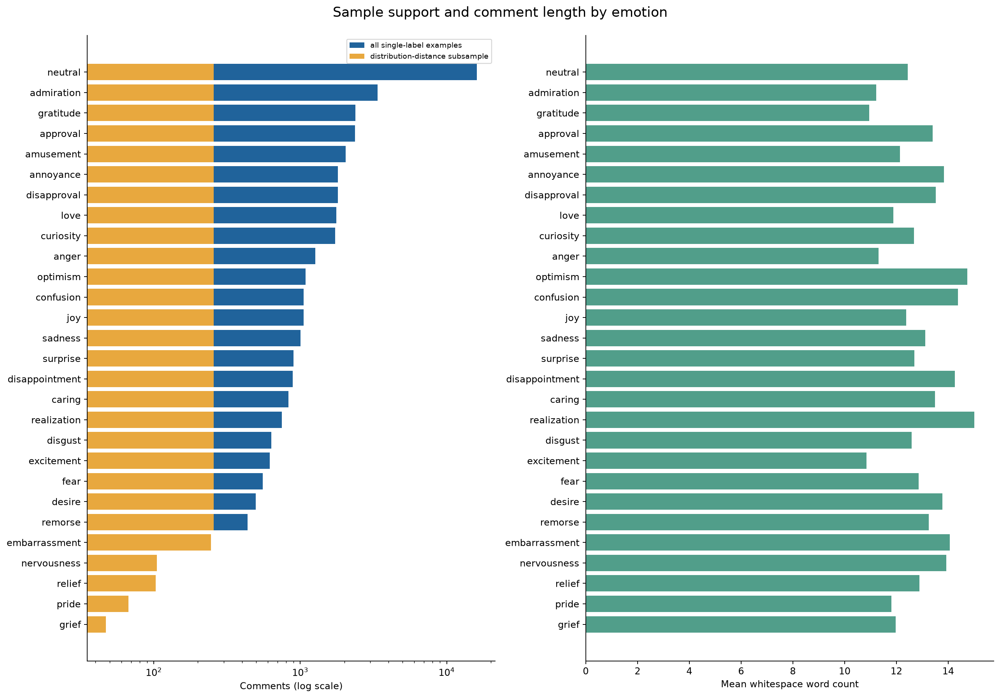

*Data: [figure_19_dataset_balance.csv](plot_data/figure_19_dataset_balance.csv). The left panel uses a logarithmic count axis; the overlaid capped counts show the actual support of the distribution-distance estimates.*

### Correctness audit and preserved artifacts

The original nearest-neighbor implementation removed the first sorted distance entry to exclude self. With clipped zero-distance ties, that entry can be another emotion. The audit found **57 affected rows across 11 of 168 RDMs**. All new analyses explicitly exclude the diagonal and break remaining ties by alphabetical label order.

Rebuilding the union-symmetric kNN graphs changes three geodesic matrices: energy at block 0 and RBF-MMD at blocks 0 and 4. The largest absolute V–A R² change is **0.00118**. The qualitative findings survive this repair, although local-neighborhood metrics also require corrected evaluation. The original run files were retained unchanged; this report's CSVs and figures use the repaired implementation. Details are in [graph_audit.csv](tables/graph_audit.csv) and [metric_audit.csv](tables/metric_audit.csv).

## 2. V–A recovery: shape, axis correlation, and held-out prediction

### Definition and inference

For each 2D embedding, a similarity transform fits a translation, an orthogonal transformation (reflection allowed), and **one uniform scale** to the NRC target. The reported statistic is

`R² = 1 − sum(||target − fitted||²) / sum(||target − target_mean||²)`.

This tests configuration similarity without privileging the arbitrary MDS orientation. It does not allow a separate scale for each axis. Aligned Pearson correlations describe the fitted axes; ordinary Pearson significance tests would ignore the estimated alignment and are not used here.

New significance calculations use **4,999 shared emotion-label permutations**. The alignment is refitted for each permutation. The family contains **336 tests**: 28 layers × 6 distances × 2 methods, with graph k fixed at the original value 5. We provide pointwise p values, Benjamini–Hochberg q values, and a stronger max-statistic p value that compares each observed R² to the maximum across all 336 fits under each shared permutation. The minimum attainable p value is **0.0002**.

Of the 336 configurations, **300** have BH q < 0.05 and **263** have max-statistic p < 0.05. These tests ask whether the assignment of lexical affect norms to the fixed emotion geometry is unusually well matched. They do not measure uncertainty from drawing different comments or prove generalization to another model or corpus. The extra graph/preprocessing sweeps are exploratory and are not included in this 336-test correction.

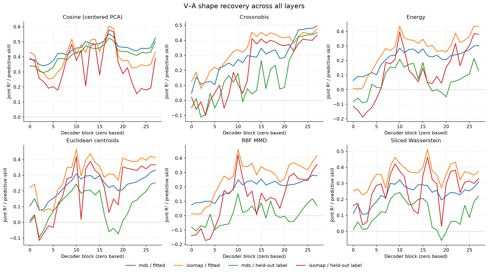

*Data: [figure_01_va_recovery.csv](plot_data/figure_01_va_recovery.csv). “Fitted” uses all labels; “held-out label” fits the transform on 27 emotions and predicts the remaining emotion. Higher is better. These two scores have different denominators, as explained below.*

### Exploratory maxima and their held-out-label scores

| Distance | Method | Block | Fitted R² | Held-out joint skill | Aligned V r | Aligned A r | Max-statistic p |
| --- | --- | ---: | ---: | ---: | ---: | ---: | ---: |
| Cosine | MDS | 17 | 0.5518 | 0.5257 | 0.8030 | 0.5916 | 0.0002 |
| Cosine | Isomap | 17 | 0.6045 | 0.5788 | 0.8364 | 0.6064 | 0.0002 |
| Crossnobis | MDS | 27 | 0.4948 | 0.4509 | 0.8875 | 0.3679 | 0.0002 |
| Crossnobis | Isomap | 27 | 0.4756 | 0.4332 | 0.8560 | 0.3367 | 0.0002 |
| Energy | MDS | 27 | 0.3038 | 0.1306 | 0.7778 | 0.1039 | 0.0030 |
| Energy | Isomap | 26 | 0.4364 | 0.3845 | 0.7147 | 0.5537 | 0.0002 |
| Euclidean | MDS | 27 | 0.3339 | 0.2512 | 0.7796 | 0.1694 | 0.0010 |
| Euclidean | Isomap | 10 | 0.4634 | 0.4183 | 0.8462 | 0.3685 | 0.0002 |
| RBF-MMD | MDS | 26 | 0.2816 | 0.1170 | 0.7443 | 0.1149 | 0.0074 |
| RBF-MMD | Isomap | 10 | 0.4603 | 0.4220 | 0.7628 | 0.4978 | 0.0002 |
| Sliced Wasserstein | MDS | 10 | 0.3217 | 0.2426 | 0.7548 | 0.2131 | 0.0016 |
| Sliced Wasserstein | Isomap | 16 | 0.5115 | 0.4627 | 0.8595 | 0.4181 | 0.0002 |

*Source: [va_recovery.csv](tables/va_recovery.csv). Block indices are zero based; block 17 is the eighteenth decoder block. The maxima were selected using fitted R². Their held-out scores are useful diagnostics, but are not a nested, selection-independent estimate of choosing the best layer.*

### Valence dominates the joint score

Across the reference labels, valence variance is **0.5459** and arousal variance **0.1367**. Approximately **80%** of centered target sum of squares belongs to valence. The joint objective therefore emphasizes V even though the two columns share the same numerical range.

The average aligned V correlations range from roughly 0.64 to 0.80 across distance–method combinations. A correlations are much smaller, especially for MDS energy (**0.109**), RBF-MMD (**0.059**), and crossnobis (**0.168**). Cosine MDS is the strongest average A configuration (**0.459**), while its average V correlation is **0.764**. These are averages across dependent layers, not independent experimental replications.

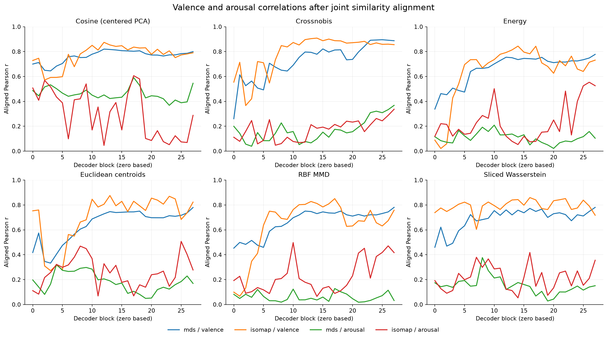

*Data: [figure_02_axis_correlations.csv](plot_data/figure_02_axis_correlations.csv). The alignment is fitted jointly; the axis correlations are descriptive after fitting.*

### Held-out-label recovery is a stricter check

For each held-out emotion, the transform is fitted to the other 27. Predictive skill is

`1 − total held-out squared error / total error of the corresponding 27-label training means`.

The denominator is computed separately for each fold and each axis. A negative score means prediction is worse than that baseline; squared correlation is not substituted for predictive skill. The embedding itself still contains all 28 emotion nodes: this is **transductive held-out alignment**, not a new-emotion out-of-sample embedding algorithm.

Average joint skill is **0.416** for cosine MDS and **0.328** for cosine Isomap. In contrast, RBF-MMD MDS averages **0.004** joint skill despite a mean fitted R² of **0.193**. The difference shows why a fitted configuration match alone is insufficient.

Only 17 configurations have positive held-out arousal skill: six cosine MDS, six cosine Isomap, three energy Isomap, one Euclidean Isomap, and one RBF-MMD Isomap. The strongest cosine Isomap block has V skill **0.6712** and A skill **0.2097**. Thus the result supports some recoverable arousal information at selected depths, alongside much broader and stronger valence information.

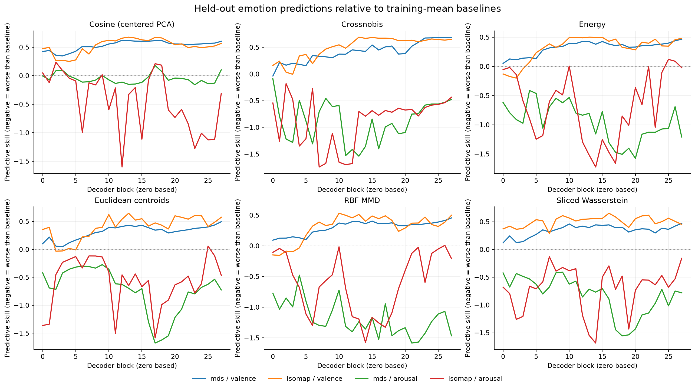

*Data: [figure_22_held_out_axes.csv](plot_data/figure_22_held_out_axes.csv); individual predictions and fold baselines: [va_predictions.csv](tables/va_predictions.csv).*

### What the fitted maps reveal

The selected maps show broad separation of positive and negative categories, but their within-valence ordering and arousal placement vary markedly. The connecting segments expose substantial residual error even in significant alignments. A visually appealing affect map should not be interpreted as accurate placement of every label.

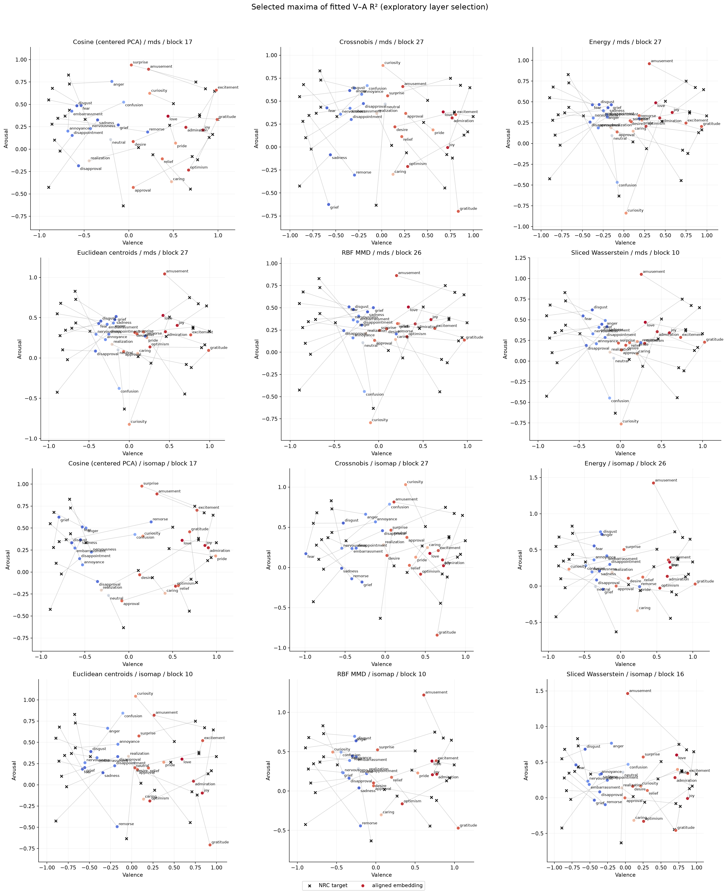

*Data: [figure_03_aligned_maps.csv](plot_data/figure_03_aligned_maps.csv). Crosses denote NRC coordinates; colored points denote fitted embedding coordinates. Segments connect matching emotions. Every panel uses its distance–method maximum over layers, explicitly an exploratory selection. Axis limits accommodate each fitted configuration; compare coordinates and residuals, not apparent panel filling.*

### Excluding neutral

Refitting after removing neutral changes joint R² by a median **+0.0017**, with a range **−0.0260 to +0.0875** across configurations. The strongest cosine Isomap result changes from **0.6045 to 0.5961**; cosine MDS at the same block changes from **0.5518 to 0.5639**. The main alignment is not explained solely by the neutral category. This ablation changes the target composition as well as removing a potentially influential point; it is not an independent replication.

## 3. Classical MDS versus Isomap

Classical MDS uses positive eigenmodes of the double-centered squared direct-distance matrix. It is a **strain-based spectral method**, not a numerical minimizer of the stress plotted below. Isomap instead builds a union-symmetric kNN graph, increases k if necessary for connectivity, computes shortest paths, and applies classical MDS to the graph distances. The main graph requests k = 5. See [Tenenbaum, de Silva, and Langford](https://doi.org/10.1126/SCIENCE.290.5500.2319) for the original Isomap construction.

Quality is always evaluated against the **direct input RDM** unless explicitly called residual variance to geodesic distances. This avoids silently scoring Isomap only against its own transformed target.

| Distance | Method | Mean stress ↓ | Mean Shepard ρ ↑ | Mean trustworthiness ↑ | Mean continuity ↑ |
| --- | --- | ---: | ---: | ---: | ---: |
| Cosine | MDS | 0.316 | 0.749 | 0.848 | 0.888 |
| Cosine | Isomap | 0.380 | 0.720 | 0.870 | 0.923 |
| Crossnobis | MDS | 0.457 | 0.748 | 0.833 | 0.894 |
| Crossnobis | Isomap | 0.385 | 0.713 | 0.832 | 0.919 |
| Energy | MDS | 0.368 | 0.855 | 0.861 | 0.905 |
| Energy | Isomap | 0.332 | 0.807 | 0.864 | 0.913 |
| Euclidean | MDS | 0.407 | 0.843 | 0.856 | 0.902 |
| Euclidean | Isomap | 0.350 | 0.796 | 0.853 | 0.916 |
| RBF-MMD | MDS | 0.382 | 0.830 | 0.850 | 0.897 |
| RBF-MMD | Isomap | 0.337 | 0.810 | 0.860 | 0.911 |
| Sliced Wasserstein | MDS | 0.442 | 0.823 | 0.852 | 0.906 |
| Sliced Wasserstein | Isomap | 0.405 | 0.729 | 0.847 | 0.915 |

*Source: [quality.csv](tables/quality.csv), 2D rows, arithmetic means across the 28 blocks. Lower stress is better; the other three metrics prefer larger values. Means across layers do not supply a sampling-based confidence interval.*

### Metric stress and Shepard structure

Normalized metric stress is the square root of summed squared direct-distance reconstruction error divided by summed squared direct distances, using the upper triangle. It preserves the embedding's fitted scale; no extra stress-minimizing rescaling is performed. Cross-distance comparisons concern distinct target dissimilarities, so the most informative comparison is **MDS versus Isomap within the same RDM**.

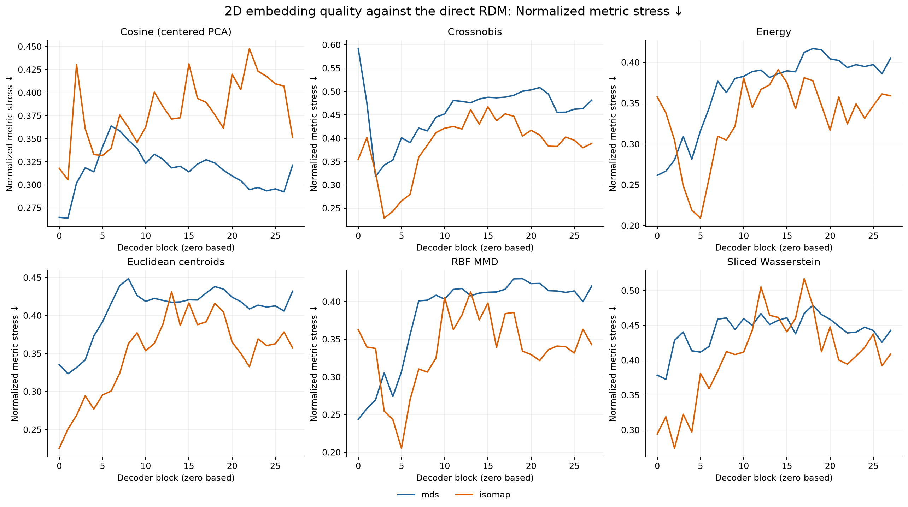

*Data: [figure_04_stress.csv](plot_data/figure_04_stress.csv).*

Shepard correlation is Spearman correlation between the 378 upper-triangle direct distances and 2D Euclidean distances. It tests ordering rather than absolute scale. Isomap has lower average Shepard correlation for every distance definition. Its lower stress for five definitions therefore should not be read as a uniform improvement in distance preservation.

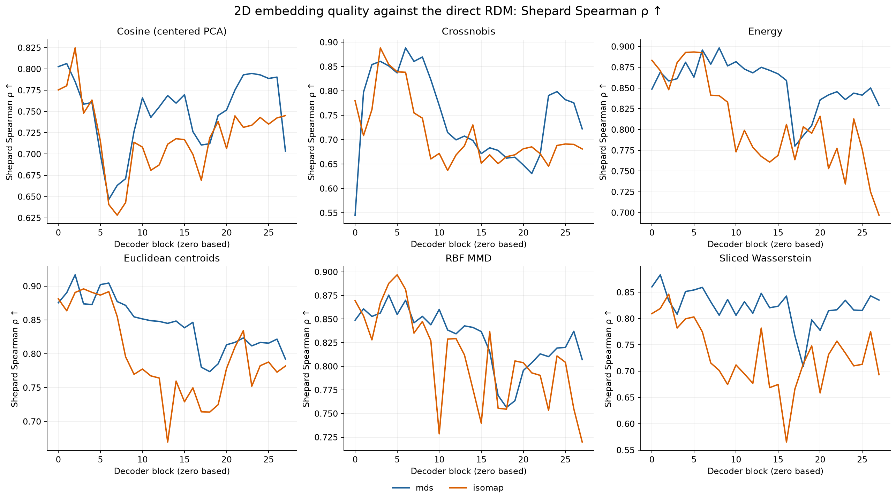

*Data: [figure_04_shepard_spearman.csv](plot_data/figure_04_shepard_spearman.csv). No dyad-wise correlation p values are reported: pairs sharing emotion nodes are dependent.*

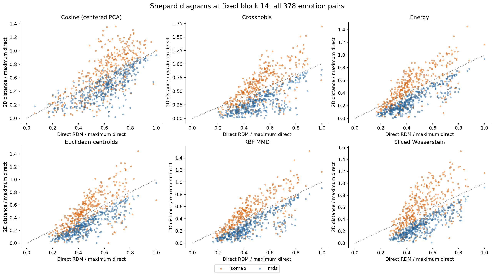

*Data: [figure_20_shepard_diagrams.csv](plot_data/figure_20_shepard_diagrams.csv). Both coordinates are divided by the maximum direct distance within the panel. The dotted line is exact reconstruction. The block was fixed in advance of selecting examples, unlike the V–A peak maps.*

### Trustworthiness and continuity

Trustworthiness penalizes neighbors that appear close in the embedding but were not close in the input; continuity penalizes original neighbors lost by the embedding. Both use k = 5 here, rank-based penalties, and explicit self-exclusion. The distinction follows the local-neighborhood diagnostics described by [Venna and Kaski](https://www.sciencedirect.com/science/article/abs/pii/S0893608006000724); our untied-input implementation is checked against [scikit-learn's trustworthiness definition](https://scikit-learn.org/1.9/modules/generated/sklearn.manifold.trustworthiness.html).

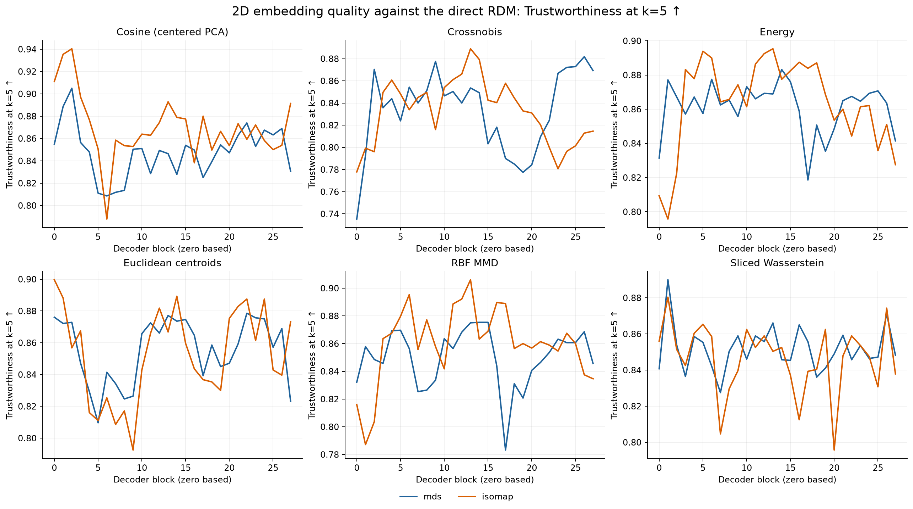

*Data: [figure_04_trustworthiness.csv](plot_data/figure_04_trustworthiness.csv).*

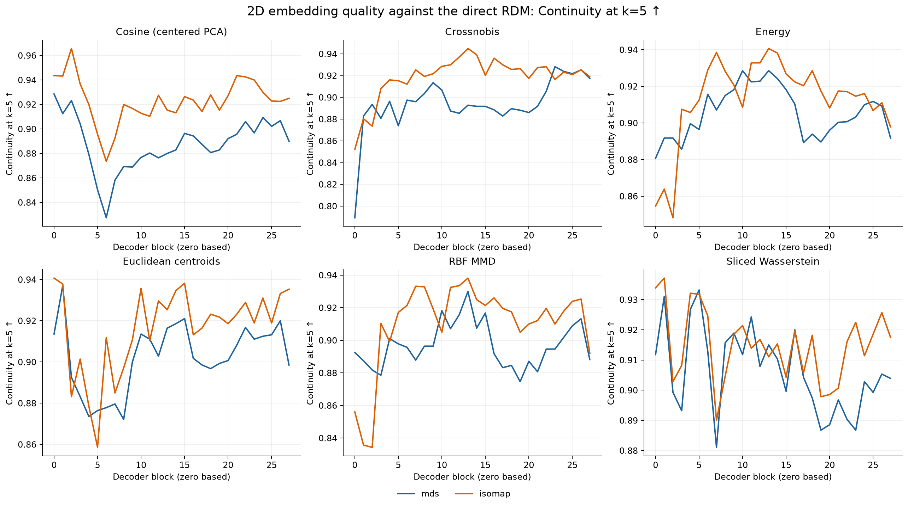

*Data: [figure_04_continuity.csv](plot_data/figure_04_continuity.csv).*

Isomap improves average continuity for all six definitions. Trustworthiness changes are much smaller and mixed: positive for cosine, energy, and MMD; slightly negative for crossnobis, Euclidean, and sliced Wasserstein. Preserving original neighborhoods and avoiding new neighbors are different objectives.

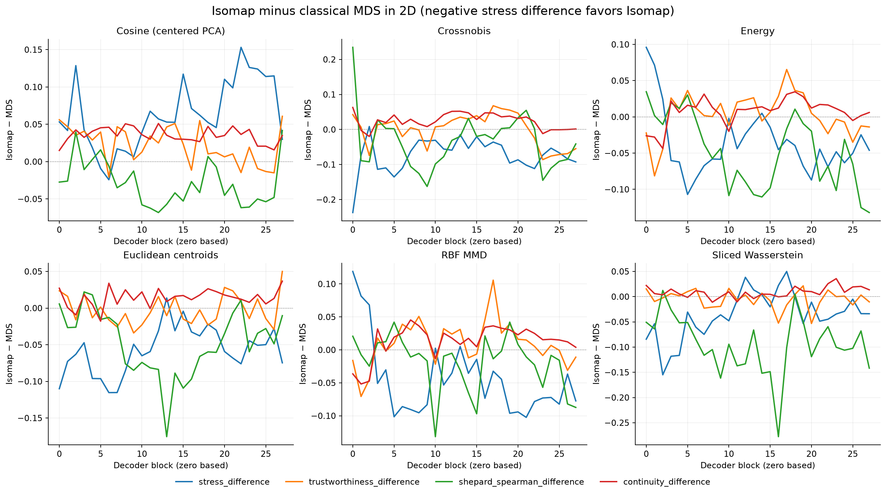

*Data: [figure_08_mds_isomap_difference.csv](plot_data/figure_08_mds_isomap_difference.csv). All differences are Isomap minus MDS. Negative stress and positive values of the other metrics favor Isomap.*

### The answer changes with embedding dimension and evaluation k

| Embedding dimension | Mean Δstress | Mean Δtrustworthiness | Mean Δcontinuity | Mean ΔShepard ρ |
| --- | ---: | ---: | ---: | ---: |
| 1 | −0.1103 | +0.0124 | +0.0234 | −0.0306 |
| 2 | −0.0306 | +0.0045 | +0.0173 | −0.0454 |
| 3 | +0.0832 | +0.0091 | +0.0181 | −0.0332 |

At 3D, Isomap's stress is higher on average: graph-distance expansion can increasingly conflict with direct-distance reconstruction. The gains should not be generalized across ranks.

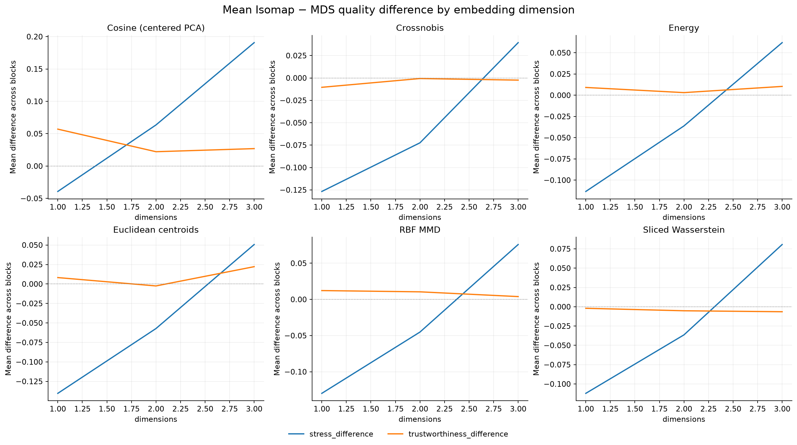

*Data: [figure_09_dimension_method_difference.csv](plot_data/figure_09_dimension_method_difference.csv).*

Changing the **evaluation** neighborhood from k = 5 to k = 10 reverses the overall trustworthiness ordering: means change from MDS **0.850**, Isomap **0.854**, to MDS **0.868**, Isomap **0.858**. Continuity changes from **0.899 versus 0.916** at k = 5 to **0.907 versus 0.897** at k = 10. These are neighborhoods used to assess the fixed 2D embeddings, distinct from the Isomap graph k. Full values: [quality_k_sensitivity.csv](tables/quality_k_sensitivity.csv).

## 4. Intrinsic dimensionality: several diagnostics, different estimands

The classical-MDS Gram matrix is `B = −0.5 H D² H`. Positive eigenvalues describe the Euclidean part of the emotion-level configuration. We report the smallest number reaching 80%, 90%, or 95% of **positive** spectral mass, and participation ratio `PR = (sum λ+)² / sum(λ+²)`. Negative spectral mass is tracked separately; it is not folded into a variance-explained claim.

| Direct MDS distance | Median d80 | Median d90 | Median d95 | Median PR | Median negative / absolute mass |
| --- | ---: | ---: | ---: | ---: | ---: |
| Cosine | 5 | 6.5 | 8 | 5.133 | 0.162 |
| Crossnobis | 7 | 10 | 12 | 7.503 | 0.002 |
| Energy | 6 | 8 | 11 | 6.060 | 0.010 |
| Euclidean | 6 | 9 | 12 | 6.697 | ≈0 |
| RBF-MMD | 6 | 8.5 | 11 | 6.062 | 0.010 |
| Sliced Wasserstein | 8 | 13 | 17 | 7.968 | ≈0 |

*Source: [intrinsic.csv](tables/intrinsic.csv), medians across 28 blocks. A noninteger median of an integer dimension reflects averaging the central two observations, not a fractional embedding dimension.*

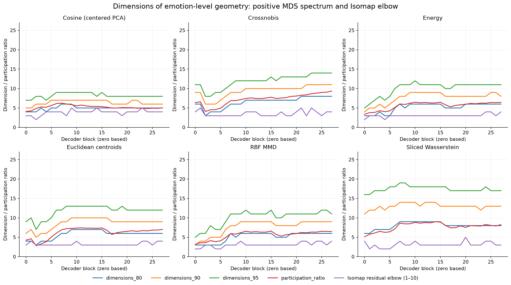

*Data: [figure_05_intrinsic_dimensions.csv](plot_data/figure_05_intrinsic_dimensions.csv). The spectral curves use direct MDS. The Isomap elbow is shown as a separate graph-based diagnostic.*

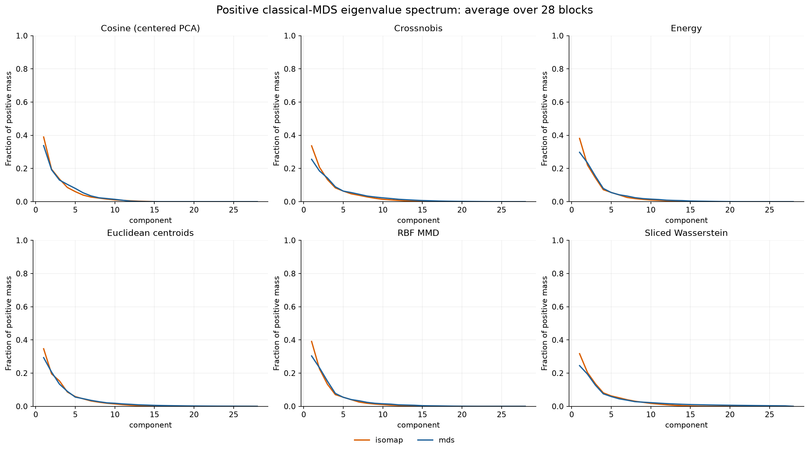

*Data: [figure_06_positive_mass.csv](plot_data/figure_06_positive_mass.csv). Every layer's spectrum is normalized before averaging; these are not eigenvalues of an averaged RDM.*

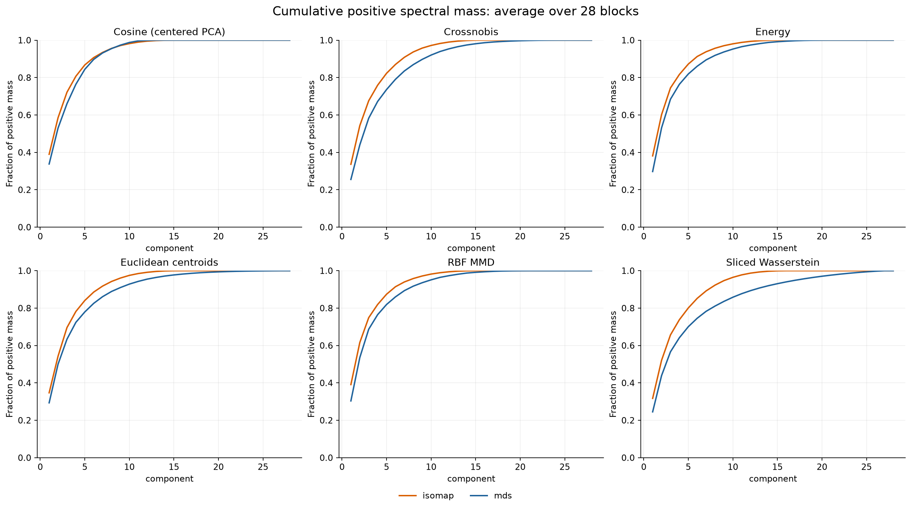

*Data: [figure_06_cumulative_positive_mass.csv](plot_data/figure_06_cumulative_positive_mass.csv). MDS and Isomap use different distance targets. Averaging smooths between-layer variation, which remains available in the full spectrum CSV.*

These diagnostics reject an adequate global **two-dimensional reconstruction** for most geometries. They do not estimate the dimension of all 45,446 activation vectors: the objects here are 28 emotion nodes, with at most 27 centered directions. They also do not identify which higher dimensions carry emotion, topic, lexical content, or noise.

### Isomap residual-variance elbow

Residual variance is `1 − Pearson(geodesic distances, embedded distances)²`, evaluated from 1 through 10 dimensions. The elbow is the greatest normalized perpendicular departure from the line joining the first and last points. Across 168 graphs, the chosen elbow is 2D in **11**, 3D in **102**, 4D in **48**, and 5D in **7** cases.

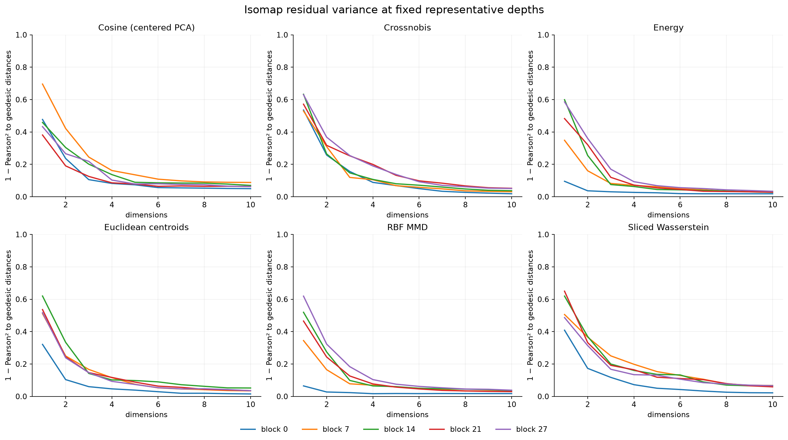

*Data: [figure_07_isomap_residuals.csv](plot_data/figure_07_isomap_residuals.csv). Curves show the prespecified blocks 0, 7, 14, 21, and 27; all blocks are in [residual_variance.csv](tables/residual_variance.csv).*

The concentration at 3–4 dimensions is compatible with a compact approximation to these particular graph distances. It does not contradict d95 values of 8–17, because an elbow and a 95%-mass threshold measure different things. It also does not establish a true manifold dimension: the elbow depends on graph k, the chosen 1–10 search range, the endpoints, and distortion from non-Euclidean inputs. No sample-level dimension estimator or random-matrix noise model is inferred from these 28-point curves.

## 5. Geodesic ratios and the limits of a curvature interpretation

For each nonzero direct pair we divide shortest-path distance by direct distance. Across all layers and pairs, the following quantiles summarize the distribution:

| Distance | 5th percentile | Median | 95th percentile |
| --- | ---: | ---: | ---: |
| Cosine | 0.923 | 1.175 | 1.789 |
| Crossnobis | 1.000 | 1.320 | 1.764 |
| Energy | 0.767 | 1.236 | 1.700 |
| Euclidean | 1.000 | 1.321 | 1.751 |
| RBF-MMD | 0.662 | 1.235 | 1.718 |
| Sliced Wasserstein | 1.000 | 1.437 | 1.949 |

*Source: [geodesic_pairs.csv](tables/geodesic_pairs.csv). Zero-direct-distance pairs remain present with undefined ratio and are excluded from these quantiles.*

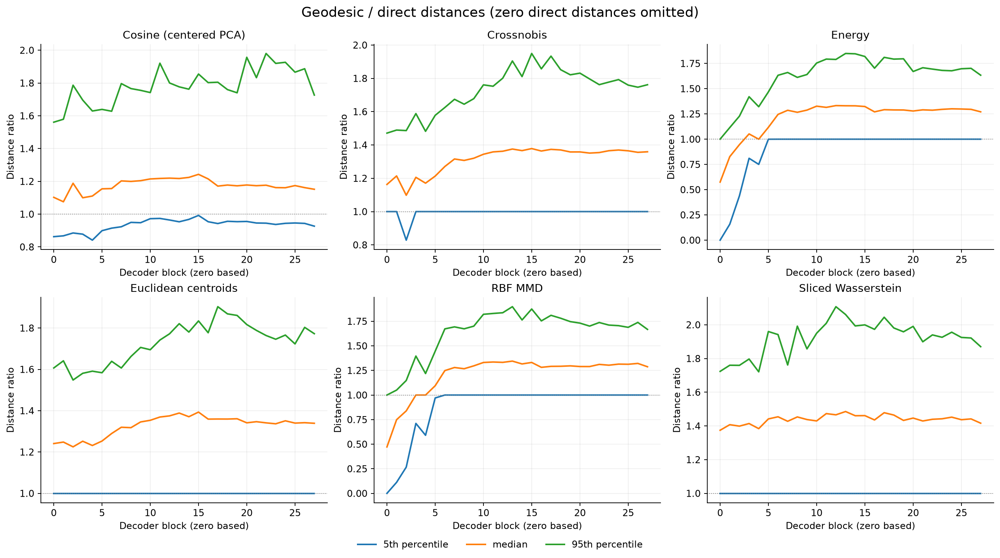

*Data: [figure_10_geodesic_ratios.csv](plot_data/figure_10_geodesic_ratios.csv). Quantiles here are computed within each layer, unlike the pooled quantiles in the table.*

Ratios above one show the detours imposed by the finite kNN graph. They are consistent with nonlinear geometry, but can also arise from sparsification of a noisy, finite set of points. **Ratios below one are especially revealing:** shortest paths can be shorter than an input dissimilarity when that dissimilarity violates the triangle inequality. They are not evidence of “negative curvature.”

The audit finds average triangle-violation fractions of **2.56%** for cosine, **1.91%** for energy, **2.49%** for MMD, and **0.12%** for crossnobis; Euclidean and sliced Wasserstein have none at the numerical tolerance used. Early MMD reaches **27.81%** and energy **22.07%**, coinciding with noisy clipped estimates. Negative direct-MDS mass is substantial for cosine and much smaller for most other direct inputs.

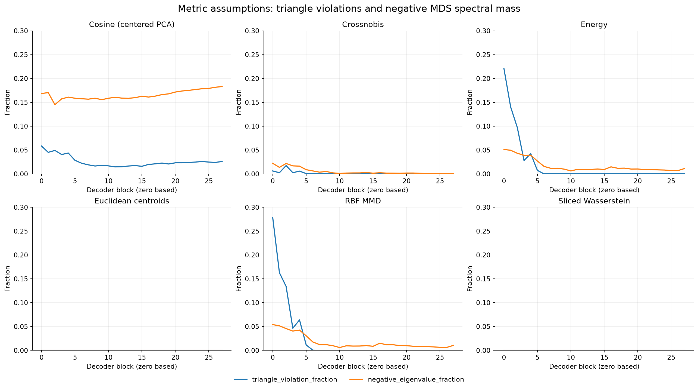

*Data: [figure_18_non_euclidean_audit.csv](plot_data/figure_18_non_euclidean_audit.csv). Triangle violations count unordered triples whose largest edge exceeds the sum of the other two by more than 1e−10. The negative mass fraction uses absolute eigenvalue mass.*

### Isomap graph sensitivity

The graph sweep requests k = 3, 4, 5, 6, 8, 10, 12, 20, and 27. For cosine, average V–A R² is **0.323** at k = 3, **0.404** at k = 5, and **0.435** at k = 8. Crossnobis instead favors sparser graphs for V–A recovery: **0.366** at k = 3 versus **0.317** at k = 8. Selecting k to optimize trustworthiness need not optimize lexical affect recovery.

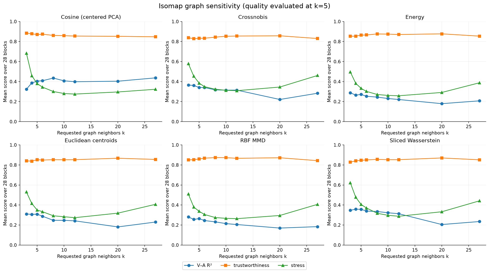

*Data: [figure_14_graph_sensitivity.csv](plot_data/figure_14_graph_sensitivity.csv). Curves average over blocks. Full tables retain requested and actually used k; connectivity can require increasing it.*

Even a complete graph does not necessarily reproduce direct MDS for nonmetric inputs: shortest paths can still shorten triangle-violating dissimilarities. Consequently the sparse-to-dense sweep combines manifold approximation with metric repair. It cannot, by itself, establish a low-dimensional curved affect manifold.

### Cosine dissimilarity versus Euclidean chord distance

An additional audit uses the **same normalized PCA centroids**, replacing `1 − cosine_similarity` with chord distance `sqrt(2 × cosine_dissimilarity)`. Chord distances are Euclidean on the unit sphere; this separates input metric validity from changing the underlying centroids. The new comparison is exploratory, with no post-hoc significance claim.

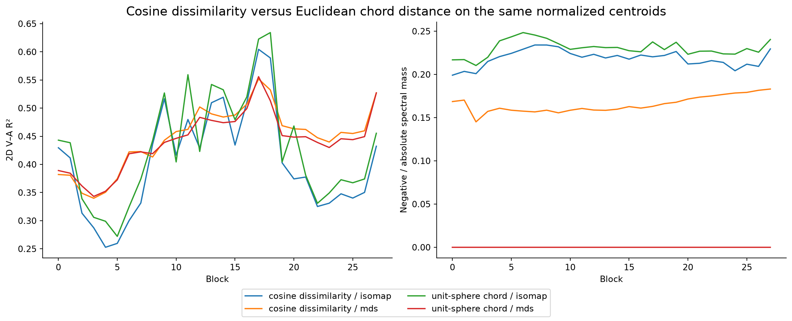

*Data: [figure_24_cosine_chord.csv](plot_data/figure_24_cosine_chord.csv). The negative-mass panel distinguishes the direct MDS target from the graph-distance Isomap target. A Euclidean direct input can still acquire negative spectral mass after graph shortest paths.*

Replacing cosine dissimilarity by chord distance removes the direct MDS negative spectrum to numerical precision, while mean fitted V–A R² changes only from **0.4476 to 0.4416**. Thus non-Euclideanity of ordinary cosine dissimilarity is not required for its broad normative alignment. Chord Isomap has mean R² **0.4281**, compared with **0.4040** for cosine Isomap, and reaches an exploratory maximum **0.6342** at block 18. This variant has not been included in the main permutation family or the held-out-alignment comparison, so its selected maximum should not replace the main result without those checks. Graph-induced negative mass remains substantial: approximately **0.230** on average for chord Isomap.

## 6. Agreement across distance notions and emotion neighborhoods

The agreement analysis matches layer, method, label ordering, and embedding dimension. RDM Spearman compares upper triangles; embedding Procrustes compares 2D shapes; kNN overlap is the fraction of each emotion's five neighbors shared across two direct RDMs, averaged over emotions.

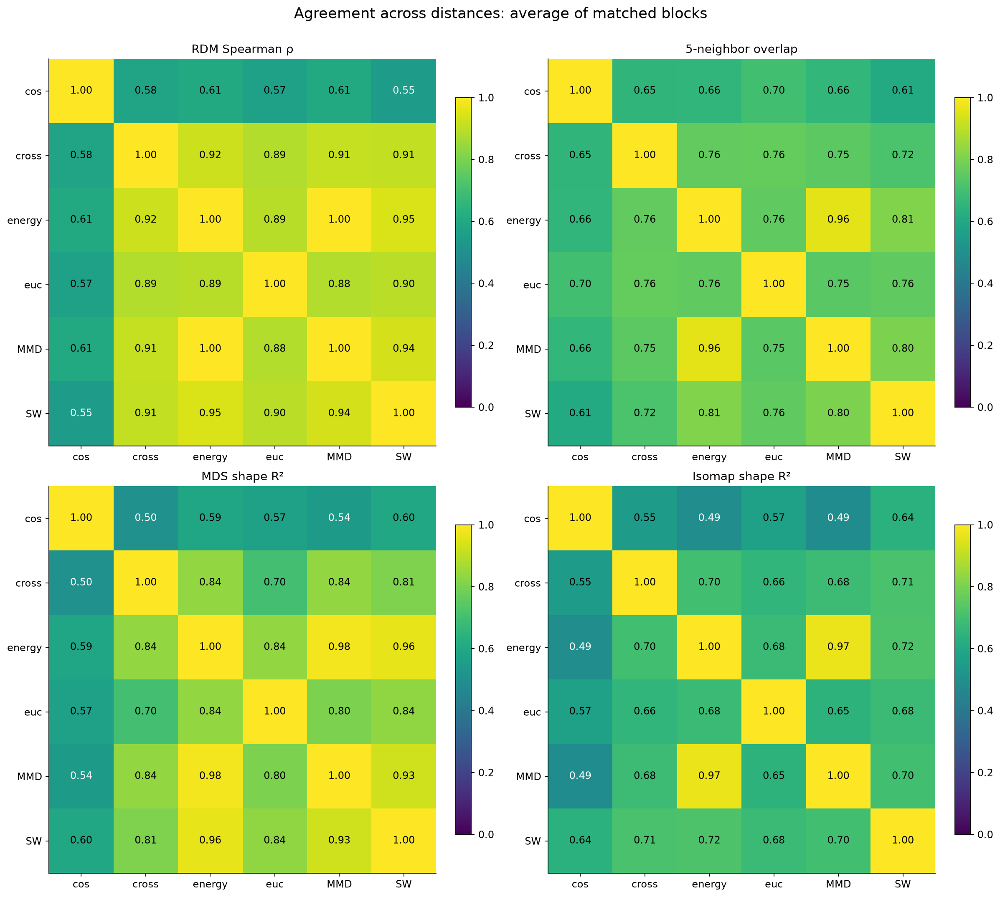

*Data: [figure_11_distance_agreement.csv](plot_data/figure_11_distance_agreement.csv). Values average matched-layer comparisons. Diagonal values are one by definition.*

**Energy and MMD are largely redundant in this run.** Their mean RDM correlation is **0.997**, their mean neighborhood overlap **0.957**, and MDS shape similarity **0.984**. Sliced Wasserstein also agrees strongly with energy at the RDM level (**0.945**) and MDS shape level (**0.965**). These are converging measurements of a broad distributional arrangement, not three independent replications of the scientific hypothesis.

Cosine is more distinct: its correlations to other distance notions span **0.549–0.608**, compared with **0.884–0.945** among most other pairs. Yet cosine has the strongest normative alignment. A method can therefore be a better match to the lexical V–A target while disagreeing with other summaries of activation geometry. There is no target-independent “best distance” identified by these results.

### Which emotions move most?

The neighborhood-change score is `1 − shared_neighbors/5`, averaged over the 15 distance pairs and 28 layers. It compares **direct RDM neighborhoods**, rather than distances between plotted 2D coordinates.

| Most distance-sensitive | Mean change | Most stable | Mean change |
| --- | ---: | --- | ---: |
| surprise | 0.440 | fear | 0.080 |
| desire | 0.431 | nervousness | 0.095 |
| amusement | 0.410 | confusion | 0.138 |
| grief | 0.373 | gratitude | 0.139 |
| relief | 0.347 | disapproval | 0.140 |

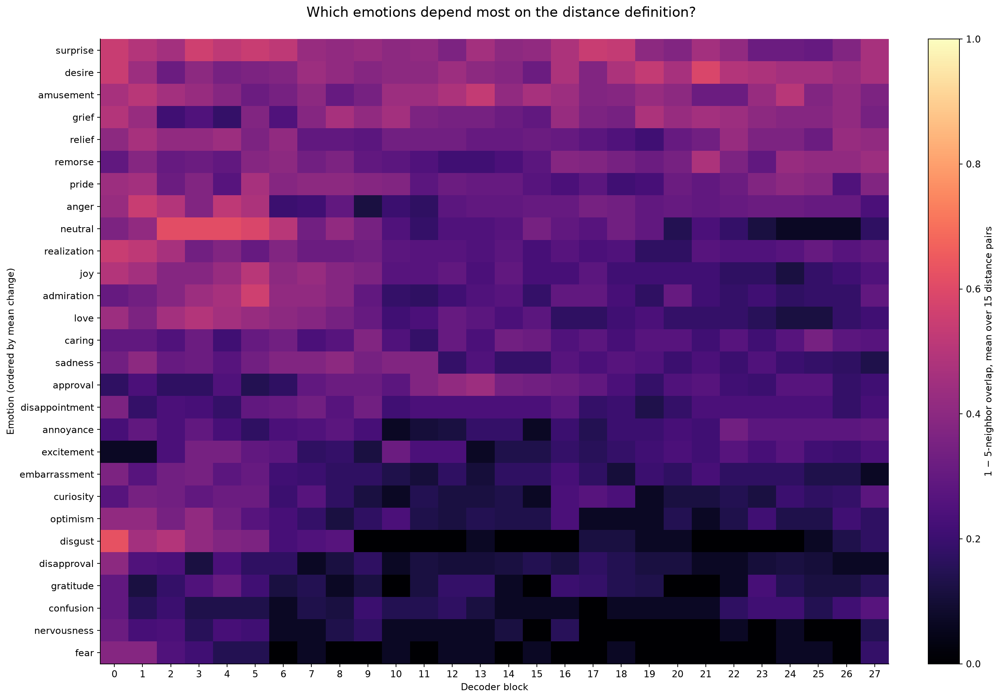

*Data: [figure_12_neighborhood_change.csv](plot_data/figure_12_neighborhood_change.csv); [neighborhood_change.csv](tables/neighborhood_change.csv) additionally preserves the named neighbor lists for each distance pair.*

Surprise and desire have enough examples that their sensitivity cannot be dismissed solely as an extremely small class effect. Grief and relief, however, have very limited support. Stable fear–nervousness neighborhoods are consistent with a coherent local grouping, but this analysis does not establish clinical or psychological equivalence of those labels. Inspect the saved neighbor identities when interpreting a specific emotion.

## 7. Layerwise emergence and cross-layer stability

A single universal emergence layer is not supported. Centered cosine already has a meaningful early configuration and reaches its strongest V–A alignment in the middle blocks. Crossnobis becomes more aligned late in the model. The distributional distances generally improve from early to middle depth and then plateau or fluctuate; Euclidean and MMD Isomap have sharp local maxima at block 10.

| Distance | Method | Mean R², blocks 0–8 | Mean R², blocks 9–18 | Mean R², blocks 19–27 |
| --- | --- | ---: | ---: | ---: |
| Cosine | MDS | 0.382 | 0.492 | 0.464 |
| Cosine | Isomap | 0.336 | 0.501 | 0.365 |
| Crossnobis | MDS | 0.151 | 0.295 | 0.412 |
| Crossnobis | Isomap | 0.187 | 0.399 | 0.432 |
| Energy | MDS | 0.130 | 0.255 | 0.253 |
| Energy | Isomap | 0.134 | 0.329 | 0.346 |
| Euclidean | MDS | 0.148 | 0.273 | 0.264 |
| Euclidean | Isomap | 0.175 | 0.358 | 0.387 |
| RBF-MMD | MDS | 0.109 | 0.228 | 0.238 |
| RBF-MMD | Isomap | 0.118 | 0.333 | 0.334 |
| Sliced Wasserstein | MDS | 0.174 | 0.279 | 0.247 |
| Sliced Wasserstein | Isomap | 0.300 | 0.404 | 0.363 |

*Source: [va_recovery.csv](tables/va_recovery.csv). These depth bins are descriptive summaries, not estimated change points. Serially dependent blocks are not treated as independent observations for a trend test.*

The earlier figures jointly show the requested layerwise trajectories: V–A R² in Figure 01; stress, trustworthiness, continuity, and Shepard correlation in Figures 04; dimensionality in Figure 05; and method differences in Figure 08. Dimensionality frequently increases during the early-to-middle transition even as normative recovery improves. Better recovery therefore does not require global collapse toward two dimensions.

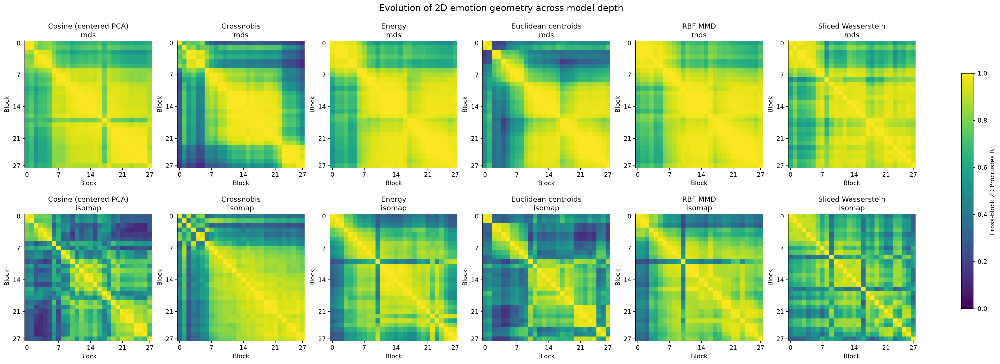

*Data: [figure_13_cross_layer_similarity.csv](plot_data/figure_13_cross_layer_similarity.csv). Each cell compares 2D configurations after independent similarity alignment. The CSV also records RDM Spearman correlation for the same layer pairs.*

Adjacent-block MDS configurations are highly stable on average: Procrustes R² is **0.965** for cosine, **0.955** for crossnobis, **0.986** for energy, **0.947** for Euclidean, **0.988** for MMD, and **0.955** for sliced Wasserstein. Adjacent Isomap averages are lower, **0.806–0.917**, reflecting additional sensitivity to graph topology and spectral changes.

From block 14 to block 27, direct-RDM correlations are **0.899–0.962** across the six distances. Yet 2D shape similarity can be lower: crossnobis MDS has only **0.474**, despite RDM correlation **0.904**; sliced-Wasserstein Isomap has **0.366**, despite RDM correlation **0.962**. A low-rank view or graph transformation can change more than the full pairwise relationship. Cross-layer embedding instability is not automatically evidence that the underlying emotion relations have been replaced.

## 8. Robustness analyses beyond fitted affect maps

### 8.1 Reference-distance RSA and nuisance controls

A separate analysis avoids fitting 2D axes. It correlates each direct RDM with distances derived from lexical valence, lexical arousal, or the joint unstandardized V–A coordinates. Inference permutes **emotion labels of the whole reference matrix**, preserving dyadic dependence, with 4,999 permutations and a BH correction over the 504 raw RSA tests. Individual distance pairs are never counted as independent experimental observations.

Partial Spearman correlations additionally residualize ranked dyads against absolute log-frequency difference, summed log frequency, and absolute mean-word-count difference. V-only analyses also control A distance; A-only analyses control V distance. Joint analyses control the three nuisance variables. The partial coefficients are **descriptive**: the saved permutation p values apply to raw RSA, not to these partial correlations.

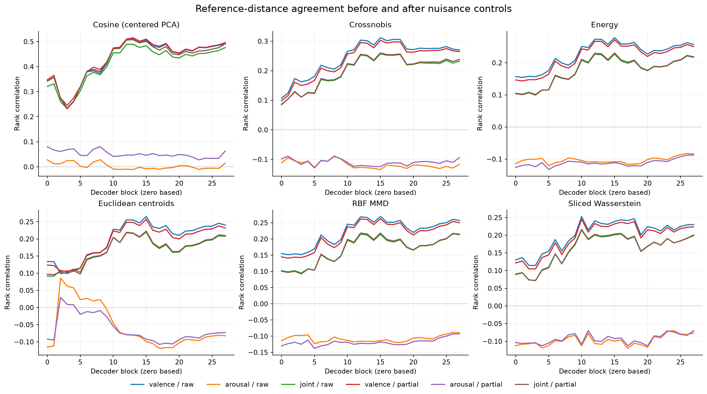

*Data: [figure_15_reference_rsa.csv](plot_data/figure_15_reference_rsa.csv); raw-test p and q values: [reference_rsa.csv](tables/reference_rsa.csv).*

Cosine's mean valence RSA is **0.429** and partial valence RSA **0.432**; joint RSA is **0.411**, rising to **0.427** after the nuisance controls. For the other distances, mean valence RSA is roughly **0.199–0.246** and remains **0.194–0.237** after adjustment. The simple frequency and length summaries do not explain away the broad valence relation.

All **168 valence RSA tests** and **147 of 168 joint RSA tests** survive BH q < 0.05. None of the arousal RSA tests survive this one-sided, positive-association test. The absence of positive arousal evidence is not evidence against any possible nonlinear or sign-dependent arousal representation.

Mean arousal RSA is approximately zero for cosine (**0.003**) and negative for the other distances (**−0.056 to −0.118**). Partial arousal RSA remains weak: cosine **0.051**, other distances **−0.062 to −0.118**. This is evidence against a strong, general arousal organization of the full RDM, even though selected 2D projections have positive fitted arousal correlation. The joint target is also valence-weighted because its coordinate variances are unequal.

These controls do not remove topic, punctuation, token identity, subreddit, annotation ambiguity, or all consequences of sample imbalance. The length feature is whitespace word count, not tokenizer length or a truncation indicator.

### 8.2 Disjoint text splits with a training-only PCA

At fixed blocks **0, 7, 14, 21, and 27**, a new PCA is fitted on **training comments only**, with a cap of 256 examples per emotion. Train, validation, and test centroids are then computed separately in that basis. Both MDS and Isomap are evaluated for cosine and Euclidean distances. To remove exact-text leakage, comments are deduplicated globally, retaining the first occurrence in train–validation–test order.

The source contains **233 duplicate-text rows**. The sensitivity analysis retains **36,151 train**, **4,510 validation**, and **4,552 test** comments. Rare-class support remains a serious limit: the smallest test emotion has only **two examples**, while the smallest validation class has six.

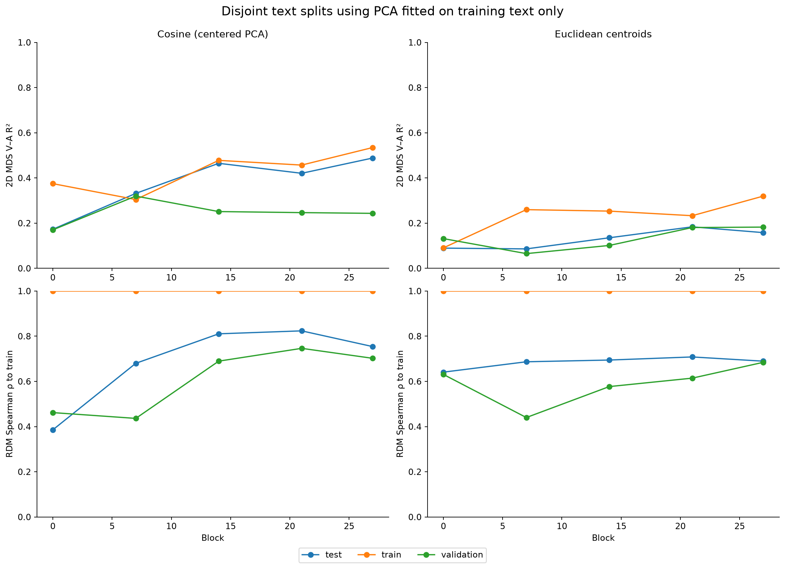

*Data: [figure_16_split_sensitivity.csv](plot_data/figure_16_split_sensitivity.csv). The figure shows MDS; [split_sensitivity.csv](tables/split_sensitivity.csv) contains both methods and support counts. No validation/test comments enter PCA fitting.*

At block 14, cosine MDS V–A R² is **0.478** on train, **0.251** on validation, and **0.465** on test; test RDM correlation to train is **0.811**. At block 27, the corresponding R² values are **0.535**, **0.243**, and **0.488**, with test-to-train RDM correlation **0.754**. The broad cosine alignment recurs on held-out text, but exact quality is heterogeneous across splits.

Euclidean MDS is weaker on held-out splits: at block 27 its R² is **0.320** on train, **0.183** on validation, and **0.158** on test. This comparison also changes PCA fitting and sample composition relative to the original pooled run. It is an informative sensitivity analysis, not an independent preregistered replication or a definitive comparison of generalization performance.

### 8.3 Equal-support sampling

At the same five blocks, **200 repeated draws of 47 comments per emotion** construct balanced centroid RDMs in the original frozen PCA basis. Each draw uses no replacement within an emotion. Grief consequently contributes its same 47 available comments in every draw. Both Euclidean and cosine MDS are recomputed.

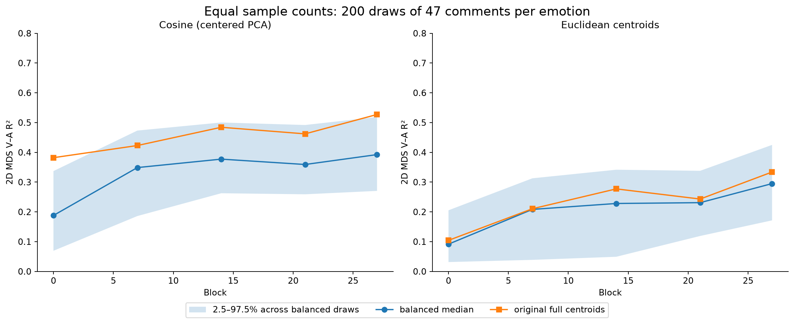

*Data: [figure_17_balanced_sampling.csv](plot_data/figure_17_balanced_sampling.csv); all individual draws: [balanced_sensitivity.csv](tables/balanced_sensitivity.csv). The shaded bands are empirical 2.5–97.5 percentiles across balanced draws, **not population confidence intervals**.*

Mean balanced cosine R² rises from **0.194** at block 0 to **0.370** at block 14 and **0.380** at block 27. The original full-centroid scores at those blocks are approximately **0.382**, **0.484**, and **0.527**. Mean balanced Euclidean R² is **0.100**, **0.214**, and **0.287** at those same depths. Broad alignment remains, with appreciable sampling variability and reduced support.

The reduction cannot be assigned solely to “class imbalance”: using only 47 comments also makes common-class centroids noisier. The frozen PCA was itself fitted using the original sampling scheme. This analysis probes joint sensitivity to equalized support and reduced sample size, not a clean causal decomposition of the two.

### 8.4 Centering, projection, and the cosine advantage

At the five audit depths we compare four centroid representations: original raw 1,024D, raw 1,024D after subtracting the original PCA fitting mean, 64D projection without subtracting that mean, and the original centered 64D PCA representation. No re-extraction or supervised fitting is involved.

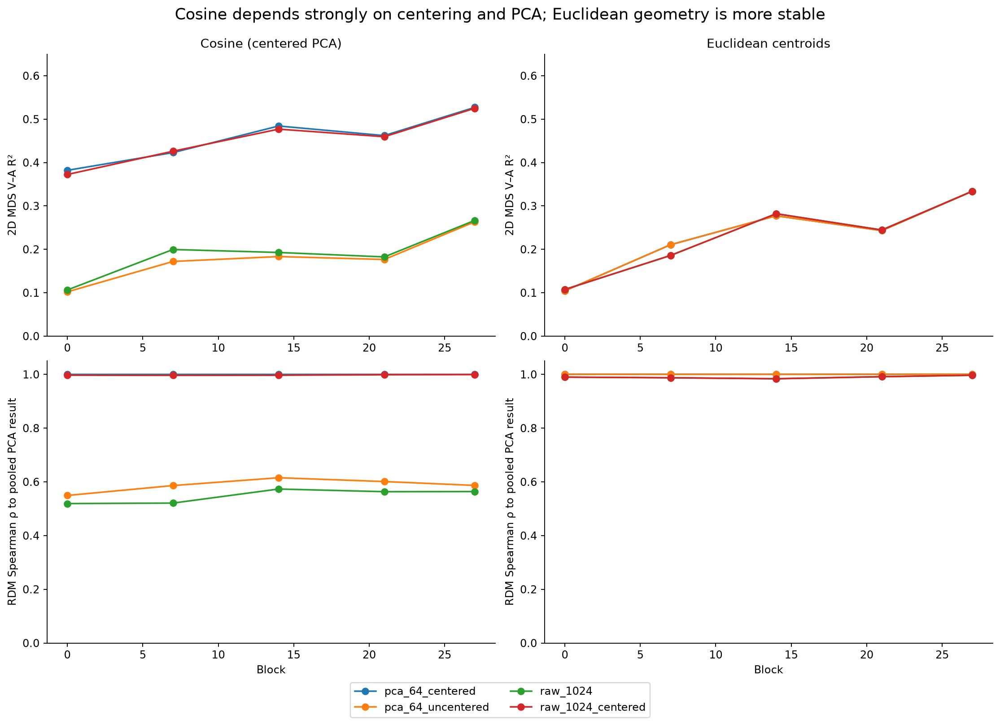

*Data: [figure_21_preprocessing_sensitivity.csv](plot_data/figure_21_preprocessing_sensitivity.csv). This comparison concerns direct MDS; all variants share the original emotion assignments and comments.*

Raw versus original centered-PCA cosine RDM correlations are only **0.519–0.573** across the audit blocks. Their MDS V–A R² values differ substantially: at block 14, **0.193 versus 0.484**; at block 27, **0.267 versus 0.527**. Raw versus PCA Euclidean RDM correlations are **0.984–0.997**, with nearly unchanged block-27 V–A R² (**0.334** in both). Euclidean distances are translation-invariant, whereas cosine is not. The additional centered-only and uncentered-projection curves separate these operations rather than attributing their combined effect to an unspecified cosine metric.

The isolating controls identify **the change of origin as the dominant operation** at these depths: centered raw 1,024D cosine RDMs correlate **0.9965–0.9993** with the original centered-PCA RDMs. At block 14, centering alone gives R² **0.4769**, close to centered PCA's **0.4842**; projecting without centering gives only **0.1833**. At block 27 those values are **0.5251**, **0.5272**, and **0.2635**, respectively. Within this five-depth audit, truncation to 64 dimensions is secondary to centering for the cosine alignment advantage.

Consequently, the strongest map should be described as **centered-PCA cosine emotion geometry**, not as a preprocessing-independent property of raw residual directions. The preprocessing choices are unsupervised with respect to NRC V–A, but still matter scientifically.

### 8.5 Affine decoding separates information from preserved shape

A supplementary leave-one-emotion-out affine decoder predicts V and A from 1D, 2D, or 3D coordinates. Unlike similarity alignment, it permits different weights and scales for the two target axes. This asks whether coordinates contain predictive information even when their geometric shape does not directly match V–A.

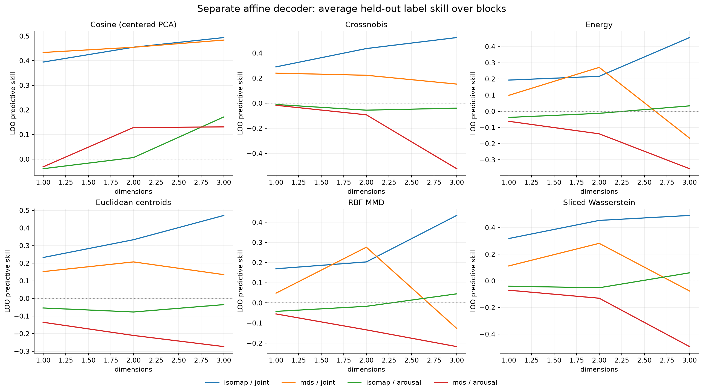

*Data: [figure_23_affine_decoding.csv](plot_data/figure_23_affine_decoding.csv). Curves average held-out-label predictive skill over all blocks. Negative scores remain visible rather than being clipped.*

For cosine MDS, mean affine arousal skill is **0.129** in 2D, compared with **−0.050** for the shared-scale similarity transform. Cosine Isomap's mean affine arousal skill rises to **0.172** in 3D. Some arousal information is therefore usable after a more flexible readout, without establishing a matching two-dimensional affect geometry.

Adding dimensions does not uniformly help: several MDS affine decoders deteriorate sharply at 3D. With only 28 labels, extra coefficients and influential emotion nodes can yield unstable estimates. These diagnostics are transductive and do not provide a held-out layer/model selection procedure. They argue for distinguishing **information availability**, **geometric correspondence**, and **out-of-sample prediction**.

## 9. Relationship to Choi and Weber and what extends the comparison

[Choi and Weber's study](https://arxiv.org/html/2604.07382v1) examines affect geometry using classification-context activations, pairwise classifier-based dissimilarities, mean pooling, and normative alignment. It also studies spectra and Isomap. The present run instead uses raw-comment last-token activations, Qwen3-0.6B, six centroid/distributional distances, and the bundled NRC norms. These differences preclude interpreting score differences as a direct replication or model ranking.

The extensions implemented here are shared-permutation correction across the complete main search, held-out-label alignment and affine decoding, explicit separation of valence from arousal, diagonal-safe neighborhood evaluation, graph-k and metric-validity audits, nuisance-adjusted reference RSA, text-deduplicated split checks with training-only PCA, repeated equal-support sampling, and preprocessing/chord-distance ablations. Together they test which geometric claims survive choices that a single fitted affect map cannot resolve.

## 10. Conclusions supported by this run, and unresolved work

The most defensible claim is that **emotion-category geometry contains a robust valence-related component**, with selected depths also supporting weaker arousal recovery. This correspondence is statistically unusual under emotion-label reassignment and recurs in several alternative analyses. Its magnitude depends on metric, preprocessing, depth, and text sample composition.

A stronger claim that Qwen has recovered a universal 2D affect manifold is unsupported. Most spectral reconstructions need more dimensions, direct arousal RSA is weak, graph ratios mix metric violations with sparsity effects, and different distances change specific emotion neighborhoods. The best normative map and the most faithful direct-distance reconstruction are different outcomes.

The following limitations bound the interpretation and prioritize further experiments:

- **Replication unit:** one model and one extraction run cannot support population conclusions across models, seeds, languages, or prompt formats. The saved model revision is not resolved to a commit, which limits exact future reconstruction even though the existing artifacts are hash-audited.
- **Category geometry:** all spectra, neighborhoods, and maps concern 28 emotion groups. They do not characterize the entire individual-comment activation manifold or establish causality of emotion features.
- **Norms and annotation:** the reference rates label words, not the comments; dominance is absent; single-label filtering removes mixed-emotion examples. Alternative normative resources and comment-level V–A ratings would test construct validity.
- **Sample uncertainty:** label permutations test label–geometry association, not the variability of estimated RDMs. Balanced draws cover only two centroid metrics at five fixed depths. Sample-level bootstrap and split reliability for crossnobis, energy, MMD, and sliced Wasserstein remain unmeasured.
- **Confounding:** word-count and frequency controls are coarse. Topic, last-token identity, punctuation, truncation, and context length may structure the residual stream. Matched or counterfactual text would be needed to separate these factors.
- **Exploration and dependence:** the peak layers, graph sweeps, and flexible decoders are exploratory. Blocks are dependent. A final model-selection protocol should choose layer, graph k, preprocessing, and distance on training/validation information and evaluate an untouched test corpus.
- **Distance estimation:** 64D PCA and the 256-example cap are fixed choices in the source run. A full PCA-rank sweep, kernel-bandwidth sweep, projection-seed sweep, and shrinkage/fold sensitivity are needed before assigning a preferred geometry to a specific distance estimator.
- **Manifold claims:** residual elbows and positive spectral thresholds are descriptive. Noise-calibrated eigengaps, sample-level local-dimension estimates, and larger sets of emotion concepts would address different dimensionality questions.

The immediate follow-up with greatest evidential value is to repeat the full pipeline on held-out, matched-support comments using several extraction seeds and pooling rules; freeze the geometry-selection procedure before evaluating an untouched corpus; and test whether a separately calibrated arousal readout generalizes. These experiments would distinguish stable affect structure from the sampling and representation choices demonstrated here.

## 11. Reproduction and artifact map

The report lives in root-level `analyses/` as requested. Original extraction and experiment artifacts remain under `outputs/qwen--qwen3-0.6b/20261019T091428Z/`. Operational logs remain under `logs/qwen--qwen3-0.6b__20261019T091428Z/`.

From the repository root, with the development environment active:

```bash
conda activate affect-geometry
OPENBLAS_NUM_THREADS=1 OMP_NUM_THREADS=1 python experiments/02_analyze_results.py
```

To redraw figures from the saved CSVs without recomputing robustness analyses:

```bash
python experiments/02_analyze_results.py --plots-only
```

The first command rebuilds numeric tables and images. This Markdown is a curated interpretation of this specific run and should be reviewed if the source run or analysis settings change. All figure functions reload the exported `figure_*.csv` they consume. Detailed analysis tables are kept separately under `tables/`; dedicated plot-ready tables are under `plot_data/`. Original intermediate data are read from the source run.

| Artifact | Purpose |
| --- | --- |
| [figure_index.csv](figure_index.csv) | One row per figure, with PNG, vector PDF, CSV, and title |
| [provenance.json](provenance.json) | Source manifest, analysis seed, permutation count, input RDM SHA-256 hashes |
| [tables/va_recovery.csv](tables/va_recovery.csv) | All fitted/held-out V–A metrics, permutation p, BH q, and max-statistic p |
| [tables/va_predictions.csv](tables/va_predictions.csv) | Every held-out emotion prediction and corresponding training-mean baseline |
| [tables/quality.csv](tables/quality.csv) | All 1D/2D/3D corrected quality metrics |
| [tables/intrinsic.csv](tables/intrinsic.csv), [spectrum.csv](tables/spectrum.csv) | Spectral dimensions and all signed eigenvalues |
| [tables/reference_rsa.csv](tables/reference_rsa.csv) | Raw reference RSA, raw-test inference, and descriptive partial coefficients |
| [tables/distance_agreement.csv](tables/distance_agreement.csv) | Matched-layer RDM, 2D shape, and neighbor agreement |
| [tables/neighborhood_change.csv](tables/neighborhood_change.csv) | Per-emotion changes with the named neighbor lists |
| [tables/cross_layer.csv](tables/cross_layer.csv) | Every cross-layer shape similarity and RDM correlation |
| [tables/split_sensitivity.csv](tables/split_sensitivity.csv) | Train-only PCA checks, both methods, all three deduplicated splits |
| [tables/balanced_sensitivity.csv](tables/balanced_sensitivity.csv) | All 200 equal-support draws at each of five audit depths |
| [tables/preprocessing_sensitivity.csv](tables/preprocessing_sensitivity.csv) | Centering/projection ablations |
| [tables/cosine_metric_sensitivity.csv](tables/cosine_metric_sensitivity.csv) | Cosine versus unit-sphere chord diagnostics |

Reusable scientific code is in `src/affect_geometry/analysis/{comprehensive,robustness,sampling}.py`; presentation code is in `src/affect_geometry/reporting/comprehensive.py`. The experiment entry point only orchestrates those modules. Tests cover known-transform held-out prediction, shared-permutation correction, and correct handling of tied zero-distance neighbors, alongside the original pipeline suite.
