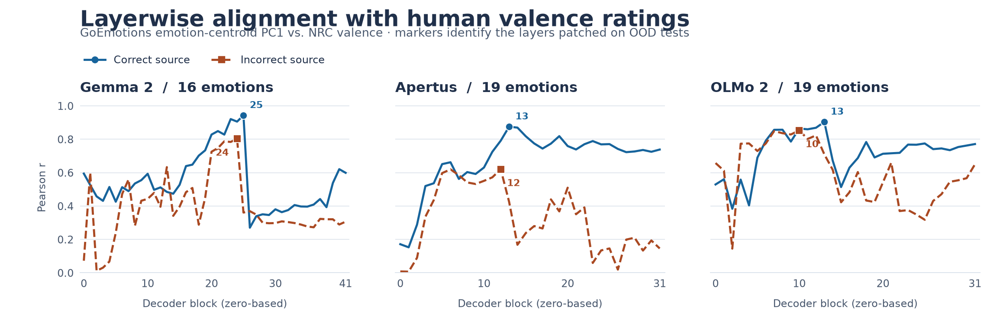
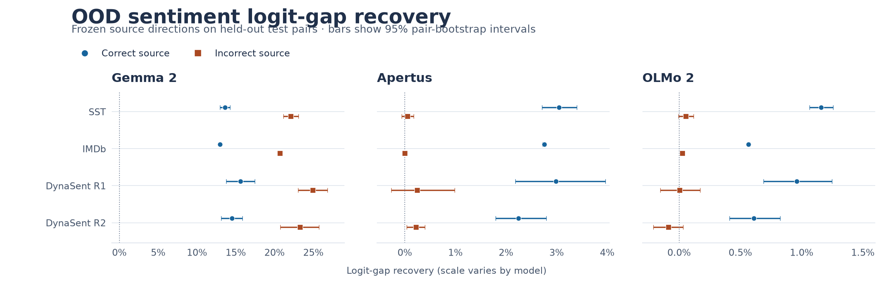

# EXP4 · Causal transfer of a GoEmotions valence direction to held-out sentiment

Replacing one activation coordinate along a frozen, NRC-aligned valence direction caused **partial sentiment transfer in Gemma 2**. Its two source directions recovered **12.95–24.94%** of the clean donor–recipient logit gap across SST, IMDb, and DynaSent R1 and R2. They flipped **1.01–6.45%** of decisions toward the donor label. Apertus and OLMo 2 showed consistent but smaller logit gains from their correct-source directions, at **2.25–3.05%** and **0.57–1.16%** recovery, respectively. Their incorrect-source interventions stayed near zero. The incorrect-source direction transferred more strongly in Gemma 2 on every test set, even though its source Pearson correlation was lower.

## Experimental design and coverage

The completed `pc1-v2` run fits PC1 to equally weighted GoEmotions emotion centroids from unnormalized, last-token, neutral-projected classification activations. Neutral is included as a centroid. The **correct** and **incorrect** labels refer to the model's GoEmotions classifications used to estimate the directions. The same two source directions are evaluated on each of a model's four sentiment test sets. The OOD target examples have separate gold sentiment labels and a separate prompt template. [Direction manifest](../../outputs/valence-transfer/pc1-v2/directions/manifest.json) · [Evaluation manifest](../../outputs/valence-transfer/pc1-v2/evaluation/manifest.json)

| Model | Checkpoint | Model revision | Source activation repository and revision |
| --- | --- | --- | --- |
| Gemma 2 | `google/gemma-2-9b` | `33c193028431` | `kokolamba/rq3-gemma2` @ `3ae38a8e481a` |
| Apertus | `swiss-ai/Apertus-8B-Instruct-2509` | `b946d40447b2` | `kokolamba/rq3-apertus` @ `07517cb3cbb7` |
| OLMo 2 | `allenai/OLMo-2-1124-7B-Instruct` | `470b1fba1ae0` | `kokolamba/rq3-olmo2` @ `a581c7d35233` |

For each opposite-label pair, both examples serve once as donor and once as recipient. The PC1 intervention replaces the recipient's component along the selected unit vector with the donor's in the raw final-token activation after the selected decoder block. The orthogonal component is preserved. The outcome is the next-token `Positive` minus `Negative` logit difference. Full-state patching replaces the whole donor state at that block. Five seeded random unit-vector patches use the same one-coordinate intervention. The saved no-op uses the clean recipient score. [Patching implementation](../../src/affect_geometry/models/activation_patching.py) · [Directional replacement](../../src/affect_geometry/interventions/directional.py) · [Evaluation and metrics](../../src/affect_geometry/evaluation/directional_patching.py)

### Target coverage and clean baselines

| Model | Test set | Candidates | Within token cap | Matched pairs | Both clean correct (pairs) | Clean accuracy (%) | No-op donor-label hit (%) | Mean clean gap (logits) |
| --- | --- | --- | --- | --- | --- | --- | --- | --- |
| Gemma 2 | SST | 1,163 | 1,163 | 150 | 143 | 97.67 | 1.33 | 3.74 |
| Gemma 2 | IMDb | 20,533 | 20,142 | 7,608 | 7,440 | 98.88 | 0.907 | 5.73 |
| Gemma 2 | DynaSent R1 | 1,238 | 1,238 | 39 | 34 | 93.59 | 6.41 | 2.47 |
| Gemma 2 | DynaSent R2 | 272 | 272 | 31 | 30 | 98.39 | 1.61 | 3.19 |
| Apertus | SST | 1,163 | 1,163 | 151 | 144 | 97.35 | 2.65 | 7.19 |
| Apertus | IMDb | 20,533 | 20,111 | 7,578 | 7,272 | 97.97 | 1.89 | 9.83 |
| Apertus | DynaSent R1 | 1,238 | 1,238 | 40 | 36 | 93.75 | 5.00 | 6.31 |
| Apertus | DynaSent R2 | 272 | 272 | 33 | 33 | 100.00 | 0 | 8.53 |
| OLMo 2 | SST | 1,163 | 1,163 | 152 | 113 | 87.17 | 10.86 | 8.82 |
| OLMo 2 | IMDb | 20,533 | 20,138 | 7,540 | 6,981 | 96.29 | 3.64 | 13.30 |
| OLMo 2 | DynaSent R1 | 1,238 | 1,238 | 40 | 26 | 82.50 | 17.50 | 8.42 |
| OLMo 2 | DynaSent R2 | 272 | 272 | 34 | 22 | 82.35 | 14.71 | 9.62 |

The candidate snapshots contain binary test examples that Pythia 2.8B classified correctly. The target models use their own tokenizers to build equal-length pairs without replacement, with a 1,000-token cap and no pair cap. Baselines and target pairs are identical between a model's two source-cohort interventions. Clean accuracy is the same for donors and recipients because roles are reversed within each pair. A recipient can already predict the donor label before intervention, so the no-op donor-label hit is reported separately. For example, it is **17.50%** on OLMo 2 DynaSent R1 even before any patch. IMDb provides roughly 97% of matched pairs within each model. DynaSent R1 retains only about 6% of candidate examples after pairing. The conclusions address these filtered pairs and the observed replication across test sets. [Pairing implementation](../../src/affect_geometry/data/sentiment_transfer.py) · [Saved target evaluations](../../outputs/valence-transfer/pc1-v2/evaluation/)

## Layerwise Pearson correlation with human valence ratings

The run orients PC1 toward increasing human NRC VAD v2.1 valence independently at every source layer. The plotted Pearson statistic is therefore the magnitude of the raw correlation over emotion centroids. The sign choice sets the plotting orientation because the donor component is replaced through a projection onto the axis. The layer with the highest source correlation in each model and cohort was frozen before OOD patching. Blocks are indexed from zero, with states taken after the indicated block. The human ratings are lexical emotion-label norms. [NRC valence reference](../../data/reference/goemotions_nrc_vad.csv) · [Reference provenance](../../data/reference/goemotions_nrc_vad.provenance.json) · [Frozen selections](../../outputs/valence-transfer/pc1-v2/directions/selection.csv)

| Model | Source cohort | Source prompts | Emotions | Blocks scanned | Patched block | Pearson r | Spearman ρ | PC1 variance (%) | Relative eigengap |
| --- | --- | --- | --- | --- | --- | --- | --- | --- | --- |
| Gemma 2 | Correct | 6,898 | 16 | 0–41 | **25** | 0.943 | 0.907 | 26.3 | 0.287 |
| Gemma 2 | Incorrect | 6,898 | 16 | 0–41 | **24** | 0.803 | 0.787 | 51.5 | 0.748 |
| Apertus | Correct | 9,241 | 19 | 0–31 | **13** | 0.875 | 0.832 | 47.7 | 0.653 |
| Apertus | Incorrect | 9,241 | 19 | 0–31 | **12** | 0.620 | 0.682 | 38.3 | 0.507 |
| OLMo 2 | Correct | 9,042 | 19 | 0–31 | **13** | 0.904 | 0.896 | 38.9 | 0.616 |
| OLMo 2 | Incorrect | 9,042 | 19 | 0–31 | **10** | 0.853 | 0.860 | 34.5 | 0.600 |

The horizontal axis shows decoder block number. The common vertical axis shows Pearson `r`. Solid blue and dashed orange curves identify correct and incorrect source cohorts, and the marked block numbers are the actual OOD patch sites. [Plot-ready CSV for all 212 scores](../../outputs/valence-transfer/pc1-v2/report-data/layerwise-nrc-valence-pearson.csv)

- **Gemma 2** peaks later than the other models, at blocks **25** (correct, `r = 0.943`) and **24** (incorrect, `r = 0.803`). Both curves rise around blocks 20–24, then fall sharply after their respective peaks, to **0.270** at block 26 for the correct cohort and **0.361** at block 25 for the incorrect cohort.
- **Apertus** uses blocks **13** (correct, `r = 0.875`) and **12** (incorrect, `r = 0.620`). The correct cohort remains near or above **0.72** from block 11 onward. The incorrect curve has two near-tied peaks, **0.6205** at block 12 and **0.6195** at block 6, and ends at **0.146**. The selected layer is sensitive to small changes in this descriptive criterion.
- **OLMo 2** uses blocks **13** (correct, `r = 0.904`) and **10** (incorrect, `r = 0.853`). The incorrect curve leads on several early blocks and reaches **0.849** at block 7. The correct curve dips from **0.904** at block 13 to **0.514** at block 15 and ends at **0.771**.

Correct-source peak `r` is higher in all three models, and the correct-source curve leads at 37 of 42 Gemma 2 blocks, 31 of 32 Apertus blocks, and 26 of 32 OLMo 2 blocks. At the selected Gemma 2 sites, incorrect-source PC1 explains more centroid variance (**51.5%** versus **26.3%**) despite weaker valence alignment. The relative eigengap measures the separation of the first and second eigenvalues as a fraction of the first eigenvalue. Apertus and OLMo 2 include three additional source emotions (annoyance, approval, and optimism). Each peak uses the same ratings for orientation and layer selection, so the peaks describe source alignment rather than performance on held-out human ratings. OOD testing covers the six selected block–direction combinations only.

## Causal effects on all matched OOD pairs

| Metric | What it measures |
| --- | --- |
| Gap recovery | Mean gain in donor-oriented logit margin divided by the mean clean donor–recipient margin gap, as a percentage. Zero means no mean shift and a negative value means a mean shift away from the donor. |
| Mean case recovery | Average of the individual percentage recoveries. Cases with absolute clean gaps at most `1e-8` are excluded from this metric only. Small or negative gaps can make this estimate unstable. |
| Calibrated flip | The change in donor-label accuracy after centering each condition's logit differences by its own mean, divided by the centered clean donor–recipient accuracy gap. It is a normalized accuracy change and can be negative. |
| Literal flips | Percentage of cases crossing the raw zero logit threshold from the recipient label to the donor label. Exact ties are excluded from flips. |
| Donor-label hit | Percentage of patched raw margins favoring the donor label, including cases already at the donor label before patching. Compare with the no-op hit rate in the coverage table. |

### Gemma 2

| Test set | Source cohort | Pairs | Gap recovery (%) | Mean case recovery (%) | Calibrated flip (%) | Literal flips (%) | Donor-label hit (%) |
| --- | --- | --- | --- | --- | --- | --- | --- |
| SST | Correct | 150 | 13.61 | 13.51 | 2.76 | 2.00 | 4.33 |
| SST | Incorrect | 150 | 22.10 | 21.13 | 4.48 | 3.33 | 5.33 |
| IMDb | Correct | 7,608 | 12.95 | 13.10 | 1.06 | 1.01 | 2.10 |
| IMDb | Incorrect | 7,608 | 20.68 | 21.03 | 2.33 | 2.14 | 3.23 |
| DynaSent R1 | Correct | 39 | 15.58 | 14.17 | 5.71 | 3.85 | 10.26 |
| DynaSent R1 | Incorrect | 39 | 24.94 | 24.42 | 10.00 | 6.41 | 12.82 |
| DynaSent R2 | Correct | 31 | 14.52 | 14.47 | 3.33 | 3.23 | 4.84 |
| DynaSent R2 | Incorrect | 31 | 23.30 | 23.22 | 8.33 | 6.45 | 8.06 |

The incorrect-source intervention has higher values on all five outcomes on each test set. It gains **7.73–9.35 percentage points** of gap recovery over the correct-source intervention. Mean case recovery shows the same ordering, and calibrated flips are **2.33–10.00%** for the incorrect source versus **1.06–5.71%** for the correct source. The largest literal flip rates, **6.41%** and **6.45%** on DynaSent, correspond to only **five** R1 cases and **four** R2 cases. IMDb gives the clearest evidence at scale, with **154** literal flips for the correct source and **325** for the incorrect source across **15,216** directed cases. The raw donor-label hit rates there rise from **0.907%** with no-op to **2.10%** and **3.23%**.

### Apertus

| Test set | Source cohort | Pairs | Gap recovery (%) | Mean case recovery (%) | Calibrated flip (%) | Literal flips (%) | Donor-label hit (%) |
| --- | --- | --- | --- | --- | --- | --- | --- |
| SST | Correct | 151 | 3.05 | 2.56 | 0.709 | 0.662 | 3.31 |
| SST | Incorrect | 151 | 0.055 | 0.015 | −0.355 | 0 | 2.65 |
| IMDb | Correct | 7,578 | 2.75 | 3.11 | 0.423 | 0.416 | 2.41 |
| IMDb | Incorrect | 7,578 | 0.0005 | −0.033 | 0 | 0 | 1.89 |
| DynaSent R1 | Correct | 40 | 2.99 | 1.41 | 1.39 | 0 | 6.25 |
| DynaSent R1 | Incorrect | 40 | 0.241 | 1.38 | 2.78 | 1.25 | 7.50 |
| DynaSent R2 | Correct | 33 | 2.25 | 2.58 | 0 | 1.52 | 1.52 |
| DynaSent R2 | Incorrect | 33 | 0.216 | 0.252 | 0 | 0 | 0 |

Correct-source gap recovery is consistently positive (**2.25–3.05%**), and mean case recovery also stays positive (**1.41–3.11%**). Incorrect-source gap recovery never exceeds **0.242%**. Its IMDb mean case recovery is slightly negative even though the aggregate gain is approximately zero. Threshold outcomes are sparse. On R1 the incorrect source yields **one** literal flip, a **2.78%** calibrated flip value, and **7.50%** donor-label hits (no-op **5.00%**), despite smaller overall gap recovery than the correct source. On R2 the correct source yields one literal flip, while the calibrated outcome remains zero. These differences matter when separating a general shift in logits from movement across either decision threshold.

### OLMo 2

| Test set | Source cohort | Pairs | Gap recovery (%) | Mean case recovery (%) | Calibrated flip (%) | Literal flips (%) | Donor-label hit (%) |
| --- | --- | --- | --- | --- | --- | --- | --- |
| SST | Correct | 152 | 1.16 | 1.63 | 0 | 0.658 | 13.16 |
| SST | Incorrect | 152 | 0.055 | 0.468 | −0.350 | 0 | 11.84 |
| IMDb | Correct | 7,540 | 0.567 | 0.637 | 0.062 | 0.106 | 3.81 |
| IMDb | Incorrect | 7,540 | 0.026 | 0.040 | 0.0069 | 0 | 3.64 |
| DynaSent R1 | Correct | 40 | 0.961 | 1.12 | 0 | 0 | 17.50 |
| DynaSent R1 | Incorrect | 40 | 0.0046 | −0.030 | 0 | 0 | 17.50 |
| DynaSent R2 | Correct | 34 | 0.608 | 0.712 | 0 | 0 | 17.65 |
| DynaSent R2 | Incorrect | 34 | −0.089 | −0.039 | 0 | 0 | 16.18 |

Correct-source gap recovery is **0.57–1.16%**, with positive mean case recovery on all four test sets. The incorrect source ranges from **−0.089% to 0.055%** in gap recovery and produces zero literal flips throughout. The correct source flips **two** SST cases and **16** IMDb cases. Its all-pairs calibrated flip value is **0.062%** on IMDb and zero on the other three sets. High raw donor-label hit rates on DynaSent chiefly reflect the clean baseline. On R1 both cohorts stay at the **17.50%** no-op rate. On R2 the correct-source rate rises from **14.71%** to **17.65%** with zero literal flips, since ties can move into the donor class without a strict sign crossing.

### Donor polarity on IMDb

IMDb supplies the largest sample for checking whether the effect works in both directions. Each donor label appears exactly once per pair. Recovery uses the mean clean gap within that donor-label stratum.

| Model | Source cohort | Cases per donor label | Negative-donor recovery (%) | Negative-donor flips | Positive-donor recovery (%) | Positive-donor flips |
| --- | --- | --- | --- | --- | --- | --- |
| Gemma 2 | Correct | 7,608 | 13.31 | 30 | 12.59 | 124 |
| Gemma 2 | Incorrect | 7,608 | 25.51 | 75 | 15.84 | 250 |
| Apertus | Correct | 7,578 | 4.03 | 52 | 1.48 | 11 |
| Apertus | Incorrect | 7,578 | 0.238 | 0 | −0.237 | 0 |
| OLMo 2 | Correct | 7,540 | 0.815 | 16 | 0.319 | 0 |
| OLMo 2 | Incorrect | 7,540 | 0.049 | 0 | 0.0024 | 0 |

Both Gemma 2 interventions move mean logits toward either donor label, and so do all three correct-source interventions. Gemma 2's negative-donor recovery is larger, while more cases cross the raw threshold toward positive. OLMo 2's correct-source flips on IMDb are all toward negative. Apertus's incorrect source has approximately cancelling mean effects by donor label. These polarity differences illustrate how paired mean shifts and the count of decisions changed can rank outcomes differently.

## Specificity relative to controls

Full-state outcomes use the same target pairs and block as PC1. The last column gives the complete range of aggregate recovery across the five random directions for each condition.

| Model | Test set | Source cohort | Gap recovery (%) | Mean case recovery (%) | Calibrated flip (%) | Literal flips (%) | Donor-label hit (%) | Random gap recovery range (%) |
| --- | --- | --- | --- | --- | --- | --- | --- | --- |
| Gemma 2 | SST | Correct | 80.66 | 80.70 | 96.21 | 91.67 | 93.67 | 0.022 to 0.312 |
| Gemma 2 | SST | Incorrect | 70.15 | 70.12 | 91.72 | 86.67 | 88.67 | 0.056 to 0.256 |
| Gemma 2 | IMDb | Correct | 79.15 | 79.72 | 97.75 | 94.93 | 96.02 | 0.0031 to 0.116 |
| Gemma 2 | IMDb | Incorrect | 67.93 | 68.39 | 92.03 | 88.41 | 89.50 | 0.0083 to 0.141 |
| Gemma 2 | DynaSent R1 | Correct | 81.49 | 75.40 | 92.86 | 80.77 | 85.90 | 0.130 to 0.455 |
| Gemma 2 | DynaSent R1 | Incorrect | 71.30 | 65.08 | 85.71 | 70.51 | 75.64 | 0 to 0.260 |
| Gemma 2 | DynaSent R2 | Correct | 80.87 | 80.14 | 95.00 | 88.71 | 90.32 | −0.505 to 0.126 |
| Gemma 2 | DynaSent R2 | Incorrect | 71.78 | 71.57 | 83.33 | 85.48 | 87.10 | −0.568 to −0.126 |
| Apertus | SST | Correct | 10.70 | 9.19 | 3.19 | 3.31 | 5.96 | 0.013 to 0.127 |
| Apertus | SST | Incorrect | 4.24 | 3.06 | 0.709 | 1.32 | 3.97 | 0.013 to 0.096 |
| Apertus | IMDb | Correct | 9.02 | 9.10 | 2.03 | 1.91 | 3.83 | −0.016 to 0.012 |
| Apertus | IMDb | Incorrect | 2.41 | 2.31 | 0.573 | 0.594 | 2.28 | −0.0045 to 0.019 |
| Apertus | DynaSent R1 | Correct | 3.72 | 25.37 | −4.17 | 2.50 | 2.50 | −0.235 to 0.266 |
| Apertus | DynaSent R1 | Incorrect | −1.43 | 19.11 | −4.17 | 2.50 | 2.50 | −0.272 to 0.124 |
| Apertus | DynaSent R2 | Correct | 4.93 | 5.77 | 0 | 7.58 | 7.58 | 0.028 to 0.250 |
| Apertus | DynaSent R2 | Incorrect | 1.41 | 1.34 | 0 | 4.55 | 4.55 | 0.0055 to 0.189 |
| OLMo 2 | SST | Correct | 8.41 | 2.14 | 2.10 | 7.24 | 19.41 | −0.022 to 0.048 |
| OLMo 2 | SST | Incorrect | 2.19 | −4.49 | 0.350 | 0.658 | 12.50 | −0.011 to 0.034 |
| OLMo 2 | IMDb | Correct | 4.92 | 5.66 | 1.11 | 2.08 | 5.70 | −0.014 to 0.0060 |
| OLMo 2 | IMDb | Incorrect | 0.319 | 0.333 | 0.069 | 0.272 | 3.61 | −0.0048 to −0.0001 |
| OLMo 2 | DynaSent R1 | Correct | 6.92 | 7.75 | 3.85 | 2.50 | 20.00 | −0.057 to 0.037 |
| OLMo 2 | DynaSent R1 | Incorrect | 1.52 | 2.71 | 2.56 | 0 | 16.25 | −0.085 to −0.013 |
| OLMo 2 | DynaSent R2 | Correct | 4.90 | 5.12 | 0 | 0 | 16.18 | −0.188 to −0.065 |
| OLMo 2 | DynaSent R2 | Incorrect | 1.02 | 1.57 | 0 | 0 | 13.24 | −0.179 to −0.103 |

The no-op is zero on gap recovery, mean case recovery, calibrated flip, and literal flip in every model, cohort, and test set. Its raw donor-label hit equals the clean baseline above. The next table gives the min–max across the five random directions and four datasets within each model and source cohort. The donor-label hit range includes the different test-set baselines.

| Model | Source cohort | Gap recovery (%) | Mean case recovery (%) | Calibrated flip (%) | Literal flips (%) | Donor-label hit (%) |
| --- | --- | --- | --- | --- | --- | --- |
| Gemma 2 | Correct | −0.505 to 0.455 | −0.687 to 0.346 | −0.345 to 0 | 0 to 0 | 0.894 to 6.41 |
| Gemma 2 | Incorrect | −0.568 to 0.260 | −0.733 to 0.613 | −0.027 to 2.86 | 0 to 0.0066 | 0.900 to 5.13 |
| Apertus | Correct | −0.235 to 0.266 | −0.600 to 1.12 | −0.355 to 2.78 | 0 to 0 | 0 to 6.25 |
| Apertus | Incorrect | −0.272 to 0.189 | −0.637 to 1.44 | −0.355 to 2.78 | 0 to 1.25 | 0 to 7.50 |
| OLMo 2 | Correct | −0.188 to 0.048 | −0.187 to 0.462 | 0 to 0.021 | 0 to 0.0066 | 3.62 to 17.50 |
| OLMo 2 | Incorrect | −0.179 to 0.034 | −0.176 to 0.486 | 0 to 0.0069 | 0 to 0.329 | 3.62 to 17.50 |

- **Gemma 2:** PC1 exceeds every sampled random direction in gap recovery in all eight conditions. The largest positive random recovery is **0.455%**. Full patching has **67.93–81.49%** recovery and **70.51–94.93%** literal flips. Full patching works better at block 25 than at block 24 on each test set, while their respective PC1 results show the reverse ordering. There is substantial donor information outside the transferred coordinate, and the layer comparison depends on the intervention.
- **Apertus:** The correct-source coordinate exceeds all five random directions in gap recovery throughout. Incorrect-source recovery is inside the random range on SST and IMDb and just above its upper end on both DynaSent rounds (by **0.118** and **0.028** percentage points). The incorrect-source R1 literal flip rate is equalled by a random direction. Full patching at the incorrect-source R1 block recovers **−1.43%** of the mean gap and flips **2.50%** of cases. Its positive mean case recovery (**19.11%**) is sensitive to small, reversed clean gaps. One case with a clean gap of **−0.375 logits** has a ratio above **1,000%** in both full-state interventions. On R2 both full-state calibrated flip values are zero even though raw flips reach **7.58%** and **4.55%**.
- **OLMo 2:** Correct-source recovery exceeds every sampled random direction, although even the full patch recovers only **4.90–8.41%** at that block. The incorrect-source PC1 is slightly above the best random recovery on each target and its largest positive recovery is **0.055%**. On R2 both its mean effect and all random mean effects are negative. Its zero literal flips are comparable with random outcomes.

Random directions provide comparison with sampled one-coordinate replacements. Each model reuses the same seed and vector width across its datasets and cohorts, so those conditions share the five draws. The unit vectors can induce different intervention magnitudes because the change depends on the projection of the donor–recipient activation difference. Five draws give a descriptive reference. Full-state replacement can also shift the mean margin away from the donor, as it did at Apertus block 12 on R1.

## Uncertainty and sensitivity

### Paired bootstrap of gap recovery

The intervals are 95% percentile intervals from 10,000 draws (seed 42, restarted per model and dataset). Each draw resamples entire opposite-label pairs, keeps both patch directions, and recomputes the ratio of summed gains to summed clean gaps. The same draw is applied to both source-cohort evaluations for the contrast. These are pointwise intervals conditional on the frozen directions, selected layers and matched target samples. They omit direction-fitting and layer-selection uncertainty, and no multiplicity adjustment is applied.

| Model | Test set | Correct recovery (%) | Incorrect recovery (%) | Incorrect − correct (pp) |
| --- | --- | --- | --- | --- |
| Gemma 2 | SST | 13.61 [12.98, 14.25] | 22.10 [21.11, 23.08] | 8.49 [7.59, 9.40] |
| Gemma 2 | IMDb | 12.95 [12.86, 13.04] | 20.68 [20.56, 20.80] | 7.73 [7.62, 7.83] |
| Gemma 2 | DynaSent R1 | 15.58 [13.78, 17.45] | 24.94 [23.02, 26.80] | 9.35 [7.01, 11.52] |
| Gemma 2 | DynaSent R2 | 14.52 [13.13, 15.84] | 23.30 [20.75, 25.72] | 8.78 [6.49, 11.00] |
| Apertus | SST | 3.05 [2.71, 3.40] | 0.055 [−0.064, 0.173] | −2.99 [−3.35, −2.64] |
| Apertus | IMDb | 2.75 [2.72, 2.79] | 0.0005 [−0.014, 0.015] | −2.75 [−2.79, −2.72] |
| Apertus | DynaSent R1 | 2.99 [2.18, 3.96] | 0.241 [−0.271, 0.985] | −2.75 [−3.62, −1.89] |
| Apertus | DynaSent R2 | 2.25 [1.79, 2.80] | 0.216 [0.038, 0.397] | −2.03 [−2.58, −1.56] |
| OLMo 2 | SST | 1.16 [1.06, 1.26] | 0.055 [−0.0069, 0.117] | −1.10 [−1.21, −1.01] |
| OLMo 2 | IMDb | 0.567 [0.555, 0.579] | 0.026 [0.019, 0.033] | −0.541 [−0.553, −0.530] |
| OLMo 2 | DynaSent R1 | 0.961 [0.688, 1.25] | 0.0046 [−0.152, 0.170] | −0.957 [−1.24, −0.692] |
| OLMo 2 | DynaSent R2 | 0.608 [0.411, 0.824] | −0.089 [−0.209, 0.033] | −0.697 [−0.888, −0.530] |

The horizontal axis is PC1 recovery, with a different scale in each model panel so small effects remain visible. The rows are test sets, points mark the estimates, and whiskers give pointwise 95% intervals. Zero is the no-op reference. Gemma 2's separation between cohorts persists across targets, including both low-sample DynaSent rounds. Apertus and OLMo 2 show the opposite ordering on every target, with correct-source intervals above zero and most incorrect-source intervals spanning it. The exceptions are Apertus R2 (**0.216%**) and OLMo 2 IMDb (**0.026%**), both small with zero literal flips. DynaSent estimates generally have wider intervals than IMDb. The figure reflects uncertainty over the saved pairs and gives no evidence on how a re-fit direction or a different selected block would behave. [Plot-ready recovery CSV](../../outputs/valence-transfer/pc1-v2/report-data/ood-pc1-recovery-by-dataset.csv)

### Restricting to pairs with both clean predictions correct

This target-side restriction applies equally to the correct and incorrect *source* cohorts. The raw recipient starts strictly on its own side of zero in every retained case, so the literal flip rate equals the donor-label hit rate. There are two zero clean gaps on Gemma 2 IMDb and two on OLMo 2 IMDb in the all-pairs records per source intervention, and none in this subset.

| Model | Test set | Source cohort | Pairs | Gap recovery (%) | Mean case recovery (%) | Calibrated flip (%) | Literal flips and donor-label hits (%) |
| --- | --- | --- | --- | --- | --- | --- | --- |
| Gemma 2 | SST | Correct | 143 | 13.71 | 13.85 | 1.76 | 2.10 |
| Gemma 2 | SST | Incorrect | 143 | 22.08 | 22.04 | 3.52 | 3.50 |
| Gemma 2 | IMDb | Correct | 7,440 | 12.96 | 13.11 | 0.822 | 1.03 |
| Gemma 2 | IMDb | Incorrect | 7,440 | 20.65 | 20.85 | 1.98 | 2.18 |
| Gemma 2 | DynaSent R1 | Correct | 34 | 15.83 | 16.22 | 5.88 | 4.41 |
| Gemma 2 | DynaSent R1 | Incorrect | 34 | 25.24 | 25.38 | 13.24 | 7.35 |
| Gemma 2 | DynaSent R2 | Correct | 30 | 14.47 | 14.35 | 3.33 | 3.33 |
| Gemma 2 | DynaSent R2 | Incorrect | 30 | 23.43 | 23.54 | 8.33 | 6.67 |
| Apertus | SST | Correct | 144 | 3.10 | 3.25 | 0.704 | 0.694 |
| Apertus | SST | Incorrect | 144 | 0.070 | 0.048 | 0 | 0 |
| Apertus | IMDb | Correct | 7,272 | 2.73 | 2.89 | 0.262 | 0.433 |
| Apertus | IMDb | Incorrect | 7,272 | 0.0035 | 0.0028 | 0.076 | 0 |
| Apertus | DynaSent R1 | Correct | 36 | 2.79 | 3.42 | 1.43 | 0 |
| Apertus | DynaSent R1 | Incorrect | 36 | 0.139 | 1.42 | 0 | 1.39 |
| Apertus | DynaSent R2 | Correct | 33 | 2.25 | 2.58 | 0 | 1.52 |
| Apertus | DynaSent R2 | Incorrect | 33 | 0.216 | 0.252 | 0 | 0 |
| OLMo 2 | SST | Correct | 113 | 1.13 | 1.18 | 0.446 | 0.885 |
| OLMo 2 | SST | Incorrect | 113 | 0.073 | 0.071 | 0 | 0 |
| OLMo 2 | IMDb | Correct | 6,981 | 0.545 | 0.585 | 0.0072 | 0.115 |
| OLMo 2 | IMDb | Incorrect | 6,981 | 0.024 | 0.023 | 0 | 0 |
| OLMo 2 | DynaSent R1 | Correct | 26 | 0.787 | 0.889 | 0 | 0 |
| OLMo 2 | DynaSent R1 | Incorrect | 26 | −0.0031 | 0.0075 | 0 | 0 |
| OLMo 2 | DynaSent R2 | Correct | 22 | 0.534 | 0.531 | 0 | 0 |
| OLMo 2 | DynaSent R2 | Incorrect | 22 | −0.072 | −0.062 | 0 | 0 |

The filter preserves the gap-recovery ordering in every model–dataset comparison. Gemma 2's gain stays in the **12.96–25.24%** range, with a maximum **7.35%** literal flip rate (five of 68 directed R1 cases). Apertus still shows **2.25–3.10%** gap recovery for its correct direction and at most **0.216%** for its incorrect direction. OLMo 2's correct-source recovery on DynaSent drops from **0.96%** and **0.61%** to **0.79%** and **0.53%**. All its DynaSent literal flips remain zero. Restricting to initially correct recipients removes the sizeable donor-label hit rates seen with OLMo 2 on the full DynaSent samples. The subset also changes the control interpretation for Apertus R1. The incorrect-source full patch goes from **−1.43%** aggregate recovery on all pairs to **+1.58%** after filtering, and its mean case recovery changes from **+19.11%** to **−0.687%**.

## Interpretation and limits

The intervention shows that transferring one GoEmotions PC1 coordinate can cause donor-oriented sentiment logit changes on held-out prompts. The effect replicates across all four sets for Gemma 2 and is smaller for the correct-source cohorts of Apertus and OLMo 2. Mean shifts in raw logit units agree with the normalized comparison. Across datasets, Gemma 2 gains **0.385–1.185 logits** over its two directions, while the correct-source interventions gain **0.189–0.271** for Apertus and **0.059–0.102** for OLMo 2. Label reversal is uncommon even where the mean gap closes appreciably. The strongest source association and the strongest OOD intervention need not coincide, as Gemma 2 demonstrates.

Each comparison between correct and incorrect sources jointly changes the fitted direction and the block at which it is applied. This design cannot isolate source correctness from layer effects. The six source maxima are selected descriptively over depth, and there is no OOD patch sweep, source-fit resampling, or ablation of the coordinate. The data therefore support sufficiency for some change at the tested sites, while necessity, unique valence specificity, and an optimal causal layer across depth are open. Cross-model comparisons also reflect model-specific matched prompts, clean logit gaps, and the different source support of Gemma 2. The intervention estimates effects for the saved binary test pairs and the stated prompt and readout.

## Verification and provenance

Both run manifests are marked completed and agree on the evaluation configuration. The audit verified all **212** layer rows against the emotion scores and expected order and recomputed the Pearson and Spearman values. The source manifests, NRC table, frozen layer selection and six selected checkpoint hashes match. The candidate and pair tables for all **12** model–dataset combinations match their provenance hashes, with two opposite directions per pair at the same prompt token length. Across **24** metric CSVs, all **384** rows matched recomputation from the case records for both subsets and all eight controls. No model inference or extraction was needed for this report.

- Source outputs include the [selection manifest](../../outputs/valence-transfer/pc1-v2/directions/manifest.json), [selections](../../outputs/valence-transfer/pc1-v2/directions/selection.csv) and each cohort’s `layer_scores.csv` and `emotion_scores.csv` under the [direction output directory](../../outputs/valence-transfer/pc1-v2/directions/).
- Target outputs include the [evaluation manifest](../../outputs/valence-transfer/pc1-v2/evaluation/manifest.json) and saved `*_metrics.csv`, `*_cases.csv`, `pairs.csv`, `candidates.csv` and `provenance.json` by test set for [Gemma 2](../../outputs/valence-transfer/pc1-v2/evaluation/gemma2/), [Apertus](../../outputs/valence-transfer/pc1-v2/evaluation/apertus/), and [OLMo 2](../../outputs/valence-transfer/pc1-v2/evaluation/olmo2/). The run used seed 42 and evaluation batch size 64.
