# Qwen3-0.6B LT-NeutralProjected: comprehensive geometry analysis

This report analyzes the complete frozen run `lt-neutral-projected-full-space-20261021`: **45,446 single-label comments, 28 labels, 28 decoder blocks, six dissimilarities, and 1,008 embeddings**. Layer numbers are zero based. This directory contains the embedded [figures](figures/), [tables](tables/), [plot-ready data](plot_data/), [metadata](metadata/) and [source snapshot](source/), together with the complete original [plot gallery](exploration.html). Canonical run artifacts are also retained under `outputs/`.

## Main findings

**The most consistent recovered structure is valence, with substantially weaker evidence for arousal and dominance.** Cosine–MDS has the highest mean 2D V–A shape recovery, **R² = 0.4447**, and mean leave-one-emotion-out alignment skill **0.3857**. Cosine–Isomap has the highest selected 2D result, **0.5889 at block 8**, while the best cosine–MDS result is **0.5475 at block 17**. These maxima were selected using the same reference that evaluates them.

The interpretation requires several qualifications:

- **Joint recovery is dominated by valence.** Valence supplies **79.98%** of the V–A target variance. Every distance/method has negative *average* held-out arousal skill in the shared-scale 2D alignment, although specific layers do better.
- **A visible 2D affective organization coexists with higher-dimensional geometry.** MDS participation ratios average **5.53–12.46** across distance choices; retaining 90% of positive spectral mass takes **5–19 dimensions** across individual direct RDMs. Two dimensions are useful for interpretation, with substantial omitted geometry.
- **Isomap trades different notions of quality.** It raises mean V–A fit for five of six distances, but mean 2D trustworthiness improves for only three. The cosine gain in trustworthiness comes with much higher direct-distance stress. Graph choice changes the conclusions quantitatively.
- **Several distances carry largely redundant information.** Energy and RBF-MMD have mean RDM Spearman **0.9955**, compared with **0.4219** for cosine versus crossnobis. Agreement among closely related distances is weaker evidence than agreement across distinct distance families.
- **Unequal sample support affects the apparent strength of the geometry.** Neutral has 16,021 examples; grief has 47. At block 17, balanced cosine–MDS draws have median V–A R² **0.3819**, versus **0.5475** using all samples. The all-split fitted projection also limits the interpretation of split checks.

These are properties of this model, dataset, pooling, transformation and distance definitions. They establish descriptive correspondence with label-level reference ratings, not general emotion recognition accuracy or a causal affective mechanism.

## 1. Scope, provenance and completeness

| Item | Frozen run |
| --- | --- |
| Model | `Qwen/Qwen3-0.6B`; 28 post-block residual-stream layers; 1,024 features |
| Input | Raw GoEmotions comment; no classification prompt or chat template |
| Pooling | Last attended content token; padding/special tokens excluded, with attended-token fallback |
| Coverage | 36,308 train + 4,548 validation + 4,590 test comments; exactly one label |
| Labels | 27 emotion categories plus neutral; every embedding includes all 28 |
| Original activations | Float16; unpinned model revision with resolved commit absent |
| Stored projected activations | Float32, 45,446 × 1,024 at every layer |
| Transformation | Equal-weight non-neutral centroid centering, then orthogonal neutral-subspace removal |
| Neutral rule | Smallest leading neutral PCA subspace reaching at least 50% covariance variance |
| Distance inputs | Full 1,024-dimensional projected vectors; **no post-projection PCA** |
| Main Isomap graph | Union-symmetric 5NN; connectivity expansion allowed |
| Embeddings | Classical MDS and Isomap; 1D, 2D, 3D; spectra and residuals retained |
| Reference | Run-local NRC VAD snapshot, all 28 labels, native [−1, 1] axes |
| Original randomization | Seed 17; 1,000 permutations for each saved reference fit |
| Audit randomization | Seed 1701; 4,999 shared label permutations; 999 eigengap permutations |
| Sampling sensitivity | 200 balanced draws at blocks 0, 7, 14, 17, 21, 27 |

The source configuration, version records and transformation metadata are in [manifest.json](./metadata/run/manifest.json), [representation.json](./metadata/run/representation.json), and [activation metadata](./metadata/run/activations/metadata.json). The frozen reference and its provenance are [NRC VAD CSV](./metadata/run/references/goemotions_nrc_vad.csv) and [reference provenance](./metadata/run/references/nrc_vad_provenance.json). The configuration's activation dtype describes extraction; the projected store records its actual float32 dtype separately.

The audit inventories **2,324 source files**, hashes all 168 NPZ RDMs, checks label order and finite symmetric geometry, rebuilds Isomap graphs, and independently recomputes every V–A and VAD score. Maximum score differences are **7.22e-16** for V–A and **5.00e-16** for VAD; maximum geodesic change is **0**. Sample-derived cosine/Euclidean RDMs at six depths match the saved exact-centroid RDMs within **5.46e-08**. All checks pass. These checks verify the saved downstream computation; they do not establish an unknown source model commit or rerun model inference.

There are **233 repeated exact-text rows**, with 45,446 distinct source IDs. These affect effective independence; globally retaining the first exact text leaves **45,213** comments for the split sensitivity check. See [audit provenance](./metadata/provenance.json), [validation](./metadata/validation.json), [source_inventory](./tables/source_inventory.csv), and [centroid_reconstruction](./tables/centroid_reconstruction.csv).

## 2. Relation to Choi–Weber

[Choi and Weber, *Latent Structure of Affective Representations in Large Language Models*, §§3–5](https://arxiv.org/html/2604.07382v1) motivates the semantic maps, Procrustes label permutations, eigenspectra/eigengaps, and MDS–Isomap comparisons here.

| Design | Choi–Weber | This run |
| --- | --- | --- |
| Activations | Mean pooling in emotion-classification prompts; correctly classified subset | Last content token of raw comments; all retained labels |
| Main dissimilarity | Pairwise classifier test accuracy | Six centroid/distribution distances after neutral projection |
| Reference alignment | ANEW overlap, 17 classes | NRC V–A/VAD, all 28 labels |
| Isomap choice | Trustworthiness-based graph choice | Fixed main k=5, with an explicit sensitivity sweep |

This report extends those geometry analyses with family-level selection checks, held-out-label alignment, per-axis predictive skill, raw/partial reference RSA, metric-validity checks, categorical neighborhoods, label influence, exact-text split sensitivity, and balanced sampling. The paper's uncertainty calibration, neural-data comparison and steering experiments require observations absent from this run; those findings cannot be tested here. The results therefore provide a related geometry study, not a direct numerical replication. [Source and scope: Choi–Weber](https://arxiv.org/html/2604.07382v1).

## 3. Sample support and what each distance estimates

Every label has equal weight as a node and in reference alignment, while its centroid has very different estimation support. Neutral is **35.25%** of samples and grief **0.10%**. Several rare classes—grief, pride, relief and nervousness—are especially uncertain. Comment length also varies: mean whitespace length ranges from about **10.85** words for excitement to **15.01** for realization; this is not a tokenizer-length or truncation audit.


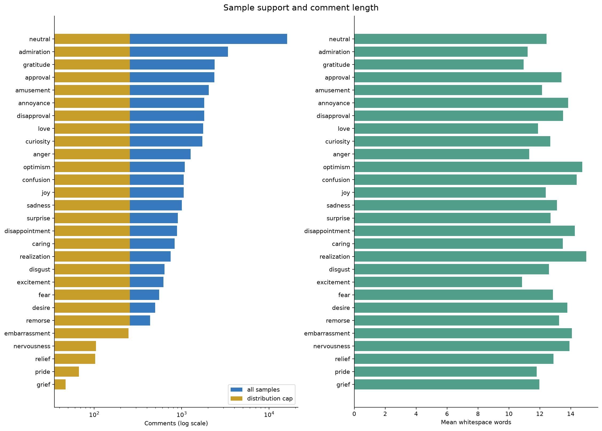

*All retained comments and the actual capped distribution sample; the first horizontal axis is logarithmic. [Plot-ready CSV](./plot_data/01_sample_support.csv); [PDF](./figures/01_sample_support.pdf).*


| Distance | Quantity used for geometry | Sample use and caution |
| --- | --- | --- |
| Cosine | 1 − cosine of exact projected class centroids | All samples; depends on the centering origin; cosine dissimilarity need not obey triangle inequality |
| Euclidean | Euclidean distance of exact projected centroids | All samples; translation invariant, sensitive to centroid norms |
| Crossnobis | Cross-validated Mahalanobis squared contrast, then √max(raw,0) | All samples; 5 folds; pooled Ledoit–Wolf precision from training-fold residuals |
| RBF-MMD | Unbiased averaged-kernel MMD², then √max(raw,0) | At most 256/class; median bandwidth with multipliers 0.5, 1, 2; negative raw estimates can be clipped |
| Energy | Unbiased two-sample energy statistic, then √max(raw,0) | Same capped sample; clipping can merge distinct nodes |
| Sliced Wasserstein | Mean W1 over 256 seeded unit directions | Same capped sample; distribution discrepancy in projected directions |

The capped sample contains **6456** rows. It gives most labels 256 examples, but only 47 for grief, 67 for pride, 103 for relief, 105 for nervousness and 246 for embarrassment. Consequently, centroid and distribution distances differ in both scientific estimand and effective sampling precision. Crossnobis fold separation protects its contrast/precision estimation, while the common neutral transformation was fitted using all splits; it does not create a wholly held-out end-to-end pipeline.

## 4. The neutral transformation is a substantial experimental choice

For class centroid `c_e`, define `g` as the equal-weight average of the **27 non-neutral** centroids. With orthonormal rows `U` fitted to covariance variation among neutral samples, the transformed vector is

`z = (h − g) − ((h − g) Uᵀ) U`.

The neutral-sample mean centers covariance estimation only; it is not an additional translation of the transformed samples. The neutral class remains a node. Euclidean pairwise distances are unaffected by subtracting `g` alone; cosine is affected. Both can change under projection.

Blocks 0 and 1 remove **28** directions each. Blocks **2–23** remove **one** direction each, but the removed variance is not constant: **99.74% at block 2**, **87.64% at block 17**, **50.26% at block 23**. Blocks 24–27 remove **2, 3, 4 and 11** directions. The rule reaches *at least* 50%, and can far exceed it when the first eigenvalue dominates. Thus “50% neutral projection” does not imply removal of exactly half the variance at every layer.


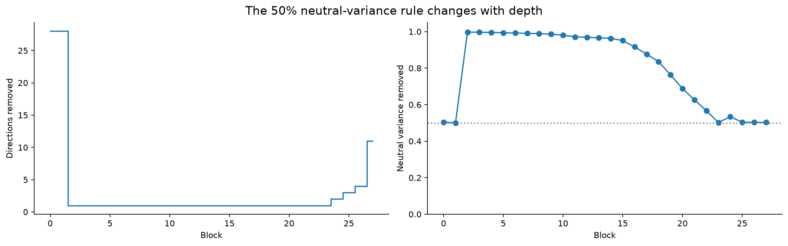

*Number of removed directions and the actual fraction of within-neutral variance removed. [Plot-ready CSV](./plot_data/02_projection.csv); [PDF](./figures/02_projection.pdf).*


Neutral covariance may contain lexical, syntactic, task, frequency and affective variation. These outputs cannot identify which component was removed. Changes near blocks 2 and 24–27 mix model-depth differences with changes in the fitted transformation. The neutral variance fraction is not the fraction of affective centroid signal removed.

## 5. Reference recovery: definitions and statistical scope

Classical MDS eigendecomposes `B = −½ J D² J`. Its axes can rotate or reflect; it minimizes a Gram-matrix criterion, not the distance stress reported below. Isomap applies the same construction to shortest-path distances. The saved cosine dissimilarity itself is squared inside MDS, a choice examined in Section 12.

Similarity Procrustes fits translation, an orthogonal transformation allowing reflection, and **one shared scale**. Joint `R² = 1 − SSE/SST` uses the sum of errors and centered target variation over all labels and axes. Axis R² uses that same fit; per-axis Pearson correlation does not measure calibration and is not axis R².

For **4,999 shared label permutations**, every fit is recomputed. V–A and VAD each have a **336-fit family** (28 layers × 6 distances × 2 methods). The report gives unadjusted randomization p, BH q within each family, and a maximum-statistic p comparing the observed score with the maximum null score across its whole family. Secondary BH correction pools all **672** V–A/VAD tests. These controls address the declared families, including peak-layer selection within them; they do not cover every exploratory choice in this report, the graph sweep, or all possible preprocessing/model variants. The smallest attainable p is **0.0002**, which is not zero.

Leave-one-emotion-out (LOO) fits alignment on 27 target labels, then predicts the omitted target. Skill is `1 − pooled squared prediction error / pooled squared error of the 27-label training-mean baseline`. This is a stricter alignment check than in-sample fit. The geometry still contains all 28 label centroids, so this is **held-out target fitting conditional on a transductive geometry**, not prediction for unseen comments or an entirely unseen emotion class. Layer selection remains exploratory.

## 6. Two-dimensional V–A recovery across depth


| distance | method | Mean R² | Median R² | Peak R² | Peak block | Block 27 R² | Mean LOO skill | LOO at peak |
| --- | --- | --- | --- | --- | --- | --- | --- | --- |
| cosine | mds | 0.4447 | 0.4571 | 0.5475 | 17 | 0.4133 | 0.3857 | 0.5231 |
| crossnobis | isomap | 0.4386 | 0.4675 | 0.5406 | 17 | 0.4645 | 0.3708 | 0.5064 |
| cosine | isomap | 0.4320 | 0.4432 | 0.5889 | 8 | 0.3492 | 0.3541 | 0.5657 |
| euclidean | isomap | 0.3625 | 0.3676 | 0.4486 | 27 | 0.4486 | 0.2394 | 0.4007 |
| crossnobis | mds | 0.3578 | 0.4163 | 0.4780 | 14 | 0.3606 | 0.2372 | 0.4100 |
| sliced_wasserstein | isomap | 0.3287 | 0.3225 | 0.4438 | 13 | 0.4332 | 0.2209 | 0.3891 |
| energy | isomap | 0.3167 | 0.3129 | 0.4917 | 10 | 0.4096 | 0.1843 | 0.4547 |
| rbf_mmd | isomap | 0.2922 | 0.3033 | 0.4917 | 10 | 0.4213 | 0.1615 | 0.4553 |
| euclidean | mds | 0.2355 | 0.2517 | 0.4146 | 27 | 0.4146 | 0.0799 | 0.3655 |
| energy | mds | 0.2258 | 0.2460 | 0.4048 | 27 | 0.4048 | 0.0912 | 0.3520 |
| sliced_wasserstein | mds | 0.2248 | 0.2295 | 0.4255 | 27 | 0.4255 | 0.0769 | 0.3810 |
| rbf_mmd | mds | 0.2067 | 0.2255 | 0.3884 | 27 | 0.3884 | 0.0478 | 0.3347 |

*Data: [report_va_ranking](./tables/report_va_ranking.csv).*


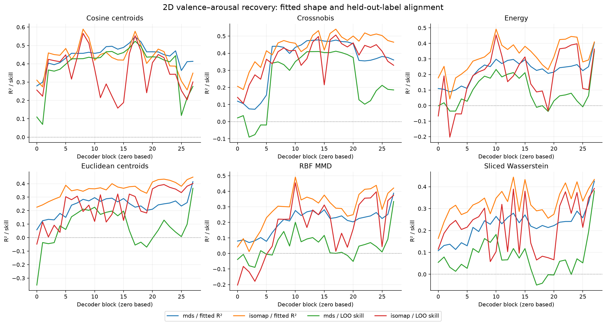

*Each line follows every block; means over layers are descriptive, not independent replications or uncertainty estimates. [Plot-ready CSV](./plot_data/03_va_recovery.csv); [PDF](./figures/03_va_recovery.pdf).*


Cosine–MDS leads in average and median fit. Crossnobis–Isomap is close in mean (**0.4386**) and has a larger median (**0.4675**) than cosine–MDS (**0.4571**). Cosine–Isomap's higher selected maximum (**0.5889**) does not give it the highest across-depth average (**0.4320**). For Euclidean, energy, MMD and sliced Wasserstein, Isomap substantially raises mean reference fit; the changes range from roughly **+0.086 to +0.127**. This says that their graph-derived shapes resemble the reference more closely, not that they preserve input geometry more faithfully.

Early/middle/late phases below are descriptive bins **0–8 / 9–18 / 19–27**, with unequal numbers of blocks. Cosine has a middle-depth advantage and late decline. Crossnobis–Isomap continues to improve on average late, and several direct MDS metrics peak at the final block. There is no distance-independent “emotion layer.”


| distance | method | early_r2 | middle_r2 | late_r2 |
| --- | --- | --- | --- | --- |
| cosine | mds | 0.3984 | 0.4921 | 0.4385 |
| crossnobis | isomap | 0.3431 | 0.4770 | 0.4914 |
| cosine | isomap | 0.4337 | 0.4717 | 0.3862 |
| euclidean | isomap | 0.3062 | 0.3695 | 0.4109 |
| crossnobis | mds | 0.2165 | 0.4592 | 0.3864 |
| sliced_wasserstein | isomap | 0.2850 | 0.3400 | 0.3598 |
| energy | isomap | 0.2205 | 0.3617 | 0.3629 |
| rbf_mmd | isomap | 0.1657 | 0.3459 | 0.3590 |
| euclidean | mds | 0.1736 | 0.2687 | 0.2604 |
| energy | mds | 0.1473 | 0.2684 | 0.2568 |
| sliced_wasserstein | mds | 0.1576 | 0.2420 | 0.2728 |
| rbf_mmd | mds | 0.1151 | 0.2505 | 0.2496 |

*Data: [report_depth_phases](./tables/report_depth_phases.csv).*


| distance | method | VA BH layers /28 | VA max-stat layers /28 | VAD BH layers /28 | VAD max-stat layers /28 |
| --- | --- | --- | --- | --- | --- |
| cosine | mds | 28 | 28 | 28 | 28 |
| crossnobis | isomap | 28 | 26 | 28 | 28 |
| cosine | isomap | 28 | 28 | 28 | 28 |
| euclidean | isomap | 28 | 28 | 28 | 28 |
| crossnobis | mds | 24 | 22 | 28 | 27 |
| sliced_wasserstein | isomap | 28 | 27 | 28 | 26 |
| energy | isomap | 27 | 24 | 28 | 26 |
| rbf_mmd | isomap | 24 | 23 | 26 | 23 |
| euclidean | mds | 27 | 20 | 28 | 24 |
| energy | mds | 23 | 18 | 27 | 22 |
| sliced_wasserstein | mds | 26 | 15 | 28 | 22 |
| rbf_mmd | mds | 22 | 16 | 26 | 22 |

*Data: [report_significance](./tables/report_significance.csv).*


Across the full 336-fit families, **313 V–A** and **331 VAD** fits pass BH q<0.05; **275** and **304**, respectively, exceed the family maximum-statistic threshold. Pooled 672-test BH retains **313 V–A** and **331 VAD** fits. The shared-null maximum-score 95th percentiles are **0.2248** (V–A) and **0.2154** (VAD). Statistical correspondence is widespread, while the effect size and axis decomposition remain essential. Randomizing labels does not measure centroid sampling uncertainty.

Full adjusted results: [va_recovery](./tables/va_recovery.csv), [vad_audit](./tables/vad_audit.csv); null maxima: [va_null_maxima](./tables/va_null_maxima.csv), [vad_null_maxima](./tables/vad_null_maxima.csv).

### Axis decomposition: valence drives the joint result

Valence and arousal have target variances **0.5459** and **0.1367**. Their shares in joint V–A SST are **0.7998** and **0.2002**. A model can therefore achieve a respectable joint fit while miscalibrating arousal. This is a property of the stated loss and native reference scale, not a claim that arousal is unimportant.


| distance | method | axis | fitted_r2 | fitted_pearson | loo_skill |
| --- | --- | --- | --- | --- | --- |
| cosine | isomap | arousal | -0.2972 | 0.2380 | -0.5870 |
| cosine | isomap | valence | 0.6146 | 0.8164 | 0.5897 |
| cosine | mds | arousal | -0.1299 | 0.3681 | -0.3394 |
| cosine | mds | valence | 0.5886 | 0.7946 | 0.5672 |
| crossnobis | isomap | arousal | -0.1902 | 0.3380 | -0.4416 |
| crossnobis | isomap | valence | 0.5960 | 0.8010 | 0.5741 |
| crossnobis | mds | arousal | -0.3035 | 0.2857 | -0.7898 |
| crossnobis | mds | valence | 0.5234 | 0.7591 | 0.4943 |
| energy | isomap | arousal | -0.2608 | 0.2374 | -0.6547 |
| energy | isomap | valence | 0.4613 | 0.7241 | 0.3943 |
| energy | mds | arousal | -0.3292 | 0.1478 | -0.8190 |
| energy | mds | valence | 0.3647 | 0.6626 | 0.3191 |
| euclidean | isomap | arousal | -0.4569 | 0.1731 | -0.9369 |
| euclidean | isomap | valence | 0.5676 | 0.8113 | 0.5339 |
| euclidean | mds | arousal | -0.3305 | 0.1532 | -0.9082 |
| euclidean | mds | valence | 0.3771 | 0.6747 | 0.3273 |
| rbf_mmd | isomap | arousal | -0.2275 | 0.2491 | -0.5675 |
| rbf_mmd | isomap | valence | 0.4223 | 0.6749 | 0.3440 |
| rbf_mmd | mds | arousal | -0.3429 | 0.1164 | -0.9337 |
| rbf_mmd | mds | valence | 0.3443 | 0.6455 | 0.2935 |
| sliced_wasserstein | isomap | arousal | -0.3327 | 0.1989 | -0.6820 |
| sliced_wasserstein | isomap | valence | 0.4943 | 0.7486 | 0.4470 |
| sliced_wasserstein | mds | arousal | -0.3597 | 0.1312 | -0.9036 |
| sliced_wasserstein | mds | valence | 0.3712 | 0.6742 | 0.3224 |

*Data: [report_va_axis_means](./tables/report_va_axis_means.csv).*


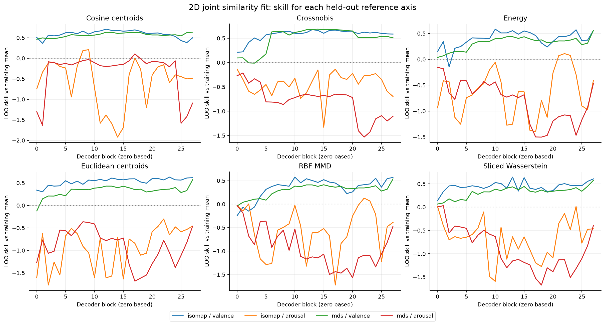

*Predicting a held-out axis worse than the training-label mean gives negative skill. [Plot-ready CSV](./plot_data/05_va_axis_skill.csv); [PDF](./figures/05_va_axis_skill.pdf).*


Every method has negative average 2D arousal skill; mean arousal skill ranges from **−0.3394** for cosine–MDS to **−0.9369** for Euclidean–Isomap. At their selected peaks, cosine–MDS block 17 has arousal fitted R² **0.1628**, Pearson r **0.5438**, and LOO skill **0.1064**; cosine–Isomap block 8 reaches **0.2388**, **0.5977**, and **0.1875**. These exceptions show that an all-layer average should not be mistaken for failure at every layer.

The secondary affine decoder fits separate linear coefficients for the targets, allowing anisotropic scaling and shear rather than preserving reference shape. Mean 2D cosine–MDS joint LOO skill rises to **0.4902**, with arousal **0.0306**; 3D cosine–Isomap arousal decoding reaches **0.1207** on average. Some arousal information may be linearly accessible without being well expressed by a 2D similarity geometry. The affine results are exploratory and conditional on the same frozen geometry; see [affine_decoding](./tables/affine_decoding.csv).

## 7. Semantic maps, neutral anchoring and rank 1/3 views

The maps below show **unaligned** embedding coordinates translated so neutral is at the origin. Red/blue/gold/gray use the independent GoEmotions positive/negative/ambiguous/neutral taxonomy. Their 5NN background is a visualization fitted to those same nodes, not an out-of-sample classifier evaluation. Panel layers maximize the evaluated V–A fit within each distance/method; the fixed-depth rank-1/3 panels avoid that layer selection.


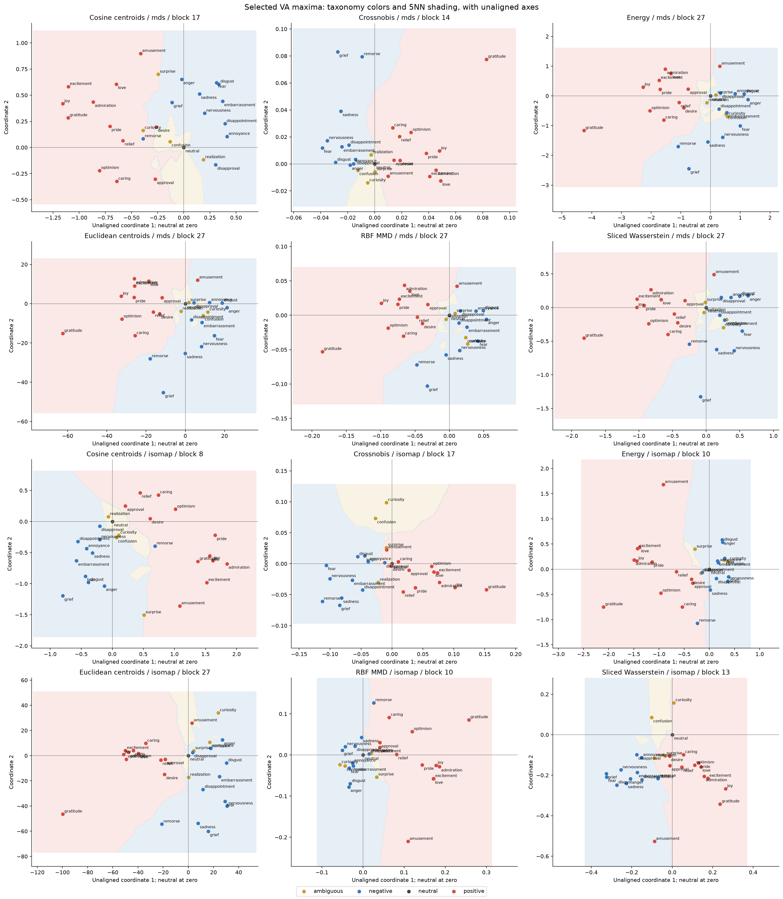

*All 28 labels appear in every panel; zoom the PDF for dense clusters. Quadrants are geometric coordinates, not named V/A states. [Plot-ready CSV](./plot_data/07_neutral_centered_maps.csv); [PDF](./figures/07_neutral_centered_maps.pdf).*


Positive and negative labels often separate along the first direction, while ambiguous labels and neutral occupy transition regions. In cosine–MDS block 17, the positive group lies mostly to the left and the negative group to the right. Cosine–Isomap block 8 reverses that sign and changes the second direction substantially. Such sign changes are arbitrary eigenvector choices. They cannot support conclusions about positive/negative arousal, nor can quadrant counts be compared across layers without an orientation convention.

Many non-cosine panels give grief, sadness and remorse a long arm, while gratitude or amusement anchor another direction. These are not identical to a clean symmetric V–A parabola: they can reflect sample support, centroid norm, distribution variation and embedding distortion. The reference-aligned panel below directly shows the mismatch rather than inferring reference axes from a raw map.


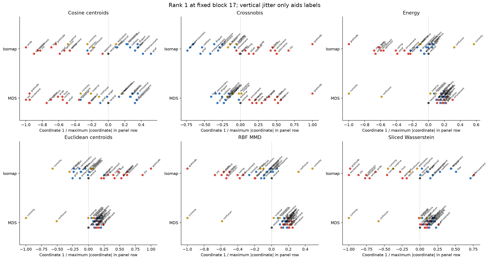

*Block 17, all six distances and both methods. Each row is normalized by its own maximum absolute coordinate; vertical position is deterministic label jitter. [Plot-ready CSV](./plot_data/08_rank1.csv); [PDF](./figures/08_rank1.pdf).*


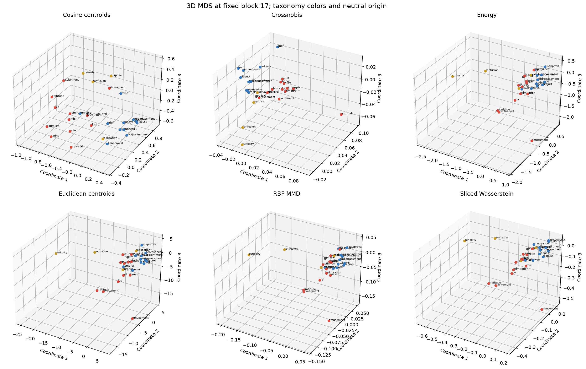

*Fixed block 17, MDS. The viewing angle and occlusion limit interpretation; all exact values are in the CSV and original gallery. [Plot-ready CSV](./plot_data/09_rank3.csv); [PDF](./figures/09_rank3.pdf).*


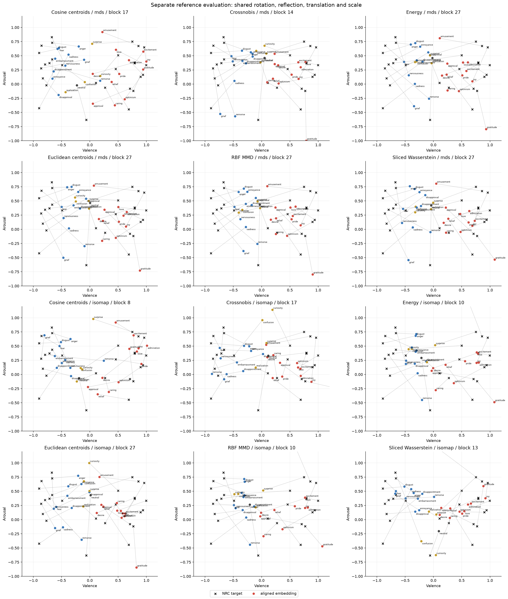

*Separate evaluation view: black crosses are NRC labels, colored points are aligned embeddings, and segments show residuals. These aligned maps are not the neutral-centered exploration coordinates. [Plot-ready CSV](./plot_data/10_aligned_reference.csv); [PDF](./figures/10_aligned_reference.pdf).*


### Quadrants in the selected cosine–MDS map

These reproduce the original block-17 counts in its unaligned orientation. All 12 positive labels are on the negative-x side; 8 of 11 negative labels are on the positive-x side. The coordinate signs are descriptive.


| quadrant | ambiguous | negative | neutral | positive |
| --- | --- | --- | --- | --- |
| I | 0 | 7 | 0 | 0 |
| II | 3 | 3 | 0 | 9 |
| III | 0 | 0 | 0 | 3 |
| IV | 1 | 1 | 0 | 0 |
| neutral | 0 | 0 | 1 | 0 |

*Data: [report_quadrants_cosine17](./tables/report_quadrants_cosine17.csv).*


### Categorical structure before embedding

A direct-RDM check restricts neighborhoods to the **12 positive and 11 negative** labels. It measures the fraction of each label's five nearest signed neighbors sharing its taxonomy sign. Under random assignment with these fixed counts, expected same-sign purity is **121/253 = 0.4783**. This is a descriptive benchmark; no independence assumption or binomial p-value is attached to the shared neighbor edges.


| distance | positive_negative_5nn_purity | between_within_ratio |
| --- | --- | --- |
| cosine | 0.8602 | 1.4096 |
| crossnobis | 0.7755 | 1.1105 |
| energy | 0.8180 | 1.1939 |
| euclidean | 0.8183 | 1.1613 |
| rbf_mmd | 0.8199 | 1.1958 |
| sliced_wasserstein | 0.7730 | 1.1154 |

*Data: [report_taxonomy](./tables/report_taxonomy.csv).*


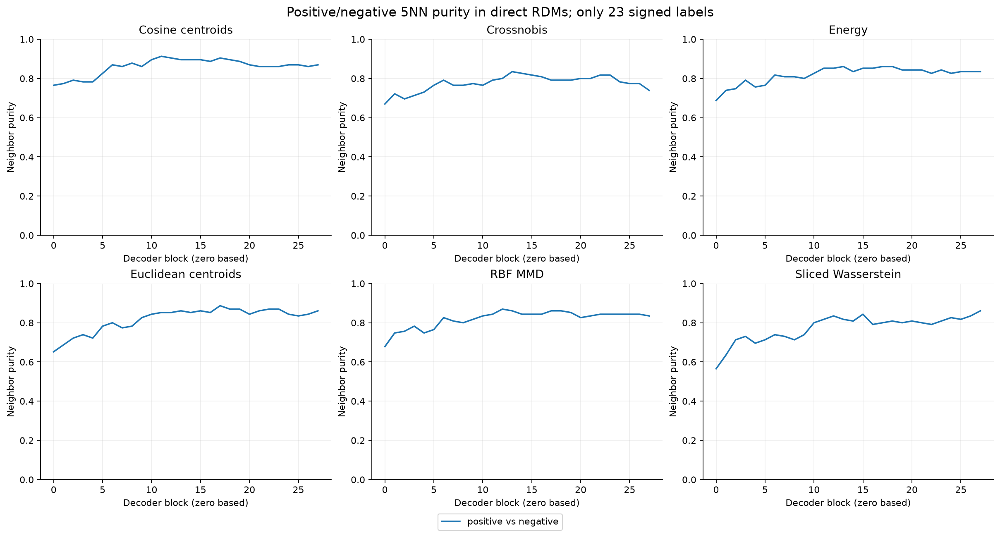

*Signed-label purity is calculated in the direct distance matrices, before any embedding or NRC alignment. [Plot-ready CSV](./plot_data/28_taxonomy.csv); [PDF](./figures/28_taxonomy.pdf).*


Cosine shows the clearest categorical organization, mean purity **0.8602** and between/within-sign distance ratio **1.4096**. Other metrics have purity about **0.773–0.820**, although crossnobis's between/within ratio is only **1.1105**. Taxonomy clustering and exact continuous reference recovery answer related but different questions. Neutral and the four ambiguous labels are excluded only from this signed-neighbor diagnostic.

### Neutral's local position

Neutral at zero is a display translation. It does not establish that neutral is the centroid, a reference midpoint, a manifold vertex or a routing hub. At block 17, its nearest neighbors in the direct RDMs are:


| distance | Nearest | Second | Third |
| --- | --- | --- | --- |
| cosine | realization | approval | disapproval |
| crossnobis | approval | realization | annoyance |
| energy | realization | desire | annoyance |
| euclidean | realization | approval | annoyance |
| rbf_mmd | realization | desire | surprise |
| sliced_wasserstein | realization | desire | annoyance |

*Data: [report_neutral_neighbors](./tables/report_neutral_neighbors.csv).*


Realization is closest for five distances; crossnobis puts approval first. The full layerwise neighbor ranks are in [neutral_neighbors](./tables/neutral_neighbors.csv). Neutral's NRC valence/arousal values are still evaluated as supplied; the target is not redefined to zero by the display anchor.


## 8. Three-dimensional VAD recovery

The 3D embedding is aligned to three native-scale reference axes with one shared scale. Its target variance shares are **62.76% valence, 15.71% arousal and 21.53% dominance**. A 3D VAD R² is not directly comparable to a 2D V–A R² as an “improvement”: both the input dimension and target loss change.


| distance | method | mean_r2 | peak_r2 | peak_layer | final_r2 | mean_loo_skill | peak_loo_skill |
| --- | --- | --- | --- | --- | --- | --- | --- |
| cosine | isomap | 0.4092 | 0.5019 | 12 | 0.3337 | 0.2719 | 0.4415 |
| cosine | mds | 0.3845 | 0.4370 | 17 | 0.3583 | 0.2475 | 0.3822 |
| crossnobis | isomap | 0.3745 | 0.4429 | 13 | 0.4000 | 0.2649 | 0.3342 |
| euclidean | isomap | 0.3615 | 0.4155 | 13 | 0.3742 | 0.2376 | 0.2764 |
| energy | isomap | 0.3345 | 0.4315 | 13 | 0.3408 | 0.2334 | 0.3646 |
| sliced_wasserstein | isomap | 0.3291 | 0.4480 | 15 | 0.4134 | 0.2280 | 0.3797 |
| crossnobis | mds | 0.3203 | 0.3649 | 19 | 0.3188 | 0.2072 | 0.2829 |
| rbf_mmd | isomap | 0.3120 | 0.4303 | 10 | 0.3563 | 0.2146 | 0.3629 |
| euclidean | mds | 0.2738 | 0.3400 | 26 | 0.3222 | 0.1792 | 0.2738 |
| energy | mds | 0.2659 | 0.3402 | 26 | 0.3233 | 0.1738 | 0.2749 |
| sliced_wasserstein | mds | 0.2594 | 0.3582 | 26 | 0.3549 | 0.1594 | 0.2953 |
| rbf_mmd | mds | 0.2573 | 0.3376 | 26 | 0.3232 | 0.1624 | 0.2712 |

*Data: [report_vad_ranking](./tables/report_vad_ranking.csv).*


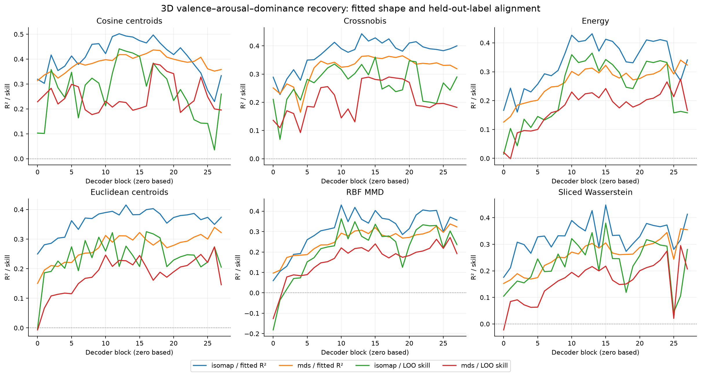

*VAD has its own 336-fit permutation family; fitted R² and LOO skill evaluate different quantities. [Plot-ready CSV](./plot_data/04_vad_recovery.csv); [PDF](./figures/04_vad_recovery.pdf).*


Cosine–Isomap leads mean VAD fit (**0.4092**) and has the best VAD maximum (**0.5019 at block 12**). Cosine–MDS leads the direct MDS methods (**0.3845**, peak **0.4370 at block 17**). In the full VAD fit, adding a third coordinate does not make every affective axis recover equally well.


| distance | method | axis | fitted_r2 | fitted_pearson | loo_skill |
| --- | --- | --- | --- | --- | --- |
| cosine | isomap | arousal | 0.1948 | 0.5055 | 0.0049 |
| cosine | isomap | dominance | 0.0472 | 0.4227 | -0.2823 |
| cosine | isomap | valence | 0.5872 | 0.8108 | 0.5289 |
| cosine | mds | arousal | 0.1216 | 0.4730 | -0.0901 |
| cosine | mds | dominance | 0.1249 | 0.4412 | -0.2621 |
| cosine | mds | valence | 0.5394 | 0.7731 | 0.5069 |
| crossnobis | isomap | arousal | -0.0332 | 0.3892 | -0.2487 |
| crossnobis | isomap | dominance | 0.1607 | 0.4578 | -0.0698 |
| crossnobis | isomap | valence | 0.5499 | 0.7942 | 0.5084 |
| crossnobis | mds | arousal | -0.1740 | 0.3200 | -0.5253 |
| crossnobis | mds | dominance | 0.1476 | 0.4349 | -0.0245 |
| crossnobis | mds | valence | 0.5033 | 0.7960 | 0.4701 |
| energy | isomap | arousal | 0.1209 | 0.4430 | -0.0135 |
| energy | isomap | dominance | -0.0080 | 0.3831 | -0.1593 |
| energy | isomap | valence | 0.5055 | 0.7907 | 0.4300 |
| energy | mds | arousal | 0.1067 | 0.4155 | -0.0334 |
| energy | mds | dominance | 0.0430 | 0.3702 | -0.1164 |
| energy | mds | valence | 0.3823 | 0.6825 | 0.3252 |
| euclidean | isomap | arousal | 0.1054 | 0.4483 | -0.0286 |
| euclidean | isomap | dominance | -0.0046 | 0.3941 | -0.2318 |
| euclidean | isomap | valence | 0.5513 | 0.8211 | 0.4653 |
| euclidean | mds | arousal | 0.1111 | 0.4251 | -0.0493 |
| euclidean | mds | dominance | 0.0459 | 0.3782 | -0.1526 |
| euclidean | mds | valence | 0.3927 | 0.6893 | 0.3502 |
| rbf_mmd | isomap | arousal | 0.1348 | 0.4404 | 0.0259 |
| rbf_mmd | isomap | dominance | -0.0188 | 0.3650 | -0.1660 |
| rbf_mmd | isomap | valence | 0.4698 | 0.7565 | 0.3925 |
| rbf_mmd | mds | arousal | 0.1053 | 0.4083 | -0.0241 |
| rbf_mmd | mds | dominance | 0.0380 | 0.3642 | -0.1391 |
| rbf_mmd | mds | valence | 0.3706 | 0.6723 | 0.3126 |
| sliced_wasserstein | isomap | arousal | 0.1315 | 0.4389 | -0.0686 |
| sliced_wasserstein | isomap | dominance | 0.0483 | 0.3947 | -0.0847 |
| sliced_wasserstein | isomap | valence | 0.4749 | 0.7343 | 0.4096 |
| sliced_wasserstein | mds | arousal | 0.0369 | 0.3534 | -0.1728 |
| sliced_wasserstein | mds | dominance | 0.0635 | 0.3781 | -0.0870 |
| sliced_wasserstein | mds | valence | 0.3823 | 0.6773 | 0.3271 |

*Data: [report_vad_axis_means](./tables/report_vad_axis_means.csv).*


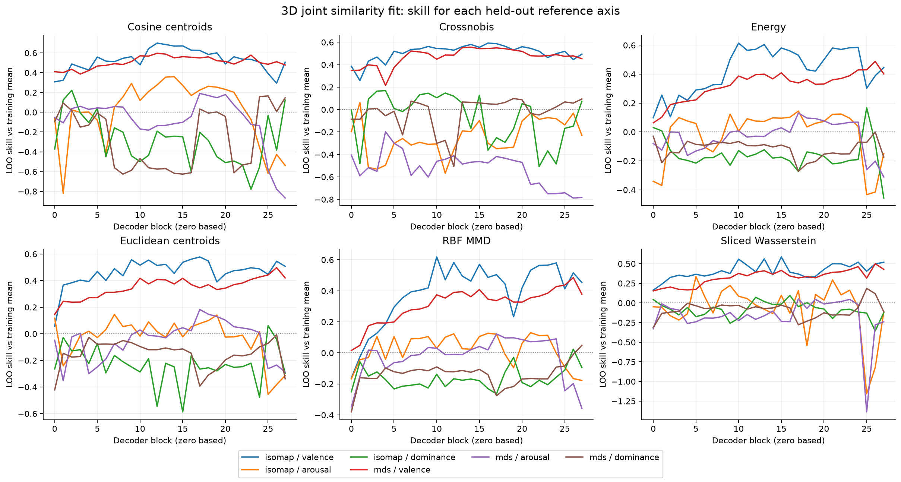

*Dominance LOO skill is negative on average for all 12 distance/method choices; arousal recovery is more variable. [Plot-ready CSV](./plot_data/06_vad_axis_skill.csv); [PDF](./figures/06_vad_axis_skill.pdf).*


| axis | fitted_r2 | fitted_pearson | loo_skill |
| --- | --- | --- | --- |
| valence | 0.7218 | 0.8827 | 0.6996 |
| arousal | 0.4103 | 0.6410 | 0.2767 |
| dominance | -0.0720 | 0.4078 | -0.1908 |

*Data: [report_peak_vad_axes](./tables/report_peak_vad_axes.csv).*


At the best VAD geometry, valence is strong, arousal is moderately recovered, and dominance remains worse than its mean baseline despite a positive fitted correlation. On average, the strongest 3D arousal LOO skills are still small: **0.026** for MMD–Isomap and **0.005** for cosine–Isomap. Dominance has negative mean LOO skill for every method. Significant *joint* VAD correspondence therefore cannot be described as independent validation of all three axes. The run does not test unique dominance information after conditioning on V–A.

## 9. How faithfully do the plots represent their input distances?

Stress is `sqrt(Σ(direct − embedded)² / Σdirect²)` over 378 unordered label pairs, without an extra rescaling. Lower is better. Shepard Spearman measures rank agreement between direct and embedded distances. Trustworthiness penalizes false embedded neighbors; continuity penalizes missing original neighbors. Both use **k=5**, independently of the graph parameter. For Isomap, these metrics below compare to the **direct RDM**, while residual variance compares to its geodesic target.


| distance | method | stress | shepard_spearman | trustworthiness | continuity |
| --- | --- | --- | --- | --- | --- |
| cosine | isomap | 0.4932 | 0.7315 | 0.8837 | 0.9333 |
| cosine | mds | 0.3373 | 0.7562 | 0.8472 | 0.8782 |
| crossnobis | isomap | 0.4038 | 0.5858 | 0.7543 | 0.8730 |
| crossnobis | mds | 0.5727 | 0.7121 | 0.8090 | 0.8756 |
| energy | isomap | 0.3482 | 0.7939 | 0.8646 | 0.9189 |
| energy | mds | 0.3909 | 0.8376 | 0.8633 | 0.9062 |
| euclidean | isomap | 0.3945 | 0.7094 | 0.8228 | 0.9043 |
| euclidean | mds | 0.4588 | 0.7781 | 0.8313 | 0.8961 |
| rbf_mmd | isomap | 0.3551 | 0.7993 | 0.8625 | 0.9207 |
| rbf_mmd | mds | 0.3926 | 0.8295 | 0.8566 | 0.9029 |
| sliced_wasserstein | isomap | 0.4595 | 0.7032 | 0.8271 | 0.9059 |
| sliced_wasserstein | mds | 0.5049 | 0.7666 | 0.8339 | 0.8988 |

*Data: [report_quality_2d](./tables/report_quality_2d.csv).*


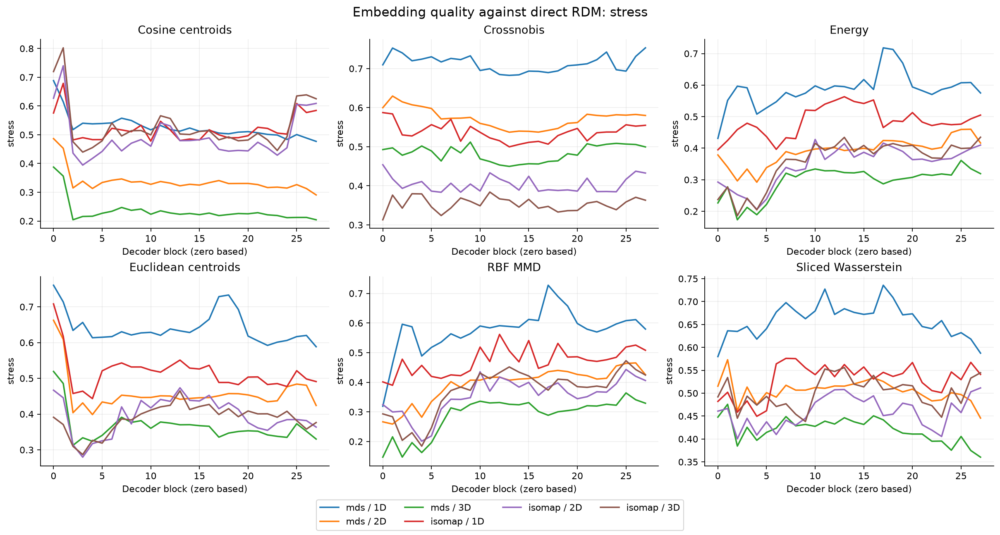

*Stress is dimensionless and normalized within each RDM; raw dissimilarity magnitudes differ across metrics. [Plot-ready CSV](./plot_data/11_stress.csv); [PDF](./figures/11_stress.pdf).*


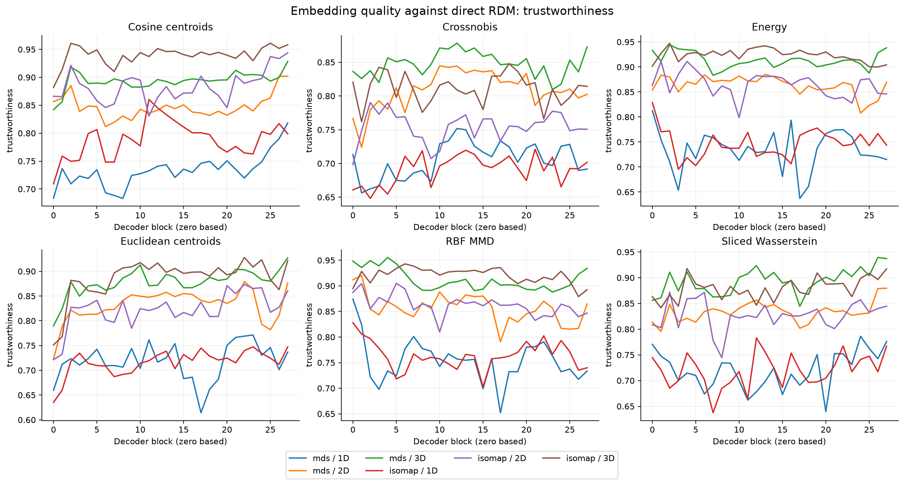

*All methods are assessed at five original/embedded neighbors. More coordinates usually help, but graph distortions can persist. [Plot-ready CSV](./plot_data/12_trustworthiness.csv); [PDF](./figures/12_trustworthiness.pdf).*


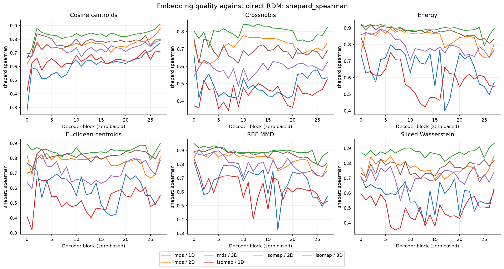

*A high rank correlation can coexist with poor absolute-distance fit. [Plot-ready CSV](./plot_data/13_shepard_spearman.csv); [PDF](./figures/13_shepard_spearman.pdf).*


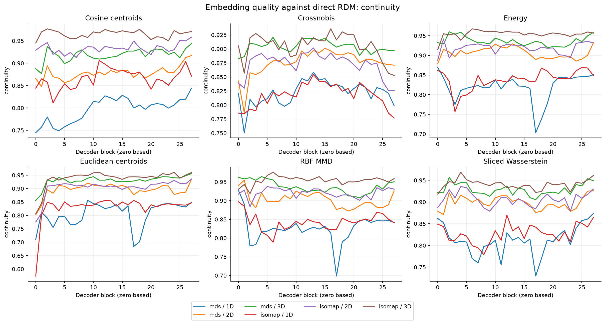

*Continuity asks whether original local relations survive the embedding. [Plot-ready CSV](./plot_data/14_continuity.csv); [PDF](./figures/14_continuity.pdf).*


Cosine–MDS has mean stress **0.3373** and trustworthiness **0.8472**. Cosine–Isomap raises trustworthiness to **0.8837** while raising stress to **0.4932**. Crossnobis–Isomap lowers stress from **0.5727 to 0.4038** but reduces trustworthiness from **0.8090 to 0.7543**. Energy/MMD show small 2D neighborhood gains, while Euclidean and sliced Wasserstein lose a little trustworthiness. A single “best embedding” score obscures these tradeoffs.

Classical MDS minimizes strain in the Gram representation; an Isomap embedding can have smaller direct-distance stress without contradicting MDS's optimization criterion. The fitted plot is also not a calibrated estimate of individual comment separability.


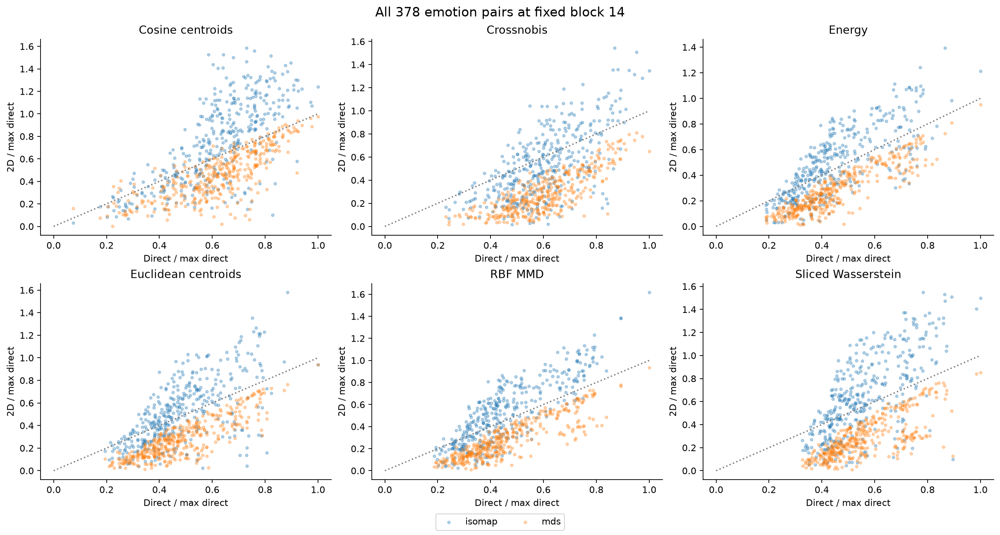

*Fixed block 14; points are all 378 label pairs, normalized by that RDM’s maximum distance. Pair observations share labels and are not independent samples. [Plot-ready CSV](./plot_data/30_shepard.csv); [PDF](./figures/30_shepard.pdf).*


## 10. Intrinsic dimensions, spectra and eigengaps

All dimensions here describe the **28-node emotion geometry**, with at most 27 centered Euclidean dimensions. They do not estimate the intrinsic dimension of 45,446 sample activations or the full 1,024-feature hidden state. Positive-mass dimensions count how many positive MDS eigenvalues reach a fraction of the total positive spectrum; the participation ratio is `(Σλ+)²/Σλ+²`. Negative spectral mass is tracked separately, rather than silently renormalized away.


| distance | mean_participation | min_participation | max_participation | min_d90 | max_d90 | mean_negative_fraction |
| --- | --- | --- | --- | --- | --- | --- |
| cosine | 5.5335 | 4.7908 | 9.9253 | 7 | 13 | 0.1275 |
| crossnobis | 12.4625 | 10.8007 | 13.2962 | 13 | 16 | 0.0005 |
| energy | 6.0914 | 3.9012 | 7.2643 | 5 | 11 | 0.0091 |
| euclidean | 7.5949 | 5.6343 | 10.4045 | 10 | 14 | 0.0000 |
| rbf_mmd | 5.9695 | 2.4181 | 7.3684 | 5 | 11 | 0.0109 |
| sliced_wasserstein | 9.7657 | 7.8456 | 11.4412 | 15 | 19 | 0.0000 |

*Data: [report_intrinsic](./tables/report_intrinsic.csv).*


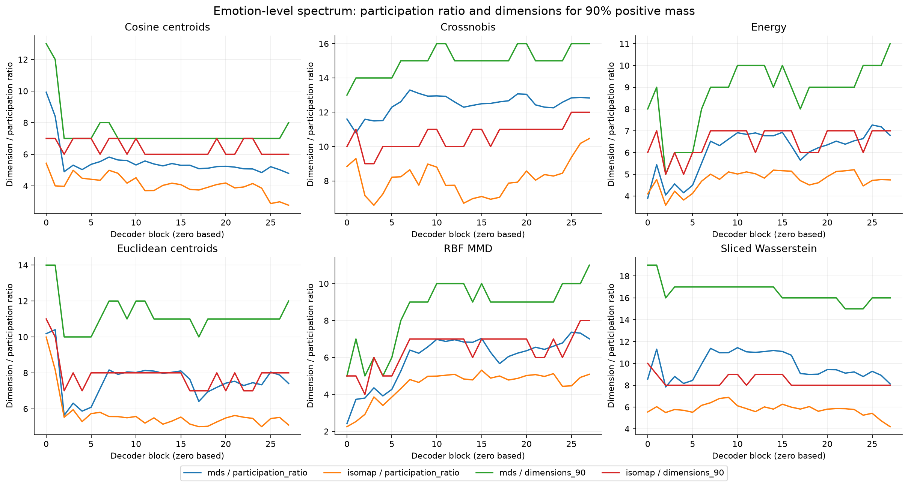

*Direct MDS and Isomap spectra describe different distance matrices. A lower Isomap participation ratio alone does not establish a truer low-dimensional manifold. [Plot-ready CSV](./plot_data/15_dimensions.csv); [PDF](./figures/15_dimensions.pdf).*


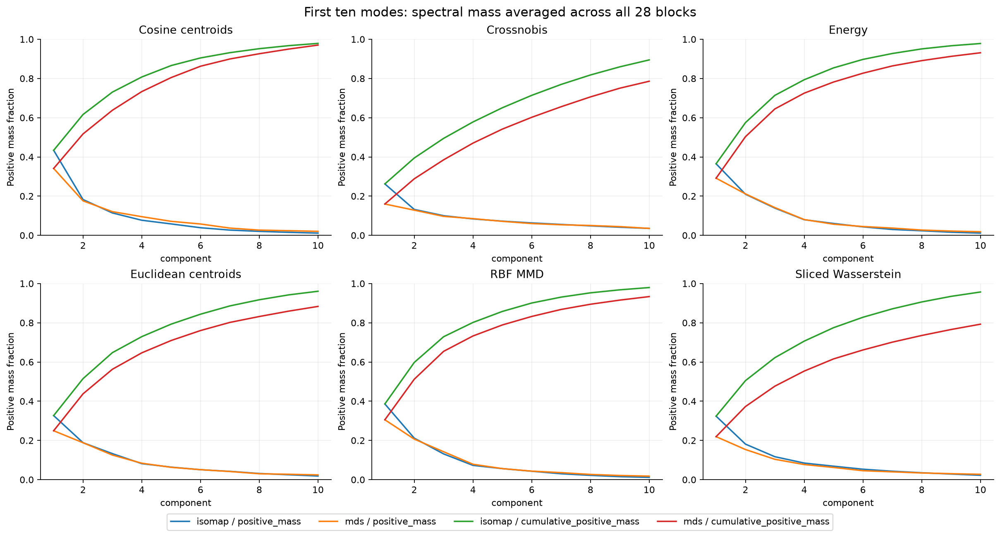

*The first ten normalized modes and cumulative mass, averaged over all blocks. Full spectra remain available for every layer and method. [Plot-ready CSV](./plot_data/16_spectrum.csv); [PDF](./figures/16_spectrum.pdf).*


The mean first-two-mode positive mass is **51.71% cosine**, **28.83% crossnobis**, **50.30% energy**, **43.75% Euclidean**, **51.19% MMD**, and **37.28% sliced Wasserstein**. Three modes raise these to approximately **63.79%, 38.51%, 64.46%, 56.28%, 65.42%, and 47.66%**, respectively. Thus even favorable visual maps leave considerable geometric structure unrepresented.

Crossnobis is the most diffuse direct spectrum (mean participation **12.46**), and sliced Wasserstein requires the most dimensions for 90% mass (**15–19**). Cosine is more concentrated but has appreciable negative spectral mass. These metric-dependent spectra support a useful low-dimensional *summary*, not a universal intrinsic rank of two or three.

### Eigengap randomization

For each direct RDM, the audit tests ratios `λ_k/λ_(k+1)` at **k=1…5**. It independently shuffles the 378 off-diagonal values, restores symmetry/zero diagonal, and recomputes MDS for **999** draws. This is an edge-value shuffle null, distinct from emotion-label permutations (which would preserve the spectrum). BH correction spans **168 × 5 = 840** gap tests. The minimum p is **0.001**. A shuffle destroys shared-label structure and can violate metric constraints; this is a benchmark for unusual spectral structure relative to that null, not a calibrated generative model of activation noise.


| distance | Gap 1: significant blocks /28 | Gap 2: significant blocks /28 | Gap 3: significant blocks /28 | Gap 4: significant blocks /28 | Gap 5: significant blocks /28 |
| --- | --- | --- | --- | --- | --- |
| cosine | 27 | 27 | 18 | 24 | 14 |
| crossnobis | 15 | 21 | 3 | 7 | 7 |
| energy | 15 | 25 | 26 | 20 | 12 |
| euclidean | 10 | 27 | 23 | 20 | 11 |
| rbf_mmd | 16 | 23 | 26 | 21 | 15 |
| sliced_wasserstein | 14 | 22 | 24 | 9 | 23 |

*Data: [report_eigengap_counts](./tables/report_eigengap_counts.csv).*


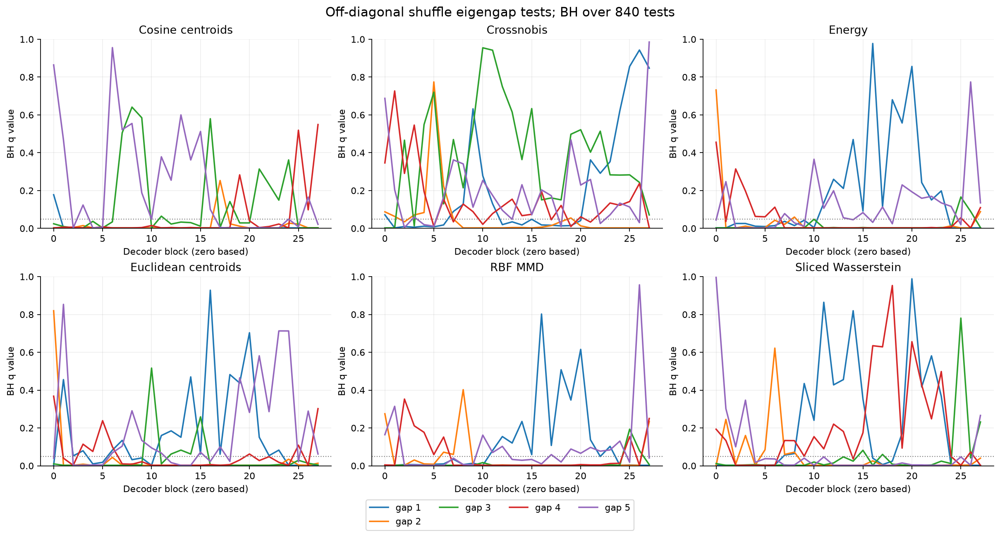

*Small q values indicate gaps large relative to the off-diagonal shuffle null. [Plot-ready CSV](./plot_data/17_eigengaps.csv); [PDF](./figures/17_eigengaps.pdf).*


Cosine has corrected first and second gaps in **27/28** blocks each, but many third, fourth and fifth gaps are also significant. Other metrics show recurring second or third gaps despite diffuse overall spectra. Multiple significant gaps across ranks, together with substantial residual mass, do not identify a unique fixed intrinsic dimension. In particular, they do not justify treating all remaining eigenmodes as noise.

## 11. Isomap, geodesics and the limits of a curvature claim

The main graph is the union of directed 5NN choices. All main graphs connect at the requested **k=5**; no connectivity expansion is needed in this run. Off-diagonal zero distances are replaced with machine epsilon as graph weights, and self nodes are explicitly excluded. The reconstructed graphs exactly match the saved geodesics. The audit sweep extends the original grid with **k=20 and 27**, while retaining 5NN quality evaluation.


| distance | Δ trust 1D | Δ trust 2D | Δ trust 3D |
| --- | --- | --- | --- |
| cosine | 0.0550 | 0.0365 | 0.0459 |
| crossnobis | -0.0145 | -0.0546 | -0.0370 |
| energy | 0.0128 | 0.0014 | 0.0100 |
| euclidean | -0.0018 | -0.0085 | 0.0079 |
| rbf_mmd | 0.0106 | 0.0059 | 0.0085 |
| sliced_wasserstein | -0.0003 | -0.0067 | -0.0139 |

*Data: [report_isomap_trust_deltas](./tables/report_isomap_trust_deltas.csv).*


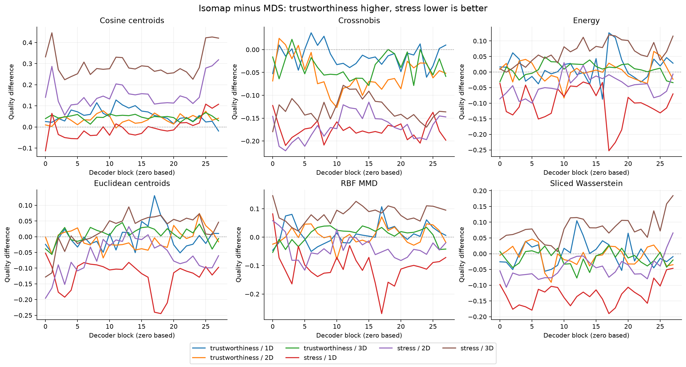

*Differences use the same direct-RDM evaluation target. Positive trustworthiness or negative stress differences favor Isomap. [Plot-ready CSV](./plot_data/18_isomap_changes.csv); [PDF](./figures/18_isomap_changes.pdf).*


The rank-1 “unrolling” gain is strongest for cosine (**+0.0550** mean trustworthiness). Energy and MMD gain about **+0.013** and **+0.011**; crossnobis loses **0.0145**. There is no uniform large rank-1 advantage across distances. In 2D, cosine gains **+0.0365**, crossnobis loses **−0.0546**, and the other changes are small. A legible rank-1 ordering is insufficient evidence for a curved one-dimensional emotion manifold.


| distance | 10th percentile | Median | 90th percentile | 95th percentile |
| --- | --- | --- | --- | --- |
| cosine | 1.0000 | 1.2799 | 1.8450 | 2.0623 |
| crossnobis | 1.0000 | 1.3815 | 1.5764 | 1.6685 |
| energy | 1.0000 | 1.2887 | 1.6644 | 1.7914 |
| euclidean | 1.0000 | 1.3559 | 1.6776 | 1.8068 |
| rbf_mmd | 1.0000 | 1.2839 | 1.6747 | 1.8083 |
| sliced_wasserstein | 1.0000 | 1.5245 | 1.8836 | 2.0552 |

*Data: [report_geodesic_quantiles](./tables/report_geodesic_quantiles.csv).*


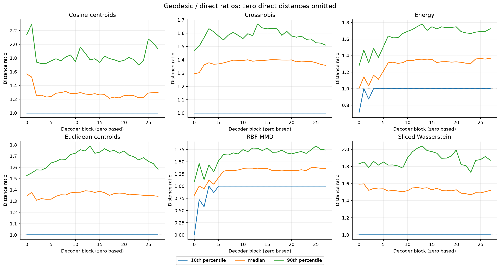

*Layerwise quantiles; the table pools equal-size label-pair sets across all blocks, omitting zero direct distances. [Plot-ready CSV](./plot_data/19_geodesic_ratios.csv); [PDF](./figures/19_geodesic_ratios.pdf).*


Median graph/direct ratios are approximately **1.28–1.52**, with pooled 90th percentiles **1.58–1.88**. These indicate substantial path inflation at this sparse graph scale. Sparse paths can inflate distances even for Euclidean data, so ratios alone do not identify manifold curvature. Cosine, energy and MMD also have paths shorter than some direct dissimilarities because their inputs can violate triangle inequality; a ratio below one is possible here. It occurs in roughly **3.90%, 2.94% and 6.59%**, respectively, of all unordered pairs before omitting zero denominators.


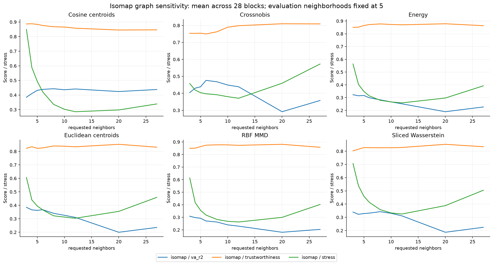

*Sweeps are diagnostic; the report does not retrospectively replace the main graph with the best-scoring setting. [Plot-ready CSV](./plot_data/22_graph_sensitivity.csv); [PDF](./figures/22_graph_sensitivity.pdf).*


Cosine's mean VA R² varies from **0.385 at k=3** to **0.443 at k=8**; trustworthiness declines as the graph becomes denser after k≈4. Crossnobis's mean VA fit peaks around **0.476 at k=6**, while its trustworthiness generally improves at larger k. Those are different selection objectives. At k=27, geodesics equal direct distances for triangle-respecting RDMs, but can still shorten nonmetric cosine/energy/MMD dissimilarities, so full-graph Isomap need not exactly equal their direct MDS.


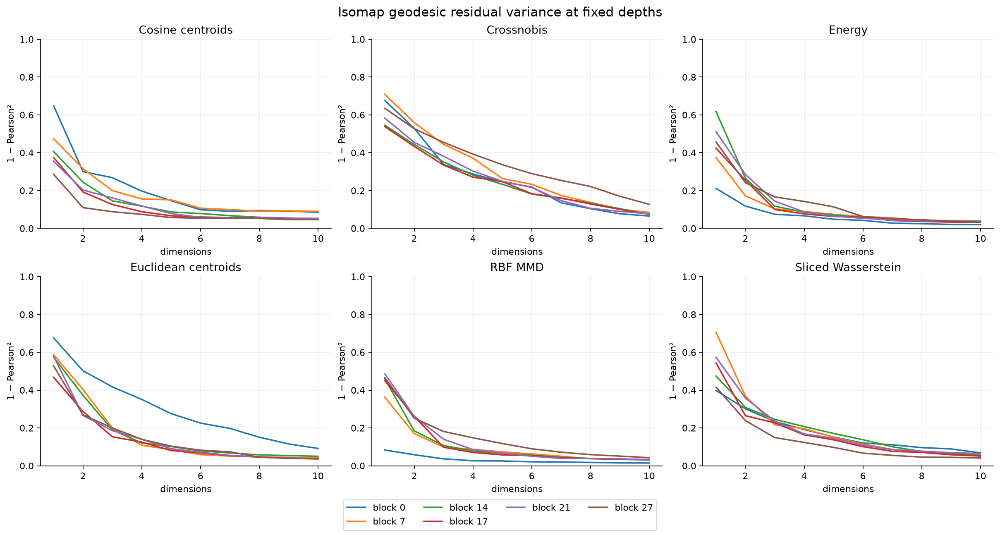

*Residual variance is 1 − Pearson² between geodesic and embedded distances; it is not a reference-alignment score. [Plot-ready CSV](./plot_data/29_isomap_residuals.csv); [PDF](./figures/29_isomap_residuals.pdf).*


The saved Isomap elbow uses the largest perpendicular departure from the endpoint line over **dimensions 1–10**, rather than a fixed residual-drop rule. Median elbows are **3** for cosine, energy, MMD and sliced Wasserstein, and **4** for crossnobis/Euclidean; individual elbows range **2–6**. A bounded-search elbow is a visualization heuristic, not a confidence interval or proof of intrinsic rank.

### An explicit check of parabolic appearance

As a limited diagnostic, the audit predicts the second unaligned coordinate from the first using a linear or quadratic polynomial, and compares leave-one-label-out squared prediction errors. First and second MDS coordinates are orthogonal by construction, so the in-sample linear fit has R²≈0; that is an algebraic fact. Quadratic predictive improvement over the linear baseline depends on orientation, outliers and the chosen first-two-mode plane.


| distance | method | quadratic_r2 | quadratic_loo_skill |
| --- | --- | --- | --- |
| cosine | isomap | 0.0815 | 0.0088 |
| cosine | mds | 0.0340 | -0.0206 |
| crossnobis | isomap | 0.1838 | -0.1061 |
| crossnobis | mds | 0.2613 | -1.7798 |
| energy | isomap | 0.0710 | -0.1739 |
| energy | mds | 0.2400 | -0.5077 |
| euclidean | isomap | 0.0684 | -0.3636 |
| euclidean | mds | 0.2018 | -5.1106 |
| rbf_mmd | isomap | 0.1028 | -0.2759 |
| rbf_mmd | mds | 0.3731 | 0.1185 |
| sliced_wasserstein | isomap | 0.1070 | 0.0239 |
| sliced_wasserstein | mds | 0.2239 | -0.2310 |

*Data: [report_curvature](./tables/report_curvature.csv).*


The quadratic fit is not broadly predictive: mean LOO improvement is negative in **9 of 12** method/distance combinations. Cosine–MDS is **−0.021**, cosine–Isomap **+0.009**, and crossnobis–MDS **−1.780**. The strongest positive average is MMD–MDS (**+0.119**). This supports describing curved-looking configurations where visible, while withholding a general parabolic-manifold claim. This fixed-axis diagnostic is not rotation invariant and has no multiplicity-adjusted causal interpretation.

## 12. Metric assumptions, clipping and cosine normalization

Raw unbiased estimates and embedding distances must be distinguished. Across all layers, energy has **6** negative raw pairs and MMD **24**; their clipped embedding distances become zero for those pairs. At worst a single MMD layer has **14/378** zero pairs, versus **4/378** for energy. Crossnobis has no negative pairs in this run. Clipping preserves a usable nonnegative input but changes geometry and creates distance ties between distinct labels. Stable alphabetical tie ordering is used for neighbor diagnostics.


| distance | total_raw_negative_pairs | max_zero_pairs_per_layer | mean_triangle_violation | max_triangle_violation |
| --- | --- | --- | --- | --- |
| cosine | 0 | 0 | 0.0099 | 0.0143 |
| crossnobis | 0 | 0 | 0.0000 | 0.0000 |
| energy | 6 | 4 | 0.0043 | 0.0580 |
| euclidean | 0 | 0 | 0.0000 | 0.0000 |
| rbf_mmd | 24 | 14 | 0.0124 | 0.1700 |
| sliced_wasserstein | 0 | 0 | 0.0000 | 0.0000 |

*Data: [report_metric_audit](./tables/report_metric_audit.csv).*


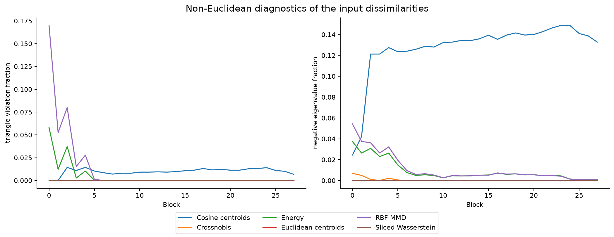

*Triangle violations are the fraction of 3,276 unordered label triples violating the triangle inequality; spectral fraction uses absolute eigenvalue mass. [Plot-ready CSV](./plot_data/25_metric_assumptions.csv); [PDF](./figures/25_metric_assumptions.pdf).*


Direct Euclidean is positive semidefinite up to rounding, as expected. Cosine has mean negative eigenvalue fraction **12.75%**; Isomap cosine raises it to **21.29%**. Main Isomap spectra have roughly **14–21%** mean negative mass across distances. The positive-mode coordinates therefore approximate matrices that are not globally Euclidean. Sliced Wasserstein has essentially no negative spectral mass in this finite dataset, without implying that every possible W1 geometry is Euclidean.

For a controlled cosine check, replace dissimilarity `d=1−cos` with unit-sphere chord distance `sqrt(2d)` on the **same normalized projected centroids**. This is Euclidean in the original normalized-vector space. It preserves pair rankings but changes metric geometry, the MDS spectrum and path sums.


| transform | method | va_r2 | negative_eigenvalue_fraction | trustworthiness | stress |
| --- | --- | --- | --- | --- | --- |
| cosine dissimilarity | isomap | 0.4320 | 0.2129 | 0.8837 | 0.4932 |
| cosine dissimilarity | mds | 0.4447 | 0.1275 | 0.8472 | 0.3373 |
| unit-sphere chord | isomap | 0.4411 | 0.2243 | 0.8791 | 0.8173 |
| unit-sphere chord | mds | 0.4325 | 0.0000 | 0.8472 | 0.4710 |

*Data: [report_cosine_chord](./tables/report_cosine_chord.csv).*


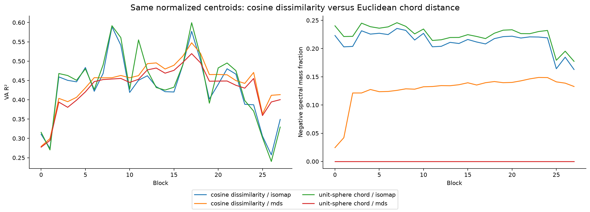

*Chord and cosine use identical normalized centroids; stress is measured against each transform’s own input matrix. [Plot-ready CSV](./plot_data/26_cosine_chord.csv); [PDF](./figures/26_cosine_chord.pdf).*


Chord–MDS eliminates negative spectral mass and changes mean VA R² from **0.4447 to 0.4325**, a modest drop of **0.0122**. Thus the broad reference correspondence survives a principled Euclidean distance transformation. This sensitivity check does not imply that the arbitrary cosine origin is irrelevant: normalizing the neutral-centered projected centroids is itself a substantive representation choice. Isomap on chord distances still has substantial negative mass, as graph shortest-path geometry need not be Euclidean.

## 13. Agreement across distances and emotion-specific neighborhoods


| distance_i | distance_j | spearman | knn_overlap | procrustes_r2 |
| --- | --- | --- | --- | --- |
| cosine | crossnobis | 0.4219 | 0.5520 | 0.3271 |
| cosine | energy | 0.5765 | 0.6589 | 0.5998 |
| cosine | euclidean | 0.5623 | 0.6990 | 0.6091 |
| cosine | rbf_mmd | 0.5706 | 0.6523 | 0.5740 |
| cosine | sliced_wasserstein | 0.5094 | 0.6156 | 0.5645 |
| crossnobis | energy | 0.7062 | 0.6168 | 0.3192 |
| crossnobis | euclidean | 0.7983 | 0.7031 | 0.3673 |
| crossnobis | rbf_mmd | 0.6819 | 0.5997 | 0.3168 |
| crossnobis | sliced_wasserstein | 0.7515 | 0.6020 | 0.3457 |
| energy | euclidean | 0.9151 | 0.7541 | 0.9341 |
| energy | rbf_mmd | 0.9955 | 0.9431 | 0.9904 |
| energy | sliced_wasserstein | 0.9014 | 0.7847 | 0.9349 |
| euclidean | rbf_mmd | 0.8979 | 0.7342 | 0.9135 |
| euclidean | sliced_wasserstein | 0.9530 | 0.7584 | 0.9133 |
| rbf_mmd | sliced_wasserstein | 0.8898 | 0.7694 | 0.9299 |

*Data: [report_distance_agreement](./tables/report_distance_agreement.csv).*


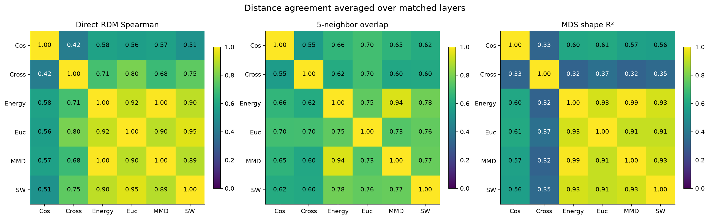

*Means of matched-layer agreement; RDM correlations, neighborhood overlap and MDS shape similarity measure distinct forms of agreement. [Plot-ready CSV](./plot_data/20_distance_agreement.csv); [PDF](./figures/20_distance_agreement.pdf).*


Energy and MMD are almost duplicates at the RDM level (**ρ=0.9955**), in 5NN overlap (**0.9431**) and in 2D MDS shape (**R²=0.9904**). Euclidean and sliced Wasserstein also agree strongly (**ρ=0.9530**). By contrast, cosine versus crossnobis has **ρ=0.4219**, neighborhood overlap **0.5520**, and MDS shape R² **0.3271**. Crossnobis can agree reasonably with Euclidean distances (**ρ≈0.798**) while producing a very different two-dimensional projection (**R²≈0.367**). Truncation can conceal the shared higher-dimensional structure.


### Agreement beyond two dimensions

The source also retains 1D and 3D shape agreement for all distance pairs. The following means span all 15 distance pairs and 28 matched layers. They are descriptive averages, not cross-validated accuracy. Energy–MMD MDS agreement remains high from 1D through 3D (0.988, 0.990, 0.996), whereas cosine–crossnobis MDS agreement is 0.541, 0.327 and 0.430. A disagreement is therefore not resolved uniformly by one extra dimension.


| dimensions | method | procrustes_r2 |
| --- | --- | --- |
| 1 | isomap | 0.6425 |
| 1 | mds | 0.5644 |
| 2 | isomap | 0.6353 |
| 2 | mds | 0.6426 |
| 3 | isomap | 0.6509 |
| 3 | mds | 0.6742 |

*Data: [report_multidimensional_agreement](./tables/report_multidimensional_agreement.csv).*


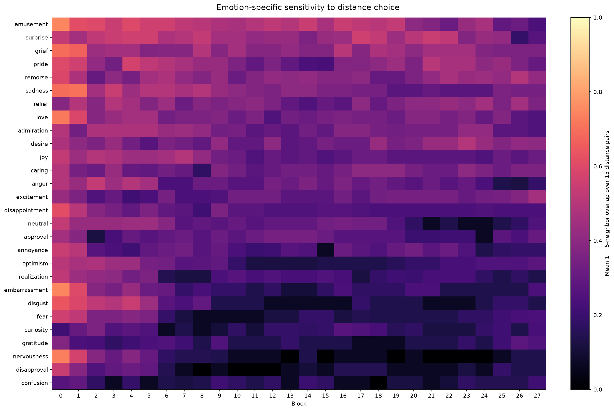

*For each label and block, mean 1−overlap over all 15 distance pairs. Larger values mean local relations depend more on the metric. [Plot-ready CSV](./plot_data/27_neighborhood_instability.csv); [PDF](./figures/27_neighborhood_instability.pdf).*


Amusement (**0.488**), surprise (**0.459**), grief (**0.434**), pride (**0.410**), remorse (**0.407**) and sadness (**0.404**) have the most distance-dependent neighbors on average. Confusion/disapproval (both about **0.141**) and nervousness (**0.151**) are much more stable. Instability is not simply rarity: amusement is well sampled, while nervousness is rare. Every label-specific change is relative to the compared distance estimands, not an observed semantic change in the model.

Selected nearest/farthest direct pairs below use each distance's **best MDS V–A block**, so the depths differ and the table is illustrative rather than a controlled same-depth comparison.


| distance | layer | kind | emotion_i | emotion_j | value |
| --- | --- | --- | --- | --- | --- |
| crossnobis | 14 | nearest | approval | neutral | 0.0393 |
| crossnobis | 14 | farthest | gratitude | grief | 0.1703 |
| cosine | 17 | nearest | confusion | curiosity | 0.0836 |
| cosine | 17 | farthest | annoyance | joy | 1.6704 |
| energy | 27 | nearest | anger | annoyance | 1.0750 |
| energy | 27 | farthest | anger | gratitude | 5.9425 |
| euclidean | 27 | nearest | approval | neutral | 17.8239 |
| euclidean | 27 | farthest | anger | gratitude | 91.3094 |
| rbf_mmd | 27 | nearest | neutral | realization | 0.0483 |
| rbf_mmd | 27 | farthest | anger | gratitude | 0.2582 |
| sliced_wasserstein | 27 | nearest | anger | annoyance | 0.7990 |
| sliced_wasserstein | 27 | farthest | anger | gratitude | 2.7244 |

*Data: [report_selected_pair_extremes](./tables/report_selected_pair_extremes.csv).*


Cosine's closest pair is confusion–curiosity and farthest is annoyance–joy at block 17. Four final-block metrics put anger–gratitude farthest; crossnobis instead emphasizes gratitude–grief at block 14. The differences are scientifically meaningful: angular centroid structure, norm/distribution structure and whitened contrasts are not interchangeable measures of emotion separation. Full top-five lists are in [selected_pairs](./tables/selected_pairs.csv).

## 14. Cross-layer persistence and transitions


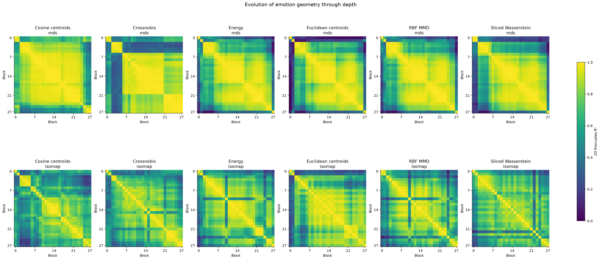

*Matched-label Procrustes R² between 2D embeddings, with each matrix aligned independently. Diagonals are one. [Plot-ready CSV](./plot_data/21_cross_layer.csv); [PDF](./figures/21_cross_layer.pdf).*


| distance | method | procrustes_r2 | rdm_spearman |
| --- | --- | --- | --- |
| cosine | isomap | 0.8507 | 0.9662 |
| cosine | mds | 0.9495 | 0.9662 |
| crossnobis | isomap | 0.8648 | 0.9877 |
| crossnobis | mds | 0.9348 | 0.9877 |
| energy | isomap | 0.8854 | 0.9788 |
| energy | mds | 0.9206 | 0.9788 |
| euclidean | isomap | 0.8973 | 0.9742 |
| euclidean | mds | 0.8963 | 0.9742 |
| rbf_mmd | isomap | 0.8707 | 0.9790 |
| rbf_mmd | mds | 0.9298 | 0.9790 |
| sliced_wasserstein | isomap | 0.8246 | 0.9781 |
| sliced_wasserstein | mds | 0.9323 | 0.9781 |

*Data: [report_adjacent_layer_similarity](./tables/report_adjacent_layer_similarity.csv).*


Adjacent direct RDM ranks are highly persistent: mean Spearman is approximately **0.966–0.988**. Neighboring 2D MDS shapes are also stable (**0.896–0.949**), while Isomap is less stable (**0.825–0.897**). For cosine, adjacent MDS shape R² is **0.949** versus **0.851** for Isomap. Small changes in sparse graph edges can have large effects on shortest paths and low-rank eigenvectors.

Heatmaps show broad middle-depth blocks of shared structure with early/final departures. They also explain why layers should not be treated as 28 independent experiments or bootstrapped as independent observations. The sudden final-block improvement for several direct MDS metrics occurs alongside changing neutral subspace dimension, so an attribution entirely to newly emerging affective computation would be premature.

## 15. Correspondence before embedding and nuisance controls

Representational similarity analysis (RSA) correlates the 378 direct pair distances with reference distances for **valence**, **arousal**, or **joint V–A**. Its one-sided randomization test permutes emotion labels jointly on matrix rows/columns; it does not treat shared-label pairs as independent observations. BH spans **504** raw RSA tests (168 RDMs × 3 targets).

The partial rank correlation residualizes rank-transformed pair values against differences in log class count, summed log class count, and differences in mean word count. Single-axis analyses also control for the other axis's reference distance. These are exploratory nuisance controls; p-values/q-values belong to the **raw RSA**, not to the partial correlations. Controls cannot remove all lexical, corpus or sample-estimation effects.


| distance | reference_axis | spearman | partial_spearman |
| --- | --- | --- | --- |
| cosine | arousal | 0.0028 | 0.0589 |
| cosine | joint | 0.4655 | 0.4822 |
| cosine | valence | 0.4804 | 0.4857 |
| crossnobis | arousal | -0.1440 | -0.1180 |
| crossnobis | joint | 0.1595 | 0.1739 |
| crossnobis | valence | 0.1898 | 0.1935 |
| energy | arousal | -0.1081 | -0.1095 |
| energy | joint | 0.1819 | 0.1833 |
| energy | valence | 0.2292 | 0.2205 |
| euclidean | arousal | -0.1060 | -0.0891 |
| euclidean | joint | 0.1569 | 0.1637 |
| euclidean | valence | 0.1950 | 0.1898 |
| rbf_mmd | arousal | -0.1111 | -0.1146 |
| rbf_mmd | joint | 0.1752 | 0.1765 |
| rbf_mmd | valence | 0.2272 | 0.2186 |
| sliced_wasserstein | arousal | -0.0876 | -0.0801 |
| sliced_wasserstein | joint | 0.1498 | 0.1552 |
| sliced_wasserstein | valence | 0.1843 | 0.1825 |

*Data: [report_rsa_means](./tables/report_rsa_means.csv).*


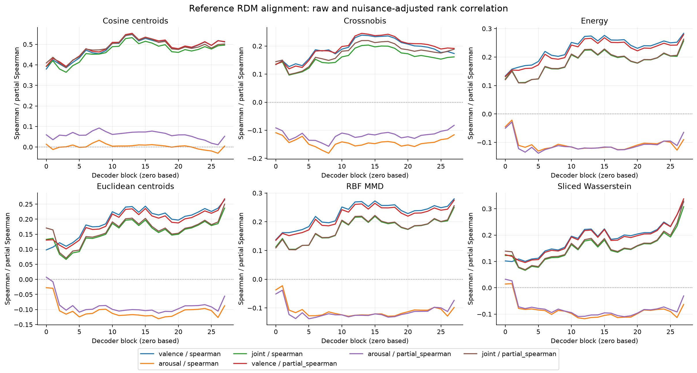

*Partial correlations are descriptive; raw label-permutation tests are supplied separately in the source table. [Plot-ready CSV](./plot_data/23_reference_rsa.csv); [PDF](./figures/23_reference_rsa.pdf).*


Cosine shows the strongest direct joint reference agreement: mean **ρ=0.466**, increasing to **0.482** after the stated nuisance controls. Valence is similarly positive (**0.480 raw, 0.486 partial**). For the other distances, mean joint RSA is about **0.150–0.182**, while arousal RSA is negative on average; cosine arousal is near zero (**0.003 raw**, **0.059 partial**). The weak arousal results are therefore visible before dimensionality reduction and are not solely a failure of the Procrustes fitting procedure.

## 16. Sample balance, exact-text splits and uncertainty

Two checks operate on the **saved projected activation matrices**, at blocks **0, 7, 14, 17, 21, 27**. The first five evenly span depth; block 17 is an additional selected cosine–MDS peak. They do not refit the neutral covariance or grand-centroid origin. The projection is fixed using all splits, so these checks condition on a transductive transformation.

For each block, 200 draws retain exactly **47 comments per emotion** without replacement within each draw. This deliberately discards much of the support for common labels and retains all grief examples. The 2.5–97.5% ranges below summarize these **balanced subsampling draws**. They are not confidence intervals for the full-data score and are not a bootstrap of all labels or transformation uncertainty.


| distance | layer | 2.5% draw | Median draw | 97.5% draw | va_procrustes_r2 |
| --- | --- | --- | --- | --- | --- |
| cosine | 0 | 0.0269 | 0.1423 | 0.2909 | 0.2793 |
| cosine | 7 | 0.2275 | 0.3526 | 0.4716 | 0.4568 |
| cosine | 14 | 0.2674 | 0.3721 | 0.5094 | 0.4796 |
| cosine | 17 | 0.2858 | 0.3819 | 0.5096 | 0.5475 |
| cosine | 21 | 0.2620 | 0.3549 | 0.4757 | 0.4647 |
| cosine | 27 | 0.3564 | 0.4181 | 0.4962 | 0.4133 |
| euclidean | 0 | 0.0198 | 0.0999 | 0.2386 | 0.0582 |
| euclidean | 7 | 0.1233 | 0.2194 | 0.3346 | 0.2574 |
| euclidean | 14 | 0.1528 | 0.2372 | 0.3550 | 0.2652 |
| euclidean | 17 | 0.1109 | 0.1970 | 0.2741 | 0.2259 |
| euclidean | 21 | 0.1537 | 0.2271 | 0.3404 | 0.2428 |
| euclidean | 27 | 0.2961 | 0.3923 | 0.4555 | 0.4146 |

*Data: [report_balanced_sampling](./tables/report_balanced_sampling.csv).*


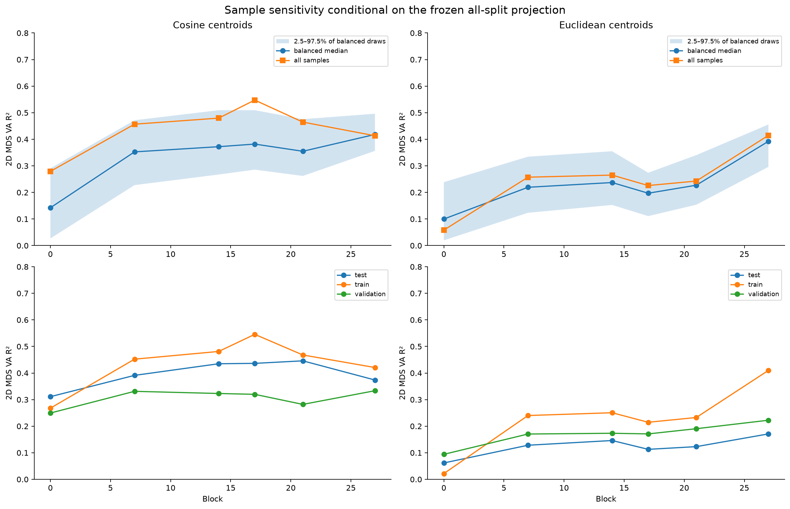

*Top: balanced-draw intervals. Bottom: exact-text-disjoint split centroids. Both condition on the same frozen all-split neutral projection. [Plot-ready CSV](./plot_data/24_sample_sensitivity.csv); [PDF](./figures/24_sample_sensitivity.pdf).*


Cosine block 17 drops from **0.5475** to balanced median **0.3819**, with a draw range **0.2858–0.5096**. The final block is more resilient: all-data **0.4133**, balanced median **0.4181** and range **0.3564–0.4962**. This change in the relative depth profile suggests that the chosen full-data peak partly depends on the amount of support available to each centroid. It does not imply that sample size caused every difference, nor that balanced 47-example centroids are intrinsically better estimators.

The second check globally deduplicates exact text, retaining the first occurrence, then computes separate train/validation/test centroids from frozen transformed vectors. Counts become **36,151 / 4,510 / 4,552**. The smallest classes have only **39 / 6 / 2** comments respectively, so held-out split centroids can be very noisy. These splits are disjoint in exact text, but not guaranteed independent in topic or near-duplicate content. The alignment to NRC is refitted on all labels within each split.


| distance | layer | split | va_r2 | rdm_spearman_to_train |
| --- | --- | --- | --- | --- |
| cosine | 0 | train | 0.2678 | 1.0000 |
| euclidean | 0 | train | 0.0216 | 1.0000 |
| cosine | 0 | validation | 0.2495 | 0.5274 |
| euclidean | 0 | validation | 0.0941 | 0.8329 |
| cosine | 0 | test | 0.3111 | 0.5833 |
| euclidean | 0 | test | 0.0616 | 0.8251 |
| cosine | 7 | train | 0.4522 | 1.0000 |
| euclidean | 7 | train | 0.2401 | 1.0000 |
| cosine | 7 | validation | 0.3312 | 0.7616 |
| euclidean | 7 | validation | 0.1705 | 0.6982 |
| cosine | 7 | test | 0.3912 | 0.8311 |
| euclidean | 7 | test | 0.1283 | 0.7397 |
| cosine | 14 | train | 0.4812 | 1.0000 |
| euclidean | 14 | train | 0.2506 | 1.0000 |
| cosine | 14 | validation | 0.3230 | 0.7879 |
| euclidean | 14 | validation | 0.1733 | 0.6799 |
| cosine | 14 | test | 0.4349 | 0.8733 |
| euclidean | 14 | test | 0.1460 | 0.6985 |
| cosine | 17 | train | 0.5456 | 1.0000 |
| euclidean | 17 | train | 0.2147 | 1.0000 |
| cosine | 17 | validation | 0.3198 | 0.7749 |
| euclidean | 17 | validation | 0.1709 | 0.6864 |
| cosine | 17 | test | 0.4364 | 0.8436 |
| euclidean | 17 | test | 0.1128 | 0.7188 |
| cosine | 21 | train | 0.4680 | 1.0000 |
| euclidean | 21 | train | 0.2326 | 1.0000 |
| cosine | 21 | validation | 0.2820 | 0.7987 |
| euclidean | 21 | validation | 0.1905 | 0.7027 |
| cosine | 21 | test | 0.4459 | 0.8447 |
| euclidean | 21 | test | 0.1230 | 0.7148 |
| cosine | 27 | train | 0.4207 | 1.0000 |
| euclidean | 27 | train | 0.4098 | 1.0000 |
| cosine | 27 | validation | 0.3335 | 0.8746 |
| euclidean | 27 | validation | 0.2224 | 0.7925 |
| cosine | 27 | test | 0.3737 | 0.8652 |
| euclidean | 27 | test | 0.1709 | 0.8019 |

*Data: [report_split_sensitivity](./tables/report_split_sensitivity.csv).*


At cosine block 17, train/validation/test fits are **0.5456 / 0.3198 / 0.4364**; at block 27, **0.4207 / 0.3335 / 0.3737**. Test cosine RDM agreement with train remains substantial (**ρ≈0.831–0.873** from blocks 7–27). Euclidean final-block fit changes more strongly (**0.4098 train, 0.2224 validation, 0.1709 test**) despite test/train distance rank correlation **0.8019**. A stable distance ordering is compatible with unstable low-rank reference recovery.

The checks support persistence of some structure beyond one pooled set of comments, while exposing sampling sensitivity. They cannot establish fully prospective generalization because centering and neutral PCA were not fitted exclusively on training data. No distribution-metric resampling, model-seed replication, reference-rating uncertainty interval, or end-to-end projection bootstrap is included.


## 17. Which labels account for reference mismatch?

The peak cosine–MDS block 17 is a useful audit example because its shape is relatively stable across neighboring blocks. The table lists all labels, ordered by fitted squared V–A error. LOO error uses a separately refitted 27-label similarity transformation for that omitted label.


| emotion | squared_error | loo_squared_error |
| --- | --- | --- |
| sadness | 1.1598 | 1.3114 |
| remorse | 1.0378 | 1.1289 |
| grief | 0.5977 | 0.6495 |
| desire | 0.5890 | 0.6341 |
| surprise | 0.5033 | 0.5643 |
| approval | 0.4985 | 0.5766 |
| amusement | 0.4634 | 0.5483 |
| neutral | 0.3988 | 0.4421 |
| love | 0.3588 | 0.4095 |
| relief | 0.3228 | 0.3586 |
| realization | 0.3145 | 0.3656 |
| nervousness | 0.3128 | 0.3526 |
| confusion | 0.2505 | 0.2730 |
| optimism | 0.2371 | 0.2881 |
| curiosity | 0.2336 | 0.2528 |
| anger | 0.2252 | 0.2534 |
| gratitude | 0.1709 | 0.2170 |
| disapproval | 0.1639 | 0.1975 |
| caring | 0.1275 | 0.1534 |
| admiration | 0.1256 | 0.1478 |
| annoyance | 0.1158 | 0.1387 |
| disgust | 0.1109 | 0.1324 |
| fear | 0.0961 | 0.1143 |
| disappointment | 0.0764 | 0.0904 |
| excitement | 0.0656 | 0.0852 |
| joy | 0.0639 | 0.0833 |
| embarrassment | 0.0166 | 0.0197 |
| pride | 0.0118 | 0.0133 |

*Data: [report_cosine17_residuals](./tables/report_cosine17_residuals.csv).*


Sadness, remorse and grief contribute **32.32%** of the fitted residual sum. Sadness has NRC arousal **−0.424** but fitted arousal **+0.5195**; remorse has target valence **−0.794** but fitted **+0.1833**. These are substantive mismatches masked by a single joint score. Conversely, pride, embarrassment and joy have small fitted error in this configuration; that does not by itself imply that their sample centroids are reliably estimated.

Refitting after removing remorse changes joint R² by **+0.0406**, and removing sadness by **+0.0339**. Removing joy decreases it by **0.0216**. Removing neutral changes **0.5475 to 0.5500**, so this particular peak is not driven by neutral alone. These influence changes also alter the target denominator and the fit, and are not additive contributions. They are diagnostics, not a rationale for excluding inconvenient labels. See [label_influence](./tables/label_influence.csv) for all V–A and VAD label deletions.

## 18. Context from the existing representation comparison

The earlier [six-representation analysis](../representation_comparison/README.md) compares raw, centered and projected centroids with cosine–MDS. It uses the same definition of LT-NeutralProjected, so it provides a useful limited transformation contrast.


| variant | mean_r2 | median_r2 | max_r2 | peak_layer |
| --- | --- | --- | --- | --- |
| LT-NeutralProjected | 0.4447 | 0.4571 | 0.5475 | 17 |
| LT-Centered | 0.4358 | 0.4601 | 0.5551 | 17 |
| LT-Raw | 0.1700 | 0.1861 | 0.2666 | 27 |

*Data: [report_previous_representations](./tables/report_previous_representations.csv).*


In that comparison, LT-Raw averages **0.1700**, LT-Centered **0.4358**, and LT-NeutralProjected **0.4447**. The large gain is associated with centering; projection adds only **0.0090** on average and loses to centering at 15 of 28 layers. At block 17, centering reaches **0.5551**, exceeding projected **0.5475**. Projection is therefore not a uniformly beneficial or isolated source of the observed correspondence.

This ancillary contrast applies to exact-centroid cosine–MDS. It should not be generalized to all six distances using a raw-run baseline with a different PCA pipeline. This run contains no matched raw/centered full-width distribution-distance ablation. Its results also do not identify a causal benefit from neutral removal.

## 19. What the evidence supports, and what remains open

The converging observations support **a stable valence-related organization of emotion-label representations**, visible in direct neighborhoods, direct reference RSA, low-rank maps, and corrected alignment tests. The evidence for faithful full V–A/VAD geometry is weaker: arousal and dominance often fail held-out axis baselines, several reference labels are poorly placed, and substantial spectral mass lies beyond the plotted dimensions.

The manifold evidence is mixed and depends on dissimilarity definition and graph choice. Sparse geodesic inflation, non-Euclidean input matrices, Isomap's negative spectra, and inconsistent rank-1 gains prevent a confident claim of a universal low-dimensional curved affective manifold. These outputs support investigating such structure rather than resolving its topology.

Material limits are:

1. **One model and extraction configuration.** No independent source-model commit, model-size comparison, model-weight replication, prompt ablation or pooling ablation is established by this run.
2. **Transductive and selected analyses.** All splits enter centering/projection and original RDM construction. LOO labels test target fitting conditional on geometry. Peak layers and ancillary graph/preprocessing checks remain exploratory.
3. **Uneven and dependent text support.** Rare centroids, repeated or related comments, capped distributions, and finite random Wasserstein directions add uncertainty that label permutation does not capture.
4. **Reference scope.** Lexical NRC label ratings are not per-comment human emotion intensities. Their calibration and upstream sampling error are not independently re-estimated. The axes have unequal variance and may share information.
5. **Finite geometry.** Twenty-eight label nodes cannot determine hidden-state topology or sample-level intrinsic dimension. MDS/Isomap are descriptive approximations with explicit distortions.
6. **Missing behavioral evidence.** No classification outcomes, calibrated confidence, misclassification boundaries, steering interventions or neural recordings are present to assess those downstream claims.

The most informative next experiments are a training-only fit of both centering and neutral PCA with evaluation on fresh comments; matched full-space raw/centered/projected ablations for every distance; resampling comments **and refitting the full transformation**; external label-level affect references and per-comment ratings; independent model/pooling replications; and preregistered layer/graph selection before behavioral testing. These are follow-up experiments, not conclusions already supplied by this analysis.

## 20. Reproduction and artifact navigation

The complete report can be rebuilt from the existing run without model inference:

```bash
PYTHONPATH=src OPENBLAS_NUM_THREADS=1 OMP_NUM_THREADS=1 \
python experiments/04_analyze_lt_neutral_projected.py
```

To redraw figures and rebuild this Markdown from the saved analysis tables:

```bash
PYTHONPATH=src python experiments/04_analyze_lt_neutral_projected.py --render-only
```

The command exposes `--run` for relocating the frozen input, `--report` for the analysis destination, `--render-only` to redraw saved tables, and `--bundle-only` to refresh this local package without rerunning computations or plotting. It reproduces the stated 4,999/999/200 audit with seed 1701. The reusable scientific function accepts other settings, but this curated narrative explicitly requires the documented run and audit settings. Report figures are rendered **only after writing and rereading their own plot-ready CSVs**. Intermediate/summary tables and plot-ready tables are separate. The report is packaged in `analyses/lt_neutral_projected/` with local `figures/`, `tables/`, `plot_data/`, `metadata/`, `source/` and `plots/` subdirectories. The original gallery data are in `plot_data/original/`. Canonical generated artifacts remain under the source run's `report/` in `outputs/`, so rebuilding the computations does not depend on relocating the original run. Structured operational progress is centralized at `logs/qwen--qwen3-0.6b__lt-neutral-projected-analysis-20261021/run.log`.

The audit independently verifies the frozen scientific scores and geodesics. Focused tests also check exact three-axis similarity recovery including held-out labels, and demonstrate why perfect axis correlation can coexist with poor shared-scale axis R². Exact analysis-library versions are saved with the report artifacts; numerical tolerances are stated in Section 1.


- [All report figures and CSV mappings](./metadata/figure_index.csv)
- [Analysis environment](./metadata/analysis_environment.json)
- [Analysis source hashes](./metadata/analysis_source_sha256.json) and [source snapshot](./source/)
- [Audit provenance, reference hash and input RDM hashes](./metadata/provenance.json)
- [Validation results](./metadata/validation.json)
- [Original self-contained exploration gallery](exploration.html)
- [Local gallery plot manifest](./metadata/plot_manifest.json)
- [Original run validation](./metadata/run/analyses/run_validation.json)
- [Complete source-artifact inventory](./tables/source_inventory.csv)

## Appendix A. Full layerwise V–A scores

Columns identify distance and embedding method. Scores are the independently recomputed fits; layers are zero based. These tables preserve the numerical context of the layerwise figures rather than displaying only favorable examples.


| layer | cosine/isomap | cosine/mds | crossnobis/isomap | crossnobis/mds | energy/isomap | energy/mds | euclidean/isomap | euclidean/mds | rbf_mmd/isomap | rbf_mmd/mds | sliced_wasserstein/isomap | sliced_wasserstein/mds |
| --- | --- | --- | --- | --- | --- | --- | --- | --- | --- | --- | --- | --- |
| 0 | 0.3107 | 0.2793 | 0.2063 | 0.1195 | 0.1784 | 0.1097 | 0.2257 | 0.0582 | 0.0425 | 0.0800 | 0.1639 | 0.1079 |
| 1 | 0.2741 | 0.2996 | 0.1876 | 0.1054 | 0.2523 | 0.1046 | 0.2429 | 0.1253 | 0.0955 | 0.0877 | 0.2389 | 0.1316 |
| 2 | 0.4592 | 0.4036 | 0.2884 | 0.0745 | 0.0427 | 0.0886 | 0.2657 | 0.1355 | 0.0124 | 0.0705 | 0.2975 | 0.1373 |
| 3 | 0.4503 | 0.3951 | 0.3501 | 0.0723 | 0.1779 | 0.1008 | 0.2849 | 0.1316 | 0.0882 | 0.0821 | 0.3154 | 0.1134 |
| 4 | 0.4465 | 0.4064 | 0.3168 | 0.1066 | 0.2023 | 0.1258 | 0.3016 | 0.1796 | 0.1464 | 0.1026 | 0.2726 | 0.1442 |
| 5 | 0.4835 | 0.4309 | 0.4144 | 0.1553 | 0.2322 | 0.1103 | 0.3882 | 0.1504 | 0.2304 | 0.0783 | 0.2836 | 0.1303 |
| 6 | 0.4220 | 0.4572 | 0.3903 | 0.4403 | 0.2861 | 0.1910 | 0.3471 | 0.2405 | 0.2695 | 0.1348 | 0.3164 | 0.2141 |
| 7 | 0.4682 | 0.4568 | 0.4598 | 0.4408 | 0.2997 | 0.2335 | 0.3558 | 0.2574 | 0.3046 | 0.1809 | 0.3282 | 0.1953 |
| 8 | 0.5889 | 0.4570 | 0.4740 | 0.4341 | 0.3128 | 0.2612 | 0.3437 | 0.2839 | 0.3020 | 0.2194 | 0.3481 | 0.2447 |
| 9 | 0.5414 | 0.4629 | 0.4638 | 0.3986 | 0.3449 | 0.2509 | 0.3636 | 0.2725 | 0.3001 | 0.2094 | 0.2765 | 0.2284 |
| 10 | 0.4190 | 0.4569 | 0.4581 | 0.4345 | 0.4917 | 0.2983 | 0.3618 | 0.2962 | 0.4917 | 0.2767 | 0.3478 | 0.2645 |
| 11 | 0.4506 | 0.4625 | 0.4092 | 0.4480 | 0.3876 | 0.2704 | 0.3693 | 0.2691 | 0.3446 | 0.2443 | 0.3786 | 0.2306 |
| 12 | 0.4621 | 0.4934 | 0.4329 | 0.4731 | 0.3608 | 0.2907 | 0.3536 | 0.2879 | 0.3629 | 0.2680 | 0.3322 | 0.2598 |
| 13 | 0.4340 | 0.4954 | 0.5046 | 0.4751 | 0.3911 | 0.2968 | 0.4001 | 0.2924 | 0.3504 | 0.2763 | 0.4438 | 0.2790 |
| 14 | 0.4210 | 0.4796 | 0.5321 | 0.4780 | 0.3375 | 0.2681 | 0.3751 | 0.2652 | 0.3247 | 0.2495 | 0.2869 | 0.2354 |
| 15 | 0.4202 | 0.4893 | 0.4182 | 0.4708 | 0.3815 | 0.2951 | 0.3658 | 0.2898 | 0.3761 | 0.2817 | 0.4326 | 0.2713 |
| 16 | 0.4899 | 0.5129 | 0.5155 | 0.4693 | 0.3499 | 0.2515 | 0.3771 | 0.2530 | 0.3274 | 0.2255 | 0.3168 | 0.2200 |
| 17 | 0.5772 | 0.5475 | 0.5406 | 0.4767 | 0.3097 | 0.2263 | 0.3807 | 0.2259 | 0.2917 | 0.2309 | 0.2897 | 0.2085 |
| 18 | 0.5016 | 0.5202 | 0.4949 | 0.4681 | 0.2627 | 0.2361 | 0.3483 | 0.2347 | 0.2894 | 0.2421 | 0.2949 | 0.2229 |
| 19 | 0.4019 | 0.4652 | 0.4746 | 0.4660 | 0.2312 | 0.2072 | 0.3289 | 0.2025 | 0.2401 | 0.2128 | 0.2561 | 0.2136 |
| 20 | 0.4400 | 0.4655 | 0.5005 | 0.4553 | 0.3130 | 0.2154 | 0.4123 | 0.2107 | 0.2500 | 0.2036 | 0.2743 | 0.2223 |
| 21 | 0.4802 | 0.4647 | 0.4706 | 0.3577 | 0.4248 | 0.2437 | 0.4300 | 0.2428 | 0.3800 | 0.2256 | 0.3659 | 0.2378 |
| 22 | 0.4664 | 0.4496 | 0.5186 | 0.3550 | 0.4273 | 0.2483 | 0.4335 | 0.2504 | 0.4132 | 0.2337 | 0.4174 | 0.2411 |
| 23 | 0.3883 | 0.4424 | 0.5039 | 0.3588 | 0.4450 | 0.2532 | 0.4251 | 0.2567 | 0.4167 | 0.2418 | 0.3447 | 0.2413 |
| 24 | 0.3870 | 0.4707 | 0.5124 | 0.3684 | 0.4402 | 0.2637 | 0.4089 | 0.2718 | 0.4387 | 0.2638 | 0.4224 | 0.2886 |
| 25 | 0.3060 | 0.3633 | 0.5032 | 0.3810 | 0.2809 | 0.2247 | 0.3807 | 0.2344 | 0.2836 | 0.2251 | 0.3340 | 0.2579 |
| 26 | 0.2573 | 0.4116 | 0.4741 | 0.3750 | 0.2938 | 0.2505 | 0.4301 | 0.2597 | 0.3876 | 0.2515 | 0.3903 | 0.3274 |
| 27 | 0.3492 | 0.4133 | 0.4645 | 0.3606 | 0.4096 | 0.4048 | 0.4486 | 0.4146 | 0.4213 | 0.3884 | 0.4332 | 0.4255 |

*Data: [report_full_va_recovery](./tables/report_full_va_recovery.csv).*


## Appendix B. Full layerwise VAD scores


| layer | cosine/isomap | cosine/mds | crossnobis/isomap | crossnobis/mds | energy/isomap | energy/mds | euclidean/isomap | euclidean/mds | rbf_mmd/isomap | rbf_mmd/mds | sliced_wasserstein/isomap | sliced_wasserstein/mds |
| --- | --- | --- | --- | --- | --- | --- | --- | --- | --- | --- | --- | --- |
| 0 | 0.3193 | 0.3135 | 0.2890 | 0.2510 | 0.1663 | 0.1257 | 0.2498 | 0.1504 | 0.0596 | 0.0966 | 0.1757 | 0.1524 |
| 1 | 0.3028 | 0.3364 | 0.2273 | 0.2305 | 0.2432 | 0.1447 | 0.2810 | 0.1955 | 0.1054 | 0.1111 | 0.2116 | 0.1661 |
| 2 | 0.4166 | 0.3509 | 0.2820 | 0.2653 | 0.1604 | 0.1844 | 0.2860 | 0.2109 | 0.1303 | 0.1733 | 0.3079 | 0.1895 |
| 3 | 0.3539 | 0.3239 | 0.3156 | 0.2538 | 0.2412 | 0.1908 | 0.3035 | 0.2077 | 0.1885 | 0.1824 | 0.2988 | 0.1738 |
| 4 | 0.3718 | 0.3427 | 0.2779 | 0.1646 | 0.2301 | 0.1972 | 0.3065 | 0.2220 | 0.1924 | 0.1843 | 0.2660 | 0.1691 |
| 5 | 0.4127 | 0.3657 | 0.3496 | 0.2607 | 0.2570 | 0.2015 | 0.3624 | 0.2209 | 0.2604 | 0.1874 | 0.3280 | 0.1746 |
| 6 | 0.3786 | 0.3847 | 0.3508 | 0.3218 | 0.2929 | 0.2320 | 0.3329 | 0.2461 | 0.2800 | 0.2161 | 0.3311 | 0.2203 |
| 7 | 0.4068 | 0.3759 | 0.3692 | 0.3461 | 0.2862 | 0.2474 | 0.3715 | 0.2528 | 0.3040 | 0.2347 | 0.2898 | 0.2324 |
| 8 | 0.4596 | 0.3824 | 0.3909 | 0.3356 | 0.3046 | 0.2498 | 0.3696 | 0.2540 | 0.3110 | 0.2353 | 0.3321 | 0.2514 |
| 9 | 0.4622 | 0.3923 | 0.4127 | 0.3420 | 0.3625 | 0.2629 | 0.3851 | 0.2709 | 0.3188 | 0.2471 | 0.3315 | 0.2494 |
| 10 | 0.4221 | 0.3977 | 0.3900 | 0.3245 | 0.4266 | 0.3011 | 0.3900 | 0.3125 | 0.4303 | 0.2924 | 0.3896 | 0.2706 |
| 11 | 0.4908 | 0.3944 | 0.3772 | 0.3267 | 0.4040 | 0.2875 | 0.3941 | 0.2898 | 0.3485 | 0.2790 | 0.3671 | 0.2636 |
| 12 | 0.5019 | 0.4182 | 0.3871 | 0.3366 | 0.4080 | 0.3095 | 0.3817 | 0.3115 | 0.4185 | 0.3031 | 0.3504 | 0.2931 |
| 13 | 0.4928 | 0.4180 | 0.4429 | 0.3628 | 0.4315 | 0.3126 | 0.4155 | 0.3110 | 0.3597 | 0.3070 | 0.4270 | 0.3033 |
| 14 | 0.4887 | 0.4032 | 0.4169 | 0.3647 | 0.3715 | 0.2961 | 0.3826 | 0.2970 | 0.3415 | 0.2901 | 0.2885 | 0.2856 |
| 15 | 0.4742 | 0.4133 | 0.4284 | 0.3574 | 0.4124 | 0.3221 | 0.3831 | 0.3225 | 0.4033 | 0.3200 | 0.4480 | 0.3053 |
| 16 | 0.4651 | 0.4225 | 0.4098 | 0.3550 | 0.4051 | 0.2899 | 0.3998 | 0.2968 | 0.3650 | 0.2830 | 0.3330 | 0.2671 |
| 17 | 0.4971 | 0.4370 | 0.4247 | 0.3630 | 0.3796 | 0.2782 | 0.4031 | 0.2799 | 0.3598 | 0.2738 | 0.3343 | 0.2610 |
| 18 | 0.4649 | 0.4347 | 0.3921 | 0.3588 | 0.3341 | 0.2951 | 0.3853 | 0.2961 | 0.3390 | 0.2905 | 0.2733 | 0.2619 |
| 19 | 0.4382 | 0.4080 | 0.3811 | 0.3649 | 0.3310 | 0.2721 | 0.3540 | 0.2709 | 0.2855 | 0.2683 | 0.3022 | 0.2631 |
| 20 | 0.4183 | 0.3999 | 0.4102 | 0.3512 | 0.3710 | 0.2763 | 0.3732 | 0.2791 | 0.3145 | 0.2714 | 0.3291 | 0.2884 |
| 21 | 0.4457 | 0.3930 | 0.4148 | 0.3351 | 0.4103 | 0.2887 | 0.3798 | 0.2892 | 0.3810 | 0.2841 | 0.3785 | 0.2972 |
| 22 | 0.4141 | 0.3874 | 0.3965 | 0.3382 | 0.4052 | 0.2923 | 0.3820 | 0.2931 | 0.4060 | 0.2886 | 0.3710 | 0.3033 |
| 23 | 0.3788 | 0.3909 | 0.3897 | 0.3358 | 0.4112 | 0.3033 | 0.3869 | 0.3069 | 0.4008 | 0.2997 | 0.3661 | 0.3196 |
| 24 | 0.3442 | 0.4078 | 0.3872 | 0.3399 | 0.4058 | 0.3290 | 0.3658 | 0.3161 | 0.4037 | 0.3274 | 0.3727 | 0.3446 |
| 25 | 0.2746 | 0.3611 | 0.3828 | 0.3308 | 0.3052 | 0.2920 | 0.3737 | 0.3002 | 0.3000 | 0.2963 | 0.2806 | 0.2435 |
| 26 | 0.2293 | 0.3520 | 0.3895 | 0.3316 | 0.2691 | 0.3402 | 0.3498 | 0.3400 | 0.3711 | 0.3376 | 0.3169 | 0.3582 |
| 27 | 0.3337 | 0.3583 | 0.4000 | 0.3188 | 0.3408 | 0.3233 | 0.3742 | 0.3222 | 0.3563 | 0.3232 | 0.4134 | 0.3549 |

*Data: [report_full_vad_audit](./tables/report_full_vad_audit.csv).*


## Appendix C. Sample counts and reference values


| emotion | sample_count | distribution_sample_count | mean_words | test | train | validation |
| --- | --- | --- | --- | --- | --- | --- |
| admiration | 3384 | 256 | 11.2184 | 348 | 2710 | 326 |
| amusement | 2046 | 256 | 12.1432 | 186 | 1652 | 208 |
| anger | 1265 | 256 | 11.3091 | 131 | 1025 | 109 |
| annoyance | 1809 | 256 | 13.8320 | 194 | 1451 | 164 |
| approval | 2367 | 256 | 13.4068 | 236 | 1873 | 258 |
| caring | 831 | 256 | 13.4862 | 86 | 649 | 96 |
| confusion | 1057 | 256 | 14.3813 | 97 | 858 | 102 |
| curiosity | 1729 | 256 | 12.6778 | 176 | 1389 | 164 |
| desire | 497 | 256 | 13.7746 | 56 | 389 | 52 |
| disappointment | 888 | 256 | 14.2601 | 88 | 709 | 91 |
| disapproval | 1809 | 256 | 13.5146 | 195 | 1402 | 212 |
| disgust | 635 | 256 | 12.5843 | 76 | 498 | 61 |
| embarrassment | 246 | 246 | 14.0691 | 23 | 203 | 20 |
| excitement | 619 | 256 | 10.8465 | 57 | 510 | 52 |
| fear | 553 | 256 | 12.8553 | 65 | 430 | 58 |
| gratitude | 2378 | 256 | 10.9474 | 260 | 1857 | 261 |
| grief | 47 | 47 | 11.9787 | 2 | 39 | 6 |
| joy | 1052 | 256 | 12.3793 | 93 | 853 | 106 |
| love | 1760 | 256 | 11.8812 | 160 | 1427 | 173 |
| nervousness | 105 | 105 | 13.9238 | 12 | 85 | 8 |
| neutral | 16021 | 256 | 12.4433 | 1606 | 12823 | 1592 |
| optimism | 1087 | 256 | 14.7470 | 107 | 861 | 119 |
| pride | 67 | 67 | 11.8060 | 7 | 51 | 9 |
| realization | 749 | 256 | 15.0093 | 89 | 586 | 74 |
| relief | 103 | 103 | 12.8932 | 7 | 88 | 8 |
| remorse | 437 | 256 | 13.2471 | 44 | 353 | 40 |
| sadness | 1003 | 256 | 13.1147 | 102 | 817 | 84 |
| surprise | 902 | 256 | 12.6962 | 87 | 720 | 95 |

*Data: [report_full_counts](./tables/report_full_counts.csv).*


| emotion | source_term | valence | arousal | dominance |
| --- | --- | --- | --- | --- |
| admiration | admiration | 0.9380 | 0.1660 | 0.4520 |
| amusement | amusement | 0.8580 | 0.6740 | 0.6060 |
| anger | anger | -0.6660 | 0.7300 | 0.3140 |
| annoyance | annoyance | -0.6660 | 0.4360 | -0.3160 |
| approval | approval | 0.7080 | -0.0800 | 0.7780 |
| caring | caring | 0.2700 | -0.0620 | 0.0000 |
| confusion | confusion | -0.4900 | 0.3340 | -0.4460 |
| curiosity | curiosity | 0.5000 | 0.5100 | -0.0740 |
| desire | desire | 0.7920 | 0.3840 | 0.2940 |
| disappointment | disappointment | -0.7700 | -0.0200 | -0.3280 |
| disapproval | disapproval | -0.8300 | 0.1020 | -0.2660 |
| disgust | disgust | -0.8960 | 0.5500 | -0.3660 |
| embarrassment | embarrassment | -0.7140 | 0.3700 | -0.5480 |
| excitement | excitement | 0.7920 | 0.3680 | 0.4620 |
| fear | fear | -0.8540 | 0.6800 | -0.4140 |
| gratitude | gratitude | 0.7700 | -0.1180 | 0.2200 |
| grief | grief | -0.8600 | 0.2800 | -0.0520 |
| joy | joy | 0.9600 | 0.6480 | 0.5880 |
| love | love | 0.9960 | 0.3340 | 0.2340 |
| nervousness | nervousness | -0.6740 | 0.8300 | -0.5180 |
| neutral | neutral | -0.0620 | -0.6320 | -0.2860 |
| optimism | optimism | 0.8980 | 0.1300 | 0.6280 |
| pride | pride | 0.4580 | 0.2680 | 0.6960 |
| realization | realization | 0.1080 | 0.0200 | 0.6720 |
| relief | relief | 0.6880 | -0.4440 | -0.0380 |
| remorse | remorse | -0.7940 | 0.3460 | -0.2460 |
| sadness | sadness | -0.8960 | -0.4240 | -0.6720 |
| surprise | surprise | 0.7500 | 0.7500 | 0.1240 |

*Data: [report_reference_values](./tables/report_reference_values.csv).*


The reference scores remain on their supplied native scale; display translation of neutral does not alter them. All scores treat labels equally regardless of sample count.

## Appendix D. Figure and source-table coverage

The report embeds all 30 new figures, with an independently reusable CSV and PDF for each. The source run contains 1,008 exploration views spanning every layer/distance/method/dimension; selected maps are embedded above and the original gallery exposes all views. The inventory includes the remaining original diagnostic plots, source matrices, embeddings, sampling records and projection checkpoints.


| Figure | Purpose | Rows | Data |
| --- | --- | --- | --- |
| 01_sample_support | Sample support and comment length | 28 | [plot_data/01_sample_support.csv](./plot_data/01_sample_support.csv) |
| 02_projection | The 50% neutral-variance rule changes with depth | 28 | [plot_data/02_projection.csv](./plot_data/02_projection.csv) |
| 03_va_recovery | 2D valence–arousal recovery: fitted shape and held-out-label alignment | 672 | [plot_data/03_va_recovery.csv](./plot_data/03_va_recovery.csv) |
| 04_vad_recovery | 3D valence–arousal–dominance recovery: fitted shape and held-out-label alignment | 672 | [plot_data/04_vad_recovery.csv](./plot_data/04_vad_recovery.csv) |
| 05_va_axis_skill | 2D joint similarity fit: skill for each held-out reference axis | 672 | [plot_data/05_va_axis_skill.csv](./plot_data/05_va_axis_skill.csv) |
| 06_vad_axis_skill | 3D joint similarity fit: skill for each held-out reference axis | 1008 | [plot_data/06_vad_axis_skill.csv](./plot_data/06_vad_axis_skill.csv) |
| 07_neutral_centered_maps | Selected VA maxima: taxonomy colors and 5NN shading, with unaligned axes | 336 | [plot_data/07_neutral_centered_maps.csv](./plot_data/07_neutral_centered_maps.csv) |
| 08_rank1 | Rank 1 at fixed block 17; vertical jitter only aids labels | 336 | [plot_data/08_rank1.csv](./plot_data/08_rank1.csv) |
| 09_rank3 | 3D MDS at fixed block 17; taxonomy colors and neutral origin | 168 | [plot_data/09_rank3.csv](./plot_data/09_rank3.csv) |
| 10_aligned_reference | Separate reference evaluation: shared rotation, reflection, translation and scale | 336 | [plot_data/10_aligned_reference.csv](./plot_data/10_aligned_reference.csv) |
| 11_stress | Embedding quality against direct RDM: stress | 1008 | [plot_data/11_stress.csv](./plot_data/11_stress.csv) |
| 12_trustworthiness | Embedding quality against direct RDM: trustworthiness | 1008 | [plot_data/12_trustworthiness.csv](./plot_data/12_trustworthiness.csv) |
| 13_shepard_spearman | Embedding quality against direct RDM: shepard_spearman | 1008 | [plot_data/13_shepard_spearman.csv](./plot_data/13_shepard_spearman.csv) |
| 14_continuity | Embedding quality against direct RDM: continuity | 1008 | [plot_data/14_continuity.csv](./plot_data/14_continuity.csv) |
| 15_dimensions | Emotion-level spectrum: participation ratio and dimensions for 90% positive mass | 672 | [plot_data/15_dimensions.csv](./plot_data/15_dimensions.csv) |
| 16_spectrum | First ten modes: spectral mass averaged across all 28 blocks | 240 | [plot_data/16_spectrum.csv](./plot_data/16_spectrum.csv) |
| 17_eigengaps | Off-diagonal shuffle eigengap tests; BH over 840 tests | 840 | [plot_data/17_eigengaps.csv](./plot_data/17_eigengaps.csv) |
| 18_isomap_changes | Isomap minus MDS: trustworthiness higher, stress lower is better | 1008 | [plot_data/18_isomap_changes.csv](./plot_data/18_isomap_changes.csv) |
| 19_geodesic_ratios | Geodesic / direct ratios: zero direct distances omitted | 504 | [plot_data/19_geodesic_ratios.csv](./plot_data/19_geodesic_ratios.csv) |
| 20_distance_agreement | Distance agreement averaged over matched layers | 15 | [plot_data/20_distance_agreement.csv](./plot_data/20_distance_agreement.csv) |
| 21_cross_layer | Evolution of emotion geometry through depth | 4536 | [plot_data/21_cross_layer.csv](./plot_data/21_cross_layer.csv) |
| 22_graph_sensitivity | Isomap graph sensitivity: mean across 28 blocks; evaluation neighborhoods fixed at 5 | 162 | [plot_data/22_graph_sensitivity.csv](./plot_data/22_graph_sensitivity.csv) |
| 23_reference_rsa | Reference RDM alignment: raw and nuisance-adjusted rank correlation | 1008 | [plot_data/23_reference_rsa.csv](./plot_data/23_reference_rsa.csv) |
| 24_sample_sensitivity | Sample sensitivity conditional on the frozen all-split projection | 72 | [plot_data/24_sample_sensitivity.csv](./plot_data/24_sample_sensitivity.csv) |
| 25_metric_assumptions | Non-Euclidean diagnostics of the input dissimilarities | 168 | [plot_data/25_metric_assumptions.csv](./plot_data/25_metric_assumptions.csv) |
| 26_cosine_chord | Same normalized centroids: cosine dissimilarity versus Euclidean chord distance | 112 | [plot_data/26_cosine_chord.csv](./plot_data/26_cosine_chord.csv) |
| 27_neighborhood_instability | Emotion-specific sensitivity to distance choice | 784 | [plot_data/27_neighborhood_instability.csv](./plot_data/27_neighborhood_instability.csv) |
| 28_taxonomy | Positive/negative 5NN purity in direct RDMs; only 23 signed labels | 168 | [plot_data/28_taxonomy.csv](./plot_data/28_taxonomy.csv) |
| 29_isomap_residuals | Isomap geodesic residual variance at fixed depths | 360 | [plot_data/29_isomap_residuals.csv](./plot_data/29_isomap_residuals.csv) |
| 30_shepard | All 378 emotion pairs at fixed block 14 | 4536 | [plot_data/30_shepard.csv](./plot_data/30_shepard.csv) |

*Data: [report_figure_coverage](./tables/report_figure_coverage.csv).*


| Source family | Analysis |
| --- | --- |
| Dataset samples/class counts/labels | Sample support, duplicate audit, exact-text split and balanced checks |
| Neutral projection checkpoints and neutral_projection.csv | Removed subspace dimensions/variance; exact-centroid reconstruction |
| All 168 raw and embedding RDMs | Finite/symmetric labels, clipping, triangles, RSA, eigengaps, pairs and agreement |
| All 1,008 coordinate configurations | 1D–3D quality; 2D V–A/3D VAD; maps and label influence |
| Full MDS/Isomap spectra and intrinsic_dimension.csv | Participation, retained mass, negative mass, threshold dimensions |
| Geodesics and Isomap neighbor sweep | Exact rebuild, path ratios, k=3…27 sensitivity, residuals |
| va_recovery.csv / va_alignment.csv | Exact score reproduction, adjusted label permutations, LOO axes/residuals |
| vad_recovery.csv / vad_alignment.csv | Exact score reproduction and fresh axis-level/LOO audit |
| rdm_agreement.csv / embedding_agreement.csv | Full matched-layer distance/rank/neighborhood and 2D shape agreement |
| neighborhood_change.csv | All labels and depth, plus instability ranking |
| cross_layer_similarity.csv | Full 2D layer-pair maps plus direct RDM correlations |
| neutral_quadrant_counts.csv | Counts reproducible from exploration coordinates; arbitrary signs prevent affective quadrant interpretation |
| Original plots / exploration.html / plot_manifest.json | All-gallery navigation; main quantitative patterns redrawn from CSVs |
| manifest / references / orchestration / upload verification | Configuration and provenance inspected; transfer status is operational context, not scientific evidence |

*Data: [report_artifact_coverage](./tables/report_artifact_coverage.csv).*
