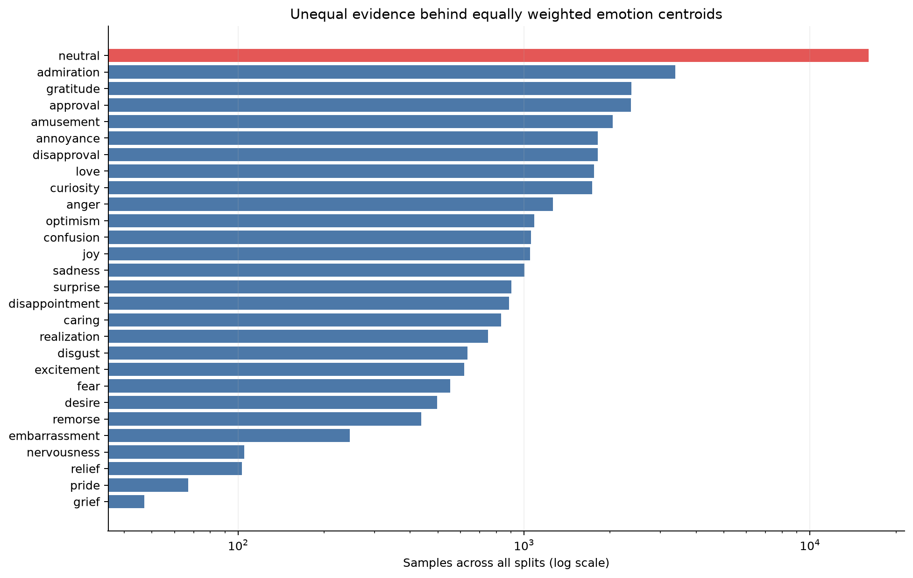
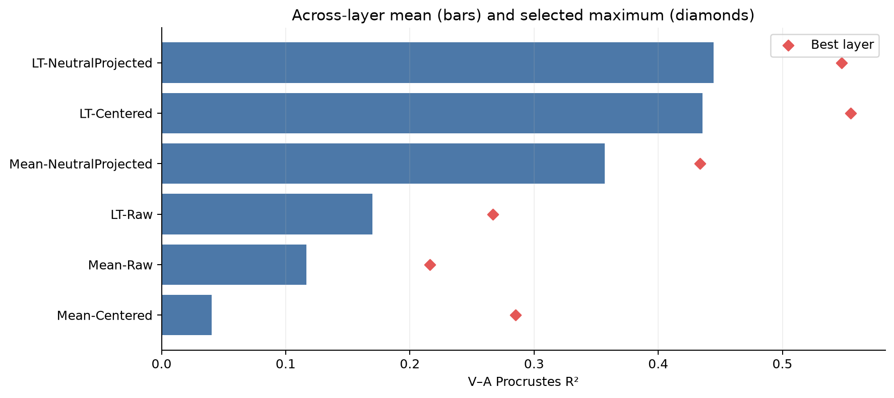
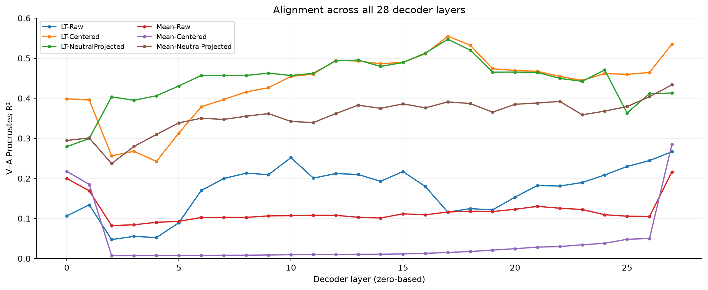
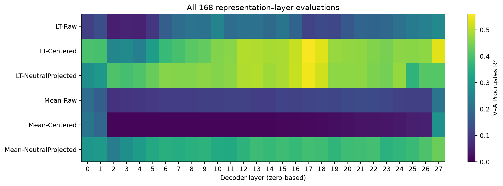
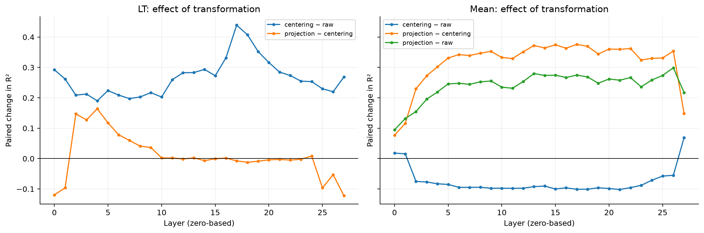
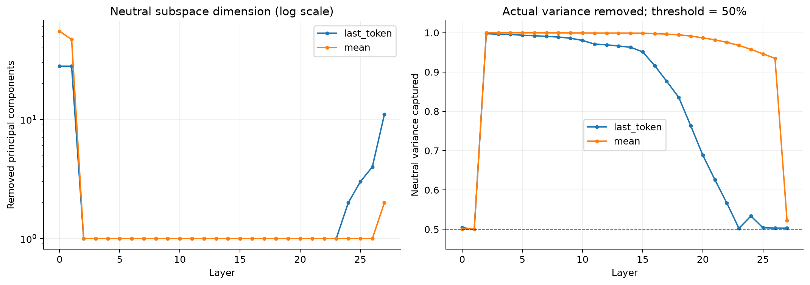
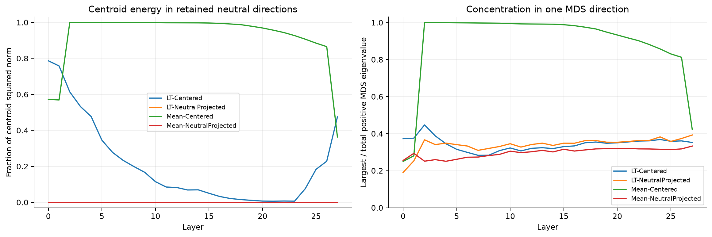
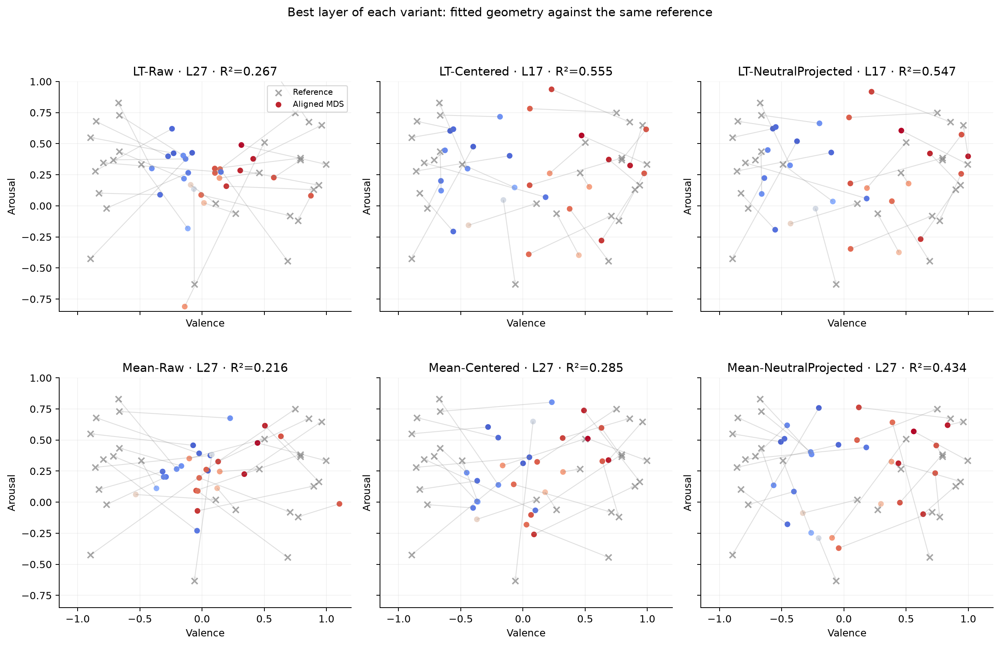
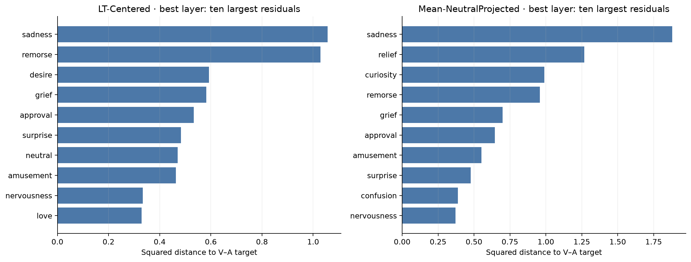

# Qwen3-0.6B: comparison of six emotion representations

## Findings

**Last-token representations provide the strongest alignment with the supplied valence–arousal reference in this experiment.** LT-NeutralProjected has the highest average score across the 28 decoder layers, **R² = 0.4447**, while LT-Centered has the highest individual score, **R² = 0.5551 at layer 17**. These are different selection criteria: the method with the highest across-layer average does not have the best peak layer.

Three findings qualify that result. First, centering helps last-token activations at every layer but harms mean-pooled activations at 25 of 28 layers. Second, projecting out a neutral-derived subspace substantially improves the mean-pooled representation: its average score rises from **0.0405 to 0.3568**. Third, the joint alignment score primarily reflects valence; arousal remains much less well recovered. At the best Mean-NeutralProjected layer, arousal-only R² is **−0.2731** under the joint similarity fit, despite a positive arousal correlation.

This is a descriptive comparison of emotion-centroid geometries, fitted and evaluated on the same 28 reference labels. It is not an estimate of held-out emotion prediction accuracy. The original last-token model commit was not recorded, so equality of model weights across the two extraction runs remains unverified.

## 1. Experimental scope and provenance

| Item | Value |
|---|---|
| Model | `Qwen/Qwen3-0.6B` |
| Decoder layers | 28, numbered **0–27** throughout this report |
| Activation width | 1,024 features per layer |
| Last-token run | `20261019T091428Z` |
| Mean-pooled run | `20261021T025934Z` |
| Mean-pooled model commit | `c1899de289a04d12100db370d81485cdf75e47ca` |
| Last-token model commit | Unknown; absent from the source metadata |
| Dataset | `google-research-datasets/go_emotions`, `simplified` configuration |
| Saved samples | 45,446, retaining exactly one emotion label per sample |
| Labels evaluated | 27 emotions plus neutral |
| Extraction maximum length | 256 tokens; longer sequences are truncated |
| Activation storage | Float16 |
| Mean extraction batch size | 32, CUDA; model computation dtype configured as `auto` |
| Comparison batch size | 2,048 for numerical aggregation, independent of extraction batch size |
| Geometry | Cosine dissimilarity; two-dimensional classical MDS |
| Neutral PCA rule | Smallest leading set reaching at least 50% cumulative neutral variance |
| Evaluation target | Repository-local `data/reference/goemotions_nrc_va.csv` |

The run IDs encode UTC timestamps. Source provenance is saved in [provenance.json](metadata/comparison_provenance.json), and the mean extraction records its pinned commit and the unverified reference revision in [activation metadata](metadata/mean_activation_metadata.json).

### Data coverage and weighting

The saved data contain **36,308 training**, **4,548 validation**, and **4,590 test** examples. All three splits are pooled when constructing the representations. Multi-label examples were excluded during dataset preparation, so these are not all examples in GoEmotions or its other configurations.

The source text, label, split, source ID, and ordering are preserved. The last-token and mean-pooled `samples.csv` files are byte-identical, with SHA-256 `c61de2d53653c6944d438230b0c61bd1132cb4bed636e5596a60cd420d081dad`.

Class sizes are very unequal: neutral has **16,021** samples, admiration **3,384**, and grief only **47**. The neutral group comprises **35.25%** of all rows. However, each emotion centroid receives one equal-weight node in the geometry and evaluation. Consequently, a centroid estimated from 47 examples contributes as much to the alignment score as one estimated from 16,021; this is a substantive uncertainty issue, not an implementation error.



*Figure 1. Counts summed across train, validation, and test. The horizontal axis is logarithmic. Neutral is highlighted. Data: [sample_counts.csv](plot_data/sample_counts.csv). Full counts by label and split appear in Appendix B.*

## 2. What the six approaches actually compute

For each layer, sample activations are averaged within each emotion, giving 28 centroids in 1,024 dimensions. Last-token extraction selects the final content token; mean pooling averages content-token activations. Padding and tokenizer-marked special tokens are excluded, with an attention-mask fallback for an example without content tokens. Activations are captured **after each decoder block**, before any separately applied final decoder normalization.

Let `c_e` denote the centroid for emotion `e`. The centering vector `g` is the equal-weight average of the **27 non-neutral centroids**. It is not the average over all samples and is not the neutral centroid. Let `U` contain the retained orthonormal neutral PCA directions, fitted separately at each layer and pooling method from the **16,021 neutral samples**, centered by their own neutral-sample mean during PCA fitting.

| Approach | Last-token variant | Mean-pooled variant | Emotion vector passed to cosine distance |
|---|---|---|---|
| Raw | LT-Raw | Mean-Raw | `c_e` |
| Centered | LT-Centered | Mean-Centered | `c_e − g` |
| Neutral-projected | LT-NeutralProjected | Mean-NeutralProjected | `(c_e − g) − ((c_e − g) Uᵀ) U` |

The neutral-projected approach therefore includes centering. Projection does not additionally subtract the neutral-sample mean; that mean is used only to fit the PCA covariance. Neutral remains one of the 28 evaluated centroids.

For each of the **6 × 28 = 168** combinations, the pipeline computes:

1. A 28-by-28 matrix of cosine dissimilarities, `d(i,j) = 1 − cosine(c_i,c_j)`.
2. Classical MDS from the double-centered matrix of **squared cosine dissimilarities**, retaining two positive eigen-directions.
3. A similarity alignment to the reference coordinates: translation, an orthogonal transformation permitting reflection, and one shared scale factor.
4. Joint `R² = 1 − SSE/SST`, where SSE sums squared residuals across both axes and all 28 emotions, and SST is the total centered reference-coordinate sum of squares.

The scale is shared across valence and arousal; each axis does not get a separate regression. Higher R² indicates a closer fitted two-dimensional geometry. It does **not** mean that the same fraction of all hidden-state variance is affective, nor that this fraction of individual samples can be classified correctly.

Implementation: [representations](source/analysis/representations.py), [comparison](source/analysis/representation_comparison.py), [MDS](source/embeddings/mds.py), and [similarity alignment](source/analysis/va.py). The reference values are treated as the supplied target; this audit does not independently verify their upstream NRC derivation or calibration.

## 3. Overall ranking and the distinction between average and peak

| Rank | Variant | Mean R² | Median R² | Peak R² | Peak layer | Layer wins |
| --- | --- | --- | --- | --- | --- | --- |
| 1 | LT-NeutralProjected | 0.4447 | 0.4571 | 0.5475 | 17 | 13 |
| 2 | LT-Centered | 0.4358 | 0.4601 | 0.5551 | 17 | 15 |
| 3 | Mean-NeutralProjected | 0.3568 | 0.3636 | 0.4336 | 27 | 0 |
| 4 | LT-Raw | 0.1700 | 0.1861 | 0.2666 | 27 | 0 |
| 5 | Mean-Raw | 0.1168 | 0.1079 | 0.2161 | 27 | 0 |
| 6 | Mean-Centered | 0.0405 | 0.0122 | 0.2851 | 27 | 0 |

*Table 1. Scores are descriptive across layers, not independent repetitions. “Layer wins” counts layers at which the variant has the highest score among all six. Peak layers are zero-based and selected on the evaluated reference itself. Source: [summary.csv](tables/summary.csv).*



*Figure 2. Bars show the equal-weight mean over 28 layers; diamonds show each variant’s selected maximum. These are not uncertainty intervals. Data: [summary.csv](plot_data/summary.csv).*

LT-NeutralProjected exceeds LT-Centered by only **0.0090** in across-layer mean R², yet LT-Centered wins **15** layers and LT-NeutralProjected wins **13**. The median favors LT-Centered slightly, **0.4601 versus 0.4571**. Thus, the average-rank advantage for projection should not be described as uniform superiority.

The best individual result is LT-Centered at layer 17, **0.5551**; LT-NeutralProjected scores **0.5475** at that same layer. The best mean-pooled approach is Mean-NeutralProjected at layer 27, **0.4336**, a **0.1215** gap from the overall maximum. Comparing selected maxima is useful descriptively, but gives each method a favorable layer selected after observing the target scores.

Raw representations perform substantially worse on average: **0.1700** for last-token and **0.1168** for mean pooling. Mean-Centered is last overall, with mean **0.0405** and median **0.0122**, despite its final-layer rebound to **0.2851**.

## 4. Layerwise structure



*Figure 3. The full depth profile separates persistent patterns from isolated maxima. Data: [scores.csv](plot_data/scores.csv).*



*Figure 4. The same 168 scores on a common color scale. The complete numerical matrix appears in Appendix A. Data: [scores.csv](plot_data/scores.csv).*

For a compact depth summary, the following phases are defined descriptively as early layers **0–8**, middle layers **9–18**, and late layers **19–27**. These phase boundaries were not a preregistered hypothesis and the middle group contains ten layers rather than nine.

| Variant | Early (0–8) | Middle (9–18) | Late (19–27) |
| --- | --- | --- | --- |
| LT-NeutralProjected | 0.3984 | 0.4921 | 0.4385 |
| LT-Centered | 0.3407 | 0.4904 | 0.4702 |
| Mean-NeutralProjected | 0.3127 | 0.3703 | 0.3861 |
| LT-Raw | 0.1186 | 0.1914 | 0.1975 |
| Mean-Raw | 0.1141 | 0.1089 | 0.1283 |
| Mean-Centered | 0.0507 | 0.0117 | 0.0622 |

*Table 2. Mean R² within each stated depth range. Source: [phases.csv](tables/phases.csv).*

LT-Centered rises from an early mean of **0.3407** to a middle mean of **0.4904**, with its maximum at layer 17; its late mean remains **0.4702**. LT-NeutralProjected gains most from projection early: its average improvement over LT-Centered is **+0.0577** in layers 0–8, **+0.0016** in layers 9–18, and **−0.0317** in layers 19–27. Its final-layer score drops to **0.4133**, versus **0.5353** for LT-Centered.

Mean-NeutralProjected improves more gradually: phase means are **0.3127**, **0.3703**, and **0.3861**, with its maximum at the final layer. Mean-Centered is especially weak from layers 2 through 26, where scores range only from **0.0071 to 0.0501**. The first two layers and final layer are qualitatively different, so its across-layer mean alone conceals the near-flat low-scoring interior.

## 5. Paired effects of pooling and transformation

| Same-layer contrast | Mean ΔR² | Median ΔR² | Positive layers / 28 |
| --- | --- | --- | --- |
| LT: centering − raw | 0.2658 | 0.2609 | 28 |
| LT: projection − centering | 0.0090 | -0.0010 | 13 |
| Mean: centering − raw | -0.0763 | -0.0945 | 3 |
| Mean: projection − centering | 0.3164 | 0.3433 | 28 |
| Mean: projection − raw | 0.2401 | 0.2532 | 28 |
| LT − Mean: raw | 0.0532 | 0.0674 | 21 |
| LT − Mean: centered | 0.3953 | 0.4208 | 28 |
| LT − Mean: projected | 0.0879 | 0.1023 | 24 |

*Table 3. Differences compare the same layer and use absolute R² units, not relative percentages. A positive value favors the first term in the contrast. Layer counts summarize consistency and are not a significance test. Source: [contrast_summary.csv](tables/contrast_summary.csv).*



*Figure 5. Paired changes at each layer; zero means no score change. Data: [contrasts.csv](plot_data/contrasts.csv).*

The most consistent effects are clear. Centering improves last-token R² at **28/28** layers, averaging **+0.2658**. Centering mean-pooled centroids improves only **3/28** layers and averages **−0.0763**. Adding neutral projection to Mean-Centered improves **28/28** layers, averaging **+0.3164**; the full mean-pooled transformation also exceeds Mean-Raw at **28/28** layers, averaging **+0.2401**.

Comparing pooling methods within matched transformations, last-token wins **21/28** raw comparisons, **28/28** centered comparisons, and **24/28** projected comparisons. The mean projected gap is **+0.0879** for last-token. Mean-NeutralProjected exceeds LT-NeutralProjected at layers **0, 1, 25, and 27**, so mean pooling is not dominated at every depth. This cross-pooling comparison remains conditional on the unverified original model revision.

For last-token activations, projection’s incremental effect is mixed: the mean improvement is **+0.0090**, but the median change is **−0.0010**, and only **13/28** layers improve. At layer 27 it loses **0.1220** relative to centering alone. Removing neutral-derived variance should therefore be assessed as a layer-dependent transformation, not assumed to help automatically.

## 6. Why mean centering fails across most layers

The saved checkpoints provide a direct geometric explanation for the low Mean-Centered scores, while stopping short of identifying the biological or linguistic meaning of the dominant direction.



*Figure 6. Component count uses a logarithmic axis. The right panel shows actual captured neutral variance; 50% is a minimum threshold, not an exact removal fraction. Data: [neutral.csv](plot_data/neutral.csv).*

The PCA threshold can overshoot substantially. Mean pooling needs **55** components at layer 0 and **47** at layer 1, but just **one component at every layer from 2 through 26**, and two at layer 27. At layer 2 that one component accounts for **99.9909%** of neutral-sample variance. At layer 17 it still accounts for **99.6424%**.

Last-token neutral variation is also concentrated after the first two layers: one component is retained in layers 2–23. At layer 17 it accounts for **87.6408%**, and the retained count later rises to 2, 3, 4, and 11 in layers 24–27. Consequently, “remove 50% of neutral variance” would be an inaccurate description of what happened at most layers.

| Variant | Neutral energy (%) | MDS top 1 (%) | MDS top 2 (%) | Negative mass (%) | Median cosine d |
| --- | --- | --- | --- | --- | --- |
| LT-NeutralProjected | 0.0000 | 36.2294 | 51.8829 | 13.9490 | 1.0485 |
| LT-Centered | 2.1119 | 35.0774 | 50.7212 | 13.4856 | 1.0472 |
| Mean-NeutralProjected | 0.0000 | 31.2094 | 46.8259 | 13.6613 | 1.0569 |
| LT-Raw | 51.0406 | 55.4013 | 76.5789 | 16.9951 | 0.0181 |
| Mean-Raw | 99.4358 | 70.7774 | 81.3728 | 24.2063 | 0.0002 |
| Mean-Centered | 99.1094 | 97.4919 | 98.6768 | 2.2699 | 1.6205 |

*Table 4. Layer 17 geometry diagnostics. “Neutral energy” is the fraction of the total squared norm of the 28 emotion vectors lying in the retained neutral directions, not a centered covariance statistic. “MDS top 1/2” divides the largest one/two positive eigenvalues by the sum of all positive MDS eigenvalues. “Negative mass” is absolute negative eigenvalue mass divided by total absolute eigenvalue mass. Source: [geometry.csv](tables/geometry.csv).*



*Figure 7. The strong mean-centered concentration coincides with the low alignment regime. Post-projection energy in the removed subspace is essentially zero by construction; that is an algebraic check, not independent evidence of scientific validity. Data: [geometry.csv](plot_data/geometry.csv).*

At layer 17, **99.1094%** of Mean-Centered centroid squared norm lies in the retained neutral direction. Its largest positive MDS eigenvalue accounts for **97.4919%** of positive eigenvalue mass. Cosine distances have a lower quartile of **0.0244** and an upper quartile of **1.9777**, close to the endpoints 0 and 2. This is consistent with a largely one-axis geometry in which centroids lie on similar or opposing directions. That dominant direction aligns poorly with the two-dimensional reference: the score is only **0.0151**.

Projection removes that dominant component. At the same layer, Mean-NeutralProjected reaches **0.3910**; its largest positive MDS eigenvalue contributes only **31.2094%**, and the distance quartiles become **0.8817** and **1.2083**. By comparison, LT-Centered already has just **2.1119%** of centroid energy in its retained neutral subspace at layer 17, so projection changes the geometry much less and slightly reduces the score there.

The raw mean-pooled geometry is also strongly concentrated: its layer-17 median cosine dissimilarity is about **0.000172**, versus **0.018081** for LT-Raw. Small raw dissimilarities indicate near-parallel centroids; they do not by themselves demonstrate missing emotion information. The similarity fit can rescale a geometry, and the decisive issue is its relational structure after MDS.

These measurements support a geometric account of the transformation effect. They do **not** establish that the removed component is exclusively non-emotional, or that neutral PCA identifies a general “neutrality” mechanism. Token-position effects, activation outliers, text characteristics, and other sources of shared variance remain possible explanations requiring additional measurements.

## 7. Valence, arousal, and emotion-specific residuals

The target coordinate variance is approximately **0.5661 for valence** and **0.1417 for arousal**. Therefore, valence contributes **79.98%** of joint SST, and arousal contributes **20.02%**. Joint R² is correspondingly a variance-weighted combination of the two axis-specific R² values under the same joint fit. An apparently moderate joint score can coexist with poor arousal calibration.

| Variant | Layer | Valence R² | Valence r | Arousal R² | Arousal r |
| --- | --- | --- | --- | --- | --- |
| LT-NeutralProjected | 17 | 0.6438 | 0.8113 | 0.1628 | 0.5438 |
| LT-Centered | 17 | 0.6476 | 0.8138 | 0.1854 | 0.5629 |
| Mean-NeutralProjected | 27 | 0.6105 | 0.8179 | -0.2731 | 0.3088 |
| LT-Raw | 27 | 0.4340 | 0.7491 | -0.4017 | 0.1859 |
| Mean-Raw | 27 | 0.2652 | 0.5203 | 0.0203 | 0.2861 |
| Mean-Centered | 27 | 0.4118 | 0.6801 | -0.2209 | 0.2437 |

*Table 5. Axis-specific diagnostics at each variant’s best joint-R² layer. Pearson correlations are calculated after the fitted joint alignment. Axis R² uses that same alignment and its shared scale; it is not squared correlation and can be negative. No axis is independently refitted here. Source: [best_layer_axes.csv](tables/best_layer_axes.csv).*

LT-Centered at layer 17 gives valence correlation **0.8138** and arousal correlation **0.5629**, with axis R² **0.6476** and **0.1854**, respectively. Mean-NeutralProjected at layer 27 gives a slightly higher valence correlation, **0.8179**, but weaker arousal correlation, **0.3088**. Its arousal R² is **−0.2731**: under this joint fit, its arousal squared error exceeds the error of predicting the reference arousal mean for every label. This is compatible with a positive correlation because calibration and scale also matter.



*Figure 8. Gray crosses are the reference labels, colored points are aligned MDS coordinates, and arrows connect each fitted point to its corresponding target. Color encodes reference valence, with blue negative and red positive. All panels use the same axes, but each shows its own selected best layer, so this is not a controlled same-layer comparison. Exact labels and coordinates are in [selected_coordinates.csv](plot_data/selected_coordinates.csv).*

The fitted maps recover broad valence separation better than detailed two-axis placement. The reference contains low-arousal emotions such as sadness, relief, and neutral; their residuals are particularly useful for diagnosing whether an apparently good valence arrangement also respects arousal.

| Emotion | Samples | Squared error | Share of SSE (%) |
| --- | --- | --- | --- |
| sadness | 1003 | 1.0567 | 12.4261 |
| remorse | 437 | 1.0293 | 12.1040 |
| desire | 497 | 0.5927 | 6.9704 |
| grief | 47 | 0.5818 | 6.8414 |
| approval | 2367 | 0.5336 | 6.2748 |
| surprise | 902 | 0.4831 | 5.6808 |
| neutral | 16021 | 0.4700 | 5.5269 |

*Table 6. Largest residual contributors for the best overall configuration, LT-Centered at layer 17. SSE share is the fraction of total two-axis residual error. Source: [emotion_errors.csv](tables/emotion_errors.csv).*



*Figure 9. Ten largest emotion errors for LT-Centered at layer 17 and Mean-NeutralProjected at layer 27. These are fitted residuals, not held-out prediction errors. Data: [selected_errors.csv](plot_data/selected_errors.csv).*

For LT-Centered, sadness and remorse together contribute **24.53%** of total SSE. Sadness is placed at approximately **(−0.400, 0.476)** instead of its reference **(−0.896, −0.424)**, showing a substantial arousal mismatch. Remorse is placed at **(0.182, 0.069)** rather than **(−0.794, 0.346)**, showing a large valence mismatch. These failures would be hidden by a statement that the entire V–A structure was recovered.

For Mean-NeutralProjected, sadness and relief contribute **17.37%** and **11.71%** of total SSE, respectively; curiosity and remorse contribute **9.14%** and **8.85%**. Grief has high error in both configurations and is estimated from only 47 samples, but large errors are not confined to rare classes. The residuals alone do not separate sampling noise, reference mismatch, and representation limitations.

### Sensitivity to scoring neutral

As a descriptive sensitivity check, neutral was removed **only from the similarity alignment and scoring**, while keeping the original 28-label MDS coordinates for the other 27 labels. The similarity fit was then re-estimated on those labels. Centroids, the PCA, and MDS were not recomputed, so this is not a complete neutral-exclusion experiment.

| Variant | 28-label mean R² | 27-label refit mean R² |
| --- | --- | --- |
| LT-NeutralProjected | 0.4447 | 0.4510 |
| LT-Centered | 0.4358 | 0.4328 |
| Mean-NeutralProjected | 0.3568 | 0.3635 |
| LT-Raw | 0.1700 | 0.1668 |
| Mean-Raw | 0.1168 | 0.1339 |
| Mean-Centered | 0.0405 | 0.0554 |

*Table 7. Mean joint R² over layers with 28-label scoring versus 27-label refitted scoring. Source: [axis_scores.csv](tables/axis_scores.csv), column `non_neutral_refit_r2`.*

The across-layer rank order is unchanged. At the already selected best layers, LT-Centered changes from **0.5551 to 0.5618**, and Mean-NeutralProjected changes from **0.4336 to 0.4161**. Neutral’s presence in scoring therefore does not by itself explain the broad ordering, although a full reconstruction without a neutral evaluation node could change the geometries.

## 8. MDS fidelity and numerical validation

Cosine dissimilarity is used directly as the distance input to classical MDS, which squares it internally. This is a specific geometry choice; it is not the same construction as using Euclidean chord distance between normalized vectors. The resulting centered Gram matrices have negative eigenvalues, so the dissimilarities are not represented exactly by the retained Euclidean coordinates.

At their best layers, LT-Centered and Mean-NeutralProjected retain about **50.72%** and **51.97%** of positive eigenvalue mass in two dimensions; their absolute negative eigenvalue fractions are about **13.49%** and **13.99%**. These spectral fractions describe this MDS construction and should not be called activation variance explained. They show that the V–A score evaluates a lossy two-dimensional summary, not the full 1,024-dimensional emotion geometry.

Conversely, Mean-Centered at layer 17 retains **98.68%** of positive mass in two MDS dimensions yet scores only **0.0151**. Strong two-dimensional compressibility is therefore insufficient for alignment with affect coordinates.

The audit verified the following directly against persisted artifacts:

| Check | Result |
|---|---|
| Unique variant–layer results | 168, covering all six variants and 28 layers |
| Saved label-coordinate rows | 4,704 = 168 × 28 |
| Representation dimensions | Every saved representation is 28 × 1,024 |
| Vectors and RDMs | Finite values in all audited files |
| Label ordering | Representation labels match saved coordinate rows |
| Reconstructed cosine RDMs | Maximum absolute discrepancy **0.0** |
| Recomputed joint R² | Maximum absolute discrepancy **2.60 × 10⁻¹⁴** |
| Across-layer summaries | Reconstructed means match the original summary |
| Source sample alignment | Last-token and mean sample CSVs are byte-identical |

These checks validate consistency between saved inputs and outputs. They do not prove equality of the original model weights, accuracy of the external affect reference, or stability to resampling. Machine-readable results: [validation.json](tables/validation.json).

## 9. Limits of the conclusions

**Model identity.** Only the mean-pooled run records the model commit. Pooling differences may reflect a pure pooling effect, but the existing artifacts cannot establish that both extractions used identical weights. Library versions, computation dtype selected by `auto`, and hardware can also affect extraction. The comparison script consumes saved arrays and does not reload or retroactively pin the last-token model.

**Evaluation and selection.** Similarity alignment is fitted and evaluated on the same 28 emotion targets; peak layers are selected from those scores. No confidence intervals, permutation p-values, bootstrap intervals, multiple-comparison correction, or held-out label scores were produced by the comparison. Layer-to-layer variability is not an independent estimate of sampling uncertainty. Layer win counts and score differences here remain descriptive.

**Dataset and aggregation.** Only single-label examples are represented. Train, validation, and test are combined; this run is not a train/test generalization experiment. Centroid averaging discards within-emotion variation, and equal label weighting does not account for the large differences in class sample size. The 256-token truncation rule can exclude part of longer texts; truncation frequency was not saved in these outputs.

**Reference and metric.** The repository-local table supplies a lexical affect target for emotion names rather than per-comment V–A annotations. Its upstream provenance was not independently checked in this analysis. The result depends on this target, inclusion of neutral, unstandardized axis variances, cosine dissimilarity, two MDS dimensions, and a similarity fit allowing reflection. A different justified metric may produce a different ranking.

**Interpretation of PCA.** PCA is fitted to neutral sample variation using all available splits and a single selected threshold. A direction found within neutral examples can still contain emotion-relevant information. The observed geometry supports investigating shared dominant directions; it does not demonstrate a disentangled neural emotion mechanism or prove that projection is universally desirable.

## 10. Decisions supported by this run and next experiments

For a candidate layer/configuration to investigate further, **LT-Centered at layer 17** is the strongest observed point and avoids an extra PCA transformation. Keep **LT-NeutralProjected** as the leading across-layer-average baseline and as a stronger option in several early layers. Within mean pooling, **Mean-NeutralProjected** is the clear candidate; its improvement over raw and centered variants is consistent across all layers in this run. These are exploratory choices to validate, not final model selections established on held-out data.

The next experiments should resolve the limitations that affect interpretation most directly:

1. **Repeat last-token extraction at the pinned mean-run commit**, using the identical sample file and compatible tokenizer, truncation, and computation settings. Re-run this comparison to isolate pooling from model-version uncertainty.
2. **Estimate uncertainty by resampling samples within emotion**, then recomputing centroids, neutral PCA, MDS, and scores. Fit preprocessing on a designated training subset and evaluate geometry stability on held-out samples. Keep rare-class uncertainty visible.
3. **Evaluate label alignment against permutation and held-out-label baselines**, refitting the similarity transformation appropriately and accounting for the search across layers and variants. The present scores alone do not establish significance.
4. **Stress-test the geometry choice** with standardized-axis scoring, separate arousal reporting, alternate justified distances or embeddings, full neutral-node exclusion, and a range of neutral variance thresholds. Do not optimize these choices on the same target and then interpret the selected score as unbiased.
5. **Inspect token-level activation magnitudes and dominant directions**, especially from layer 2 onward. Test whether position, sequence length, particular tokens, or a small number of outlier features explain the strong mean-pooled neutral-PC concentration. Assess split-wise and sample-wise stability before interpreting it as an affect mechanism.

The supported conclusion is specific: in these saved Qwen3-0.6B runs, transformation choice strongly changes the cosine/MDS emotion geometry; last-token centering gives the best individual alignment, neutral projection gives the best across-layer mean, and mean-pooled geometry benefits substantially from removing its dominant neutral-derived directions. Recovery of the supplied valence structure is stronger than recovery of arousal.

## 11. Artifacts and reproduction

This directory is a self-contained report bundle: `figures/` contains all embedded PNGs and matching PDFs, `tables/` contains the supporting numeric tables and audit checks, `plot_data/` contains the inputs used to render the figures, and `metadata/` contains provenance and the V–A reference. The files are copies of the original artifacts under `outputs/representation_comparison/`. Every embedded figure has a self-contained plot CSV containing its plotted values, identifiers, labels where applicable, and run/model/metric context. Plot rendering reads those CSV files rather than unpersisted arrays. PNGs are embedded here; PDFs with matching basenames are available alongside them.

| Artifact | Location |
|---|---|
| Comparison provenance | [metadata/comparison_provenance.json](metadata/comparison_provenance.json) |
| Original six-way summary | [analyses/representation_summary.csv](tables/original/representation_summary.csv) |
| Original full layer results | [analyses/layerwise_procrustes.csv](tables/original/layerwise_procrustes.csv) |
| Original aligned coordinates | [analyses/aligned_coordinates.csv](tables/original/aligned_coordinates.csv) |
| Report tables and audit checks | [tables/](tables/) |
| Independent plot inputs | [plot_data/](plot_data/) |
| Report figures, PNG and PDF | [figures/](figures/) |

The report, all embedded figures, and their supporting CSVs can be read after copying this entire folder elsewhere. `source/` contains snapshots of the referenced analysis and plotting implementation for inspection; they are not a separate installable package. Absolute paths inside copied provenance identify the original runs and are historical context, not required paths for viewing this report.

The original intermediate PCA checkpoints, representation arrays, RDMs, and MDS spectra remain under `outputs/representation_comparison/` in the project. They are needed for a full numerical audit rerun, but not for reading the report or recreating its figures from the bundled plot CSVs.

To regenerate the audit tables and supplemental figures, run the following **from the original project root**, with its original comparison artifacts available:

```bash
conda activate affect-geometry
OPENBLAS_NUM_THREADS=4 OMP_NUM_THREADS=4 \
  python script/analyze_representation_comparison.py
```

This does not download a model, extract new activations, or change the original comparison results. It writes the audit tables and plots; the interpretation in this report is a written analysis of this run. The numerical analysis lives in [representation_audit.py](source/analysis/representation_audit.py), with plotting separated into [reporting/representation_audit.py](source/reporting/representation_audit.py). Operational logs are centralized at `logs/qwen--qwen3-0.6b__representation-audit-20261021T025934Z/`.

## Appendix A. All layerwise alignment scores

| Layer | LT-Raw | LT-Centered | LT-NeutralProjected | Mean-Raw | Mean-Centered | Mean-NeutralProjected |
| --- | --- | --- | --- | --- | --- | --- |
| 0 | 0.1063 | 0.3986 | 0.2793 | 0.1999 | 0.2177 | 0.2945 |
| 1 | 0.1341 | 0.3960 | 0.2996 | 0.1693 | 0.1851 | 0.3012 |
| 2 | 0.0475 | 0.2565 | 0.4036 | 0.0822 | 0.0071 | 0.2370 |
| 3 | 0.0554 | 0.2677 | 0.3951 | 0.0843 | 0.0072 | 0.2799 |
| 4 | 0.0523 | 0.2424 | 0.4064 | 0.0904 | 0.0075 | 0.3097 |
| 5 | 0.0893 | 0.3133 | 0.4309 | 0.0928 | 0.0076 | 0.3387 |
| 6 | 0.1699 | 0.3788 | 0.4572 | 0.1025 | 0.0079 | 0.3503 |
| 7 | 0.1996 | 0.3971 | 0.4568 | 0.1028 | 0.0081 | 0.3473 |
| 8 | 0.2131 | 0.4160 | 0.4570 | 0.1027 | 0.0083 | 0.3552 |
| 9 | 0.2093 | 0.4265 | 0.4629 | 0.1064 | 0.0088 | 0.3619 |
| 10 | 0.2518 | 0.4545 | 0.4569 | 0.1070 | 0.0094 | 0.3422 |
| 11 | 0.2008 | 0.4605 | 0.4625 | 0.1079 | 0.0100 | 0.3394 |
| 12 | 0.2121 | 0.4948 | 0.4934 | 0.1078 | 0.0103 | 0.3617 |
| 13 | 0.2099 | 0.4931 | 0.4954 | 0.1030 | 0.0106 | 0.3828 |
| 14 | 0.1927 | 0.4863 | 0.4796 | 0.1012 | 0.0107 | 0.3749 |
| 15 | 0.2171 | 0.4899 | 0.4893 | 0.1116 | 0.0115 | 0.3861 |
| 16 | 0.1796 | 0.5111 | 0.5129 | 0.1092 | 0.0129 | 0.3762 |
| 17 | 0.1159 | 0.5551 | 0.5475 | 0.1162 | 0.0151 | 0.3910 |
| 18 | 0.1246 | 0.5324 | 0.5202 | 0.1182 | 0.0174 | 0.3870 |
| 19 | 0.1214 | 0.4739 | 0.4652 | 0.1173 | 0.0211 | 0.3654 |
| 20 | 0.1533 | 0.4696 | 0.4655 | 0.1230 | 0.0245 | 0.3850 |
| 21 | 0.1825 | 0.4674 | 0.4647 | 0.1303 | 0.0286 | 0.3883 |
| 22 | 0.1810 | 0.4545 | 0.4496 | 0.1256 | 0.0299 | 0.3922 |
| 23 | 0.1898 | 0.4447 | 0.4424 | 0.1224 | 0.0343 | 0.3587 |
| 24 | 0.2086 | 0.4620 | 0.4707 | 0.1093 | 0.0381 | 0.3680 |
| 25 | 0.2298 | 0.4597 | 0.3633 | 0.1057 | 0.0481 | 0.3794 |
| 26 | 0.2445 | 0.4645 | 0.4116 | 0.1051 | 0.0501 | 0.4040 |
| 27 | 0.2666 | 0.5353 | 0.4133 | 0.2161 | 0.2851 | 0.4336 |

*Four-decimal display; full precision remains in [layerwise_scores.csv](tables/layerwise_scores.csv). Layer 0 is the output of the first decoder block; layer 27 is the output of the 28th.*

## Appendix B. Sample counts for every emotion

| Emotion | Train | Validation | Test | Total |
| --- | --- | --- | --- | --- |
| neutral | 12823 | 1592 | 1606 | 16021 |
| admiration | 2710 | 326 | 348 | 3384 |
| gratitude | 1857 | 261 | 260 | 2378 |
| approval | 1873 | 258 | 236 | 2367 |
| amusement | 1652 | 208 | 186 | 2046 |
| annoyance | 1451 | 164 | 194 | 1809 |
| disapproval | 1402 | 212 | 195 | 1809 |
| love | 1427 | 173 | 160 | 1760 |
| curiosity | 1389 | 164 | 176 | 1729 |
| anger | 1025 | 109 | 131 | 1265 |
| optimism | 861 | 119 | 107 | 1087 |
| confusion | 858 | 102 | 97 | 1057 |
| joy | 853 | 106 | 93 | 1052 |
| sadness | 817 | 84 | 102 | 1003 |
| surprise | 720 | 95 | 87 | 902 |
| disappointment | 709 | 91 | 88 | 888 |
| caring | 649 | 96 | 86 | 831 |
| realization | 586 | 74 | 89 | 749 |
| disgust | 498 | 61 | 76 | 635 |
| excitement | 510 | 52 | 57 | 619 |
| fear | 430 | 58 | 65 | 553 |
| desire | 389 | 52 | 56 | 497 |
| remorse | 353 | 40 | 44 | 437 |
| embarrassment | 203 | 20 | 23 | 246 |
| nervousness | 85 | 8 | 12 | 105 |
| relief | 88 | 8 | 7 | 103 |
| pride | 51 | 9 | 7 | 67 |
| grief | 39 | 6 | 2 | 47 |
| TOTAL | 36308 | 4548 | 4590 | 45446 |

*Counts are from the exact sample file used for both activation runs. Training/validation/test counts do not imply independent evaluation because these splits were combined for representation construction. Source: [sample_counts.csv](tables/sample_counts.csv).*
